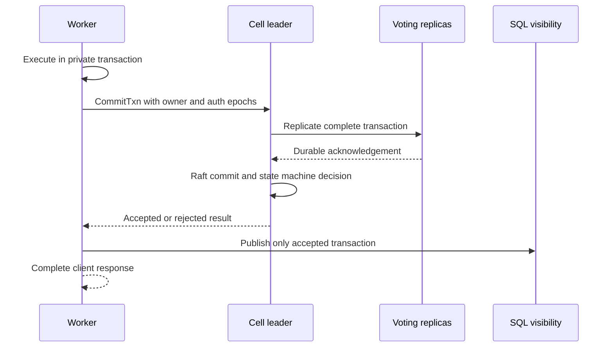

# 一致性、提交与故障恢复协议

> 状态：`Proposed / Implementation Gate`。本文规定 SCAP 拟实现的协议和验收条件，不表示仓库已经实现这些保证。`libSQL virtual WAL` 的提交边界、raft-rs 的 driver 与持久化适配、精确读快照以及恢复流程都必须通过 PoC 和故障注入验证，才能对生产用户承诺本文的语义。2026-10-28 的共识库调整见 [ADR-0006](../adr/0006-raft-rs-consensus-library.md)。

2026-10-31 实现进度：正式 driver/Store/native 后端已接入固定 raft-rs，`scap-cell` 已实现有界 owner/auth、事务接受、去重与取消规则，并有独立受限 SQLite 接合实验。PreVote、Safe ReadIndex 与 snapshot 的实测范围见 [Raft 安全边界](../engineering/raft-safety.md)；业务子集见 [cell 合同](../engineering/cell-state-machine.md)。本文其余完整生命周期、精确 SQL 读快照、生产传输和恢复承诺仍按原门禁验证，局部通过不能把整份协议标记为已实现。

本阶段进一步新增 [正式 SQLite adapter](../engineering/sqlite-engine.md)：私有连接、整个 batch 的结果缓冲、前置线性化请求查询、提交前物理 gate、无变化事务的 quorum 结果记录，以及完整物理历史恢复。它尚未实现本文的独立 SQL snapshot 读 API 和自动恢复编排；当前 SELECT 经由有记录的事务路径。

字段别名：本文的 `database_id` 等同于其他文档的 `db_id`，`revision` 等同于 `db_seq`；`owner_epoch` 是所有权世代简写 `epoch` 的规范名。权限世代单独命名为 `auth_epoch`，与 `owner_epoch` 不可互换。最终代码、持久格式与 wire protocol 的字段名在 `G0` 冻结，本文中的结构是协议模型，不是已冻结的接口定义。

## 1. 范围与保证

SCAP 的首版以 Rust 实现服务层，使用 **基于 SQLite C 实现的 libSQL fork** 作为 SQL 引擎及 `virtual WAL` 接入候选。它不是 Turso 原名 Limbo 的 Rust 数据库重写，也不是安装 `sqld`、启用 Bottomless 后即可获得的现成 HA 产品。libSQL 提供的扩展接口是实现入口，本文中的仲裁、持久化、读屏障和生命周期协议由 SCAP 负责实现。[S1] [S2]

首版部署在一个区域的三个可用区。每个 `storage cell` 对应一个以 raft-rs 为首选候选的 Raft 复制组，三个持有完整日志的投票副本分别位于三个可用区；多个数据库共享该复制组。每个数据库最多有一个得到 cell 授权的 `worker` 执行写事务，worker 可以迁移，worker 的本地数据库文件和 WAL 是可重建的执行缓存。

在本文规定的故障模型内，目标保证为：

- 一个已返回成功的写事务不会因为单个 worker、单个 storage node 或单个可用区失效而丢失。
- 每个数据库的提交具有唯一顺序；默认读请求读取经过 quorum 屏障验证的已提交快照。
- 一个事务的全部页面变更、提交元数据和幂等结果原子生效。其他事务不能看到只提交了一部分的页面，也不能看到尚未经过 quorum 提交的修改。
- 无法联系 cell quorum 时，拒绝发起新的强一致读写；不会改成只写本地文件后返回成功。
- 对已经建立快照的读事务，可以在资源仍然可用时继续读取该快照；这不等于允许分区后的新请求绕过读屏障。

保证以**单个数据库中的事务**为单位。自动提交的一条 SQL 是一个事务；显式多语句事务是一个整体。显式读事务中的后续语句保持同一个快照，不承诺每条语句都读取执行时最新状态。首版不支持跨数据库事务，也不支持通过 `ATTACH` 写入多个数据库后声称全局原子性。

`RPO = 0` 的范围是以上已确认提交和指定故障模型。本文不承诺区域整体毁损、超出容错范围的永久数据丢失、恶意节点、应用主动误删，以及数据库引擎缺陷导致的逻辑错误都能自动无损恢复。RTO 取决于选举、重放、S3 读取和缓存恢复耗时，必须实测，不能由“用了 Raft”直接推导。

## 2. 故障模型与权威边界

### 2.1 必须成立的假设

1. storage node 是非恶意的，可能崩溃、重启、丢包、发生网络分区或检测到磁盘损坏；不考虑节点伪造日志、伪造持久化完成或蓄意发送互相矛盾的状态。
2. 存储设备、文件系统和部署配置履行经过验证的持久化契约：成功的 `fsync` 或等价屏障意味着指定字节和必要元数据能在承诺的掉电、重启场景后恢复。仅写入操作系统缓存不算持久化。
3. 三个投票副本放置在三个独立可用区，且没有在容忍一次故障的承诺下同时维护、移除或丢失第二个必要副本。
4. 归档后的不可变 S3 对象满足所选存储产品的持久性和按键读取语义。`S3-compatible` 是接口描述，不能替代对具体产品、部署拓扑和故障范围的验证。
5. 只有 SCAP 管理的进程能够访问执行文件。业务方不能绕过 SCAP 打开这些文件、切换 journaling 模式或直接修改 WAL。

检测不到的硬件谎报或所有副本同时持久化错误不属于 Raft 能解决的问题。可检测损坏必须使节点或数据库停止服务并进入修复流程，不能把“能打开文件”当作数据正确。

### 2.2 哪一层决定什么

| 组件 | 权威职责 | 不能作为证明的内容 |
| --- | --- | --- |
| cell Raft 状态机 | 数据库身份、placement、owner epoch、auth epoch、权限 fence、事务顺序、已接受提交、manifest、seal 和 tombstone | 单台节点尚未提交的日志 |
| worker | 在已授权身份下执行 SQL，产生事务页面变更，维护执行快照 | 本地 SQLite 提交、缓存文件存在、最近一次心跳 |
| etcd 控制面 | 数据库到 cell 的目录、期望放置、调度任务和路由提示 | 是否允许当前写事务提交，或哪个 epoch 仍然有效 |
| S3 | 已发布 manifest 引用的不可变快照和归档段 | `LIST` 的最大文件名、尚未发布的对象、对象修改时间 |
| gateway | 凭据验证、权限准入、路由、请求边界、错误映射 | 缓存路由、正向权限缓存、连接存活、负载均衡健康检查 |

etcd 可暂时不可用或保存过期路由。已经知道正确 cell 的请求仍须由该 cell 的协议判定是否能继续；路由可达不等于拥有写权。cell 无 quorum 时，控制面不能签发一个替代的有效写许可。

心跳、超时、租约 TTL 和时钟可以用于怀疑故障、触发调度、限制资源占用，**不能证明旧 owner 已经失去提交能力**。正确性由同一个 Raft 状态机内有序的 fencing 命令和提交校验保证。

## 3. 身份、版本和不变量

### 3.1 身份与状态

```text
CellIdentity = (cell_id, cell_incarnation)
DatabaseIdentity = (database_id, incarnation)
OwnershipToken = (
  CellIdentity,
  DatabaseIdentity,
  placement_generation,
  owner_epoch,
  worker_instance_id
)
```

- `database_id` 是不可变的内部标识，不能把可复用的租户名或数据库显示名当成它。
- `incarnation` 区分数据库的创建世代。删除重建、以旧备份建立替代数据库时必须产生新世代，防止历史请求和旧页面进入新数据库。
- `cell_incarnation` 区分复制组世代。不能把丢失持久状态的空节点直接伪装成旧复制组的完整延续。
- `placement_generation` 标识数据库在哪一代 placement 上拥有权威归属，跨 cell 迁移时递增。
- `owner_epoch` 由当前权威 cell 的状态机单调增加，不能由 etcd 计数器、worker 启动时间或随机 TTL 代替。
- `auth_epoch` 是独立的权限 fence 版本，由同一 cell 状态机单调增加。它约束用户或服务主体是否仍获准执行某项操作；一个有效 owner token 不能替代请求方的当前权限。
- `worker_instance_id` 必须包含进程启动世代。同一机器重启的新进程不能直接复用旧进程的有效身份。
- `revision` 是单库已经接受的写事务序号。它只在一个 `CommitTxn` 被状态机接受时加一，不等于共享 cell 的 Raft log index。
- `last_applied_log_id` 是 cell 状态机持久应用位置，使用 SCAP 的 `CellLogPosition {cell_id, cell_incarnation, term, index}`。只在同一 cell 实例内比较日志水位，并校验对应 term/index 身份；不能跨复制组比较裸整数，也不以库内部类型充当长期协议格式。

每个数据库的权威状态至少包含：

```text
DatabaseState {
  identity,
  placement_generation,
  lifecycle,
  owner_epoch,
  owner_instance,
  auth_epoch,
  auth_policy,
  revision,
  last_commit_hash,
  engine_format,
  manifest_refs,
  dedup_state,
  migration_state,
  deletion_state
}

lifecycle ∈ {
  SUSPENDED, PREPARING, ACTIVE, SEALED, DELETED, QUARANTINED
}
```

`DRAINING` 可以是 worker 的本地接入状态；只停止接收新请求不会改变写权。真正撤销写权必须提交相应的 cell 状态机命令。

### 3.2 必须始终保持的不变量

| 编号 | 不变量 |
| --- | --- |
| `I1` | 对一个 `DatabaseIdentity` 和 placement，任意时刻只有权威状态机中记录的一个 owner epoch 能产生新的有效提交。 |
| `I2` | `revision = r + 1` 的提交必须基于 `revision = r`；不能接受缺口、分叉或覆盖更新的旧页面。 |
| `I3` | 返回写成功前，完整事务已按 Raft 规则提交，并已由状态机接受；计入 quorum 的副本均已完成真实持久化。 |
| `I4` | 可供其他事务读取的 SQL 快照只能由已接受的完整事务构成。待提交页面不能进入公共 WAL 索引或读快照。 |
| `I5` | owner、incarnation、placement、auth epoch、权限、base revision 和幂等决策在同一个有序状态机中判定。入口预检查不能替代应用时校验。 |
| `I6` | 每个新强读从一次有效的 quorum 屏障取得同一权威快照中的身份、owner、auth epoch、权限和目标 revision，并读取该 revision 的完整 SQL 快照。 |
| `I7` | 任何已回收的持久数据，都存在仍被保护、能够重建所需 revision 的替代恢复路径。 |
| `I8` | `SEALED` 和 `DELETED` 不能因路由回退、旧备份、重复调度或节点重启而逆转。 |
| `I9` | 不确定的提交结果只能报告 `UNKNOWN`，不能根据超时、连接断开或本地回滚推断事务未提交。 |
| `I10` | 已撤销的权限版本不能授权新的提交、读屏障或历史结果查询；状态机不根据各副本的本地墙钟作出不同授权判定。 |

### 3.3 权限 fence、缓存与到期

`auth_policy` 必须包含确定性判断主体及操作权限所需的状态，或引用已经随状态机持久化的不可变策略。不能在 `apply` 中查询外部权限服务或只保存一个无法重建策略的摘要。

请求携带受可信准入组件验证并绑定的 `AuthorizationContext`，至少标识 `principal_id`、`credential_id` 或指纹、`admission_id`、数据库世代、`auth_epoch` 和操作范围。客户端不能自行提高 `auth_epoch` 或伪造“已通过准入”。日志中保存必要的验证上下文和审计标识，不保存可直接使用的原始秘密凭据。

权限变更使用同 cell 有序的 `RevokeAuth` / `AuthFence` 命令：

```text
AuthFence {
  database_identity,
  expected_auth_epoch,
  next_auth_epoch,
  policy_change,
  administrative_authorization,
  operation_id
}
```

状态机校验管理请求本身的当前权限和预期版本，原子更新策略并增加 `auth_epoch`，之后才确认撤销成功。`RevokeAuth` 是具有撤销含义的策略变更，使用同一个 fence 机制。首版可以用数据库级的粗粒度 `auth_epoch` 使旧授权上下文全部失效，再让仍有权限的主体刷新上下文；不要求首版实现每凭据一套独立的复制协议。

**60 秒正向权限缓存是准入优化，不是 60 秒内持续有效的授权保证。** gateway 可以使用最长 60 秒的缓存减少外部查询，但 `CommitTxn` 的应用和 `ReadBarrier` 的权威读取必须重新核对 cell 中的 `auth_epoch` 及权限。缓存尚未到期也不能绕过已经提交的撤销。

凭据签名、受众、数据库绑定、token expiry 和准入时限在请求进入服务及提交 proposal 之前由受信组件检查。若长事务在发起 proposal 前已不满足准入条件，终止私有事务或要求重新认证；不能把过期 token 当成新请求提交。已经通过提案前检查的命令在复制过程中发生时间流逝，不会让各副本分别按自己的墙钟接受或拒绝它：`apply` 只依据复制的上下文、权限 fence、当前确定性策略及其他状态机条件。审计时间戳不是共识分支条件。

撤销与在途操作的边界如下：

- `CommitTxn` 排在有效 `AuthFence` 之前且已被接受，事务保持提交；撤销不能回滚它，其原始响应也可能稍后才到达。
- `CommitTxn` 排在 fence 之后，旧 `auth_epoch` 必须被拒绝，即使 SQL 已执行、请求已被 gateway 接收或权限缓存还有效。
- 读在 fence 之前完成屏障和权限校验，可以按已授权的操作与快照结束；首版不承诺把已经传出的字节收回，或即时终止所有既有结果流。
- 只有准入成功、但尚未取得有效读屏障的请求，没有上述例外。fence 之后的新读、重试、结果查询和后续新 RPC 必须通过当前权限版本校验，不能沿用旧连接的授权。
- 已提交请求的历史结果也受当前权限保护。旧凭据不得通过幂等命中、`GetCommitStatus` 或 `ResolveOrCancel` 读取原结果或绕过撤销。

token 到期本身遵循准入边界；需要在共识顺序上立即 fence 在途未提交写入时，必须提交 `AuthFence`。全账号或多库批量撤销不自动具有跨 cell 原子性：必须逐个权威 cell 确认完成，或另行定义更强协议，不能把 etcd 中一条策略更新称为所有数据库同时完成撤销。

## 4. 复制内容与引擎边界

### 4.1 复制物理事务，不在副本重新执行 SQL

worker 是唯一执行用户 SQL 的地方。cell 复制的是完整事务的物理页面变更和提交元数据，不是在各副本重新执行 SQL。否则时间、随机数、扩展函数和连接状态可能产生不同结果。

首版使用有大小上限的单条 `CommitTxn` 命令承载一个完整事务：

```text
CommitTxn {
  ownership_token,
  auth_epoch,
  authorization_context,
  base_revision,
  next_revision,
  previous_commit_hash,
  transaction_id,
  request_identity?,
  request_digest?,
  engine_format,
  page_size,
  database_size_pages_after_commit,
  page_changes[],
  transaction_hash,
  result_metadata
}

PageChange {
  page_number,
  page_bytes,
  page_checksum
}
```

`transaction_hash` 覆盖规范化后的完整命令和事务边界；`previous_commit_hash` 把单库提交串联成可校验的历史。文件截断、数据库大小、page 1 的变化以及一次事务内同一页面的最终版本必须有明确编码。

这里的“WAL/page 变更”是能够重建事务的完整物理表示，**不意味着可以把某个 worker 的原始 WAL 文件字节不加区分地追加到另一个 worker 的 WAL**。SQLite WAL 的 generation、salt、校验和、frame 顺序及 commit marker 必须由适配器正确转换或验证；checkpoint 后的文件布局不能破坏重放语义。[S3]

首版超限事务返回明确的大小限制错误，并在进入提交协议前终止。不能先复制指向本地大文件的引用、提前返回成功，再异步补传文件。以后若引入分块事务，必须另外规定分块的 quorum 持久化、完整性校验、最终提交和孤儿块回收协议。

### 4.2 `virtual WAL` 的必要能力

选定的引擎接入点必须同时做到：

1. 在数据库提交对其他连接可见之前，取得完整事务及提交边界。
2. 在等待 Raft 时保留一个可取消或可丢弃的私有事务阶段；禁止其他连接读取它。
3. Raft 已接受后，原子地发布该事务；发布失败时能关闭有问题的执行实例，并从权威状态重建。
4. 对状态机明确拒绝的事务清除私有修改，不留下可被后续读或 checkpoint 使用的未提交页面。
5. 对结果 `UNKNOWN` 的事务冻结或丢弃执行实例，先查询权威结果，不能在不明基础上继续执行下一个写事务。
6. 导入、重放、checkpoint、连接关闭和恢复路径均不能绕过上述协议。

普通 `sqlite3_wal_hook` 在 SQLite 已提交并释放写锁后调用；回调返回错误也不会撤销该提交。因此，**提交后 hook 加上“等待 Raft 再回 HTTP”不满足本协议**，它会允许其他连接在 quorum 提交前看到数据。[S4]

如果选定版本的 libSQL virtual WAL 无法满足这些条件，必须修改适配器或引擎接入方式；PoC 失败不能被表述成“暂时允许少量不一致”。需要锁定准确的 libSQL revision、编译选项和接口版本，不能只依赖接口名称存在。[S2]

### 4.3 执行环境限制

首版为每库串行化写事务，最多保留一个尚未判定结果的 mutating transaction。多个业务连接可以排队，读事务可以并行，但不能通过多条连接绕过写入顺序。

必须固定并验证 journaling、checkpoint 和共享缓存设置，禁止 `read_uncommitted` 或其他暴露未提交数据的路径。外部文件型 virtual table、可产生外部副作用的扩展、未适配的写入 API，以及会绕过虚拟 WAL 的恢复或替换文件操作，不在首版支持范围。

从 worker 迁移不能恢复客户端的进程内对象、临时表、prepared statement 或尚未提交的交互式事务。连接故障后需要重新建立会话；不能把数据库状态恢复等同于无感延续一个任意 SQL 会话。

客户端 SDK 的本地 embedded replica 读取若绕过 SCAP 的读屏障，就不属于本文默认强读路径。使用同一种 SQL 或同一个驱动包不能自动继承服务端的一致性保证。

## 5. 事务提交协议

### 5.1 取得和激活 owner

`ClaimOwner` 和 `ActivateOwner` 都是 cell Raft 命令。

1. 调度器提交 `ClaimOwner(database, expected_epoch, new_worker_instance)`。
2. 状态机确认数据库未删除、未 seal、未隔离，并检查 `expected_epoch`。接受时增加 `owner_epoch`，设置新 owner 和 `PREPARING`，返回当前权威 `revision`。
3. `ClaimOwner` 之前已被接受的旧事务包含在这个 revision 中；排在它之后的旧 epoch 提交被拒绝。入口是否先处理旧请求不影响这个顺序。
4. 新 worker 根据受保护的 manifest 和 cell committed tail 恢复完整数据库，验证身份、格式、校验和及目标 revision。
5. 新 worker 提交 `ActivateOwner(expected_token, restored_revision)`。只有 token 仍然匹配且恢复 revision 等于权威 revision 时，状态机才转为 `ACTIVE`。
6. gateway 可以据此更新路由。路由更新失败只影响可达性，不能重新授予旧 owner 写权。

失败恢复可以再次提交新的 `ClaimOwner` 来 fence 一个停滞的 `PREPARING` owner。每次都增加 epoch，不复用历史授权。重复调度操作必须有管理操作 ID 和条件检查，避免无意增加 epoch。

### 5.2 写入步骤



具体规则如下：

1. worker 以有效 owner 身份取得单库写事务执行权，请求先通过权限准入，并在已提交的基准 revision 上执行 SQL。事务自己的读取可以看到自己的未提交修改。
2. 到达提交点时，重新执行提案前准入检查，适配器封存私有页面集合及结果元数据，连同请求的 `auth_epoch` 和授权上下文生成不可变 `CommitTxn`。此时对其他事务仍不可见。
3. leader 可以做快速预检查，但最终判定只能发生在 Raft 状态机的有序 `apply` 中。
4. leader 通过 raft-rs 与 SCAP adapter 复制完整命令。三副本稳定配置下，需要至少两个副本持久化完整命令，且满足 Raft 当前 term、日志连续性和提交推进规则。不能自行把“任意两个节点曾收到某些字节”当成提交证明。
5. 状态机依序处理命令，原子更新数据库 revision、页面索引或受保护的日志引用、提交哈希、幂等记录以及 `last_applied_log_id`。只有此时命令才获得应用层的 `Accepted` 或 `Rejected` 结果。
6. `Accepted` 后，worker 才允许适配器将该事务发布到公共 SQL 快照，并记录本地 `applied_revision`。服务层此后才能向客户端返回写成功。
7. 如果状态机已经接受而 worker 在发布时失败，事务仍然已提交。关闭或隔离该执行实例，恢复权威状态；客户端可能得到 `UNKNOWN`，不能得到“已撤销”。

Raft 日志被提交和 SQL 事务被状态机接受是两个概念。一个带旧 epoch 的 `CommitTxn` 可以成为已提交的 Raft 条目，但其应用结果必须是 `Rejected`，不能因此返回 SQL 写成功。

### 5.3 确定性状态机判定

下面是协议伪代码，不是已实现的 API：

```text
apply CommitTxn(command):
  check CellIdentity and DatabaseIdentity
  require trusted authorization context bound to this request
  require command.auth_epoch == state.auth_epoch
  require current deterministic policy permits principal and action
  check request identity is not retired or explicitly aborted

  if an accepted result exists for request_identity:
    require principal may view this original request result
    if request_digest differs:
      return IDEMPOTENCY_CONFLICT
    return ORIGINAL_COMMIT_RESULT

  require lifecycle == ACTIVE
  require command.ownership_token == authoritative_owner_token
  require base_revision == state.revision
  require next_revision == base_revision + 1
  require previous_commit_hash == state.last_commit_hash
  require supported format, valid complete payload and size limits

  atomically:
    install authoritative page changes or protected references
    advance revision and commit hash
    record accepted result and request identity, if present
    advance last_applied_log_id

  return ACCEPTED
```

所有分支，包括重复、拒绝和管理命令，都必须正确推进 cell 的 `last_applied_log_id`；“不修改数据库”不代表“没有应用这条 Raft 日志”。授权校验必须位于去重返回之前，不能因为历史请求曾经有权限就再次返回结果。状态机不在此读取本地墙钟判断 token 是否到期；owner token 与当前权限也不能相互替代。

重复请求命中原始提交时，只能返回原始结果。它不能授权 worker 发布重复执行产生的新页面；任何重复的私有事务必须丢弃，并与权威状态重新对齐。

### 5.4 原子可见性和响应

原子可见性的单位是一个完整 SQL 事务。`page_changes`、数据库大小和 revision 不能分别生效。读事务必须绑定到一个已发布 revision，不能在扫描中途切换到新 revision。

自动提交的写语句如果使用 `RETURNING`，在事务最终判定前产生的行也必须暂存在受限缓冲区，不能先把它们作为一个成功写请求的结果发给客户端。显式事务中的语句结果是该事务的暂定结果，事务仍可能在 `COMMIT` 时失败。

提交结果需要重试重放时，`last_insert_rowid`、影响行数及协议承诺重放的返回值必须与提交一起持久化。首版必须设置结果大小上限；不能在返回值丢失后重新执行 SQL 来猜测原始结果。

## 6. raft-rs driver 与持久化适配契约

raft-rs 提供共识核心；driver、持久写、网络、业务状态机与恢复仍属 SCAP。必须选择并验证具体后端，不能把 RawNode 或内存 Storage 示例视为掉电安全的数据库。[S5] [S6] 完整顺序和专项测试见 [raft-rs 集成契约](../engineering/raft-rs-integration.md)。

### 6.1 日志与投票

- 一个 cell 的 RawNode 串行驱动。取得 Ready 后按锁定版本处理，再推进该批；不得让并发任务随意修改共识状态。
- `HardState` 的 term/vote/commit、entries 和 snapshot 按 Ready 契约保存。只有完整记录、校验信息及必要文件元数据真实持久化后，才能发送依赖它们的 `persisted_messages` 或推进持久完成；普通 messages 使用独立的上游发送规则。
- 首版采用同步 Ready → `advance_append` → 完整消费 `LightReady` → 持久有序 apply → `advance_apply_to(durable_applied)`。`propose()` 返回成功不是提交成功，不能漏掉 LightReady 产生的提交和消息。
- 日志替换、截断、压缩、HardState 与 snapshot 的更新必须满足锁定版本要求，不能由互相独立的后台队列破坏顺序。snapshot 的新视图、ConfState/applied、合法 HardState/commit 与日志边界须通过同一可恢复安装事务发布，不能先发布 applied 再补 commit。
- 日志必须连续，不能留下 index 空洞。文件创建、轮转、rename 和目录更新需要相应的崩溃一致性处理。
- leader 只有在自己的日志真实持久化后才能把自己计入 durable quorum；其他副本同理。
- 可以在受限批次中合并事务，但每个已确认事务都必须完整处于覆盖它的持久化边界内。异步 Ready 和跨 cell 合并刷盘首版关闭；未来 `on_persist_ready(n)` 只能确认已经连续持久化的前缀，不能跳过较早的未完成批次。
- 磁盘写入或刷盘失败必须进入失败路径，不允许仍然发送成功的持久化回调。

这些是适配器验收条款，不能因为 storage trait 编译通过就视为满足。[S5]

### 6.2 状态机恢复策略

首版选择**持久化状态机**策略：应用一个或一批有序条目时，页面映射、身份与 lifecycle、`auth_epoch` 与权限策略/fence、幂等记录、完整 `ConfState` 及 `last_applied_log_id` 必须以可恢复的原子事务持久化，之后才调用 `advance_apply_to` 并报告应用完成。空条目、拒绝、去重命中和成员变更同样推进真实应用水位。

页面字节可以仍位于受保护的持久日志或不可变对象中，但所有引用必须有可验证的生命周期约束，不能指向可能被无条件 purge 的文件。元数据原子落盘不能代替被引用字节的持久化。

持久 commit 必须先于或与业务 applied 同批保存；不得从“条目已经 committed”推断 commit index 已落盘。重启需要验证 `snapshot_index <= durable_applied <= durable_commit <= recoverable_last_index`，不能用 `max(commit, applied)` 掩盖不一致。[S6] 若未来改成仅持久 snapshot 后重建状态机，必须另行证明 committed/applied、重建边界和何时可读，不能保留较新的 applied 却恢复较旧的业务状态。

成员变更使用锁定版本的 `ConfChangeV2` / `apply_conf_change`，先加入 learner、补齐状态，再完成合法的配置转换；完整保存 joint configuration 与应用位置。内存成员已变但持久化失败时停止节点。不能在网络故障时通过手改配置把一个孤立节点变成新多数，或删除必要副本来“恢复写入”。

## 7. 默认读协议

### 7.1 强读不是“连上 primary 就算强”

worker 可能仍然运行但已经失去 owner 身份；cell 的旧 leader 也可能仍然可达。每个新强读事务必须获得 cell 的线性化读屏障。缓存中的 owner、刚收到的心跳或一段尚未到期的 TTL 都不能替代它。

本文的 `ReadIndex` 是协议概念。首版使用 raft-rs 的 `ReadOnlyOption::Safe`：对实际请求调用带唯一 context 的 `read_index`，匹配 Ready 中的 `ReadState`，等待持久状态机应用达到返回水位。迟到或旧世代 context 不得授权新请求；只验证 leader 身份、check_quorum 或本地 lease 不够。[S5] [S7]

### 7.2 `ReadBarrier` 与精确 SQL 快照

```text
ReadBarrier {
  read_id,
  cell_identity,
  database_identity,
  placement_generation,
  owner_epoch,
  owner_instance,
  auth_epoch,
  principal_id,
  admission_id,
  authorized_scope,
  applied_log_id,
  target_revision,
  target_commit_hash
}
```

一次新读事务按以下顺序建立：

1. 请求先通过当前准入检查，worker 为这个实际到达的请求建立 `read_id`，进入单库的 snapshot-start gate。该 gate 在建立读快照期间阻止本地发布或应用越过目标版本；它不需要覆盖整个查询执行时间。
2. cell leader 完成 quorum `ReadIndex` 屏障，并等待状态机至少应用到该位置。
3. 从**同一个不可变或原子读取的状态机视图**取得数据库身份、lifecycle、placement、owner epoch、`auth_epoch`、权限策略和目标 revision；不能先查 epoch 或权限，后从另一个时刻读取 revision。
4. 确认 lifecycle 为 `ACTIVE`，worker 与该视图中的 owner 匹配，授权上下文的 `auth_epoch` 等于该视图中的当前值，且主体具有请求所需权限，再产生绑定请求、主体和范围的 `ReadBarrier`。否则返回拒绝授权、失去 owner、休眠、迁移、删除或不可用错误。
5. worker 验证 token、数据库身份、请求主体和授权范围，把执行缓存推进到 `target_revision`，校验对应提交哈希，并在 gate 内打开**恰好该 revision** 的 SQLite 读快照。若当前实现不能可靠打开这个快照，必须重新取得屏障并重新对齐，不能以“差不多最新”替代。
6. 实际建立并固定 SQLite 快照后释放 gate。单独执行延迟建立快照的 `BEGIN` 不足以完成这一步，适配器必须能证明实际读取使用的 revision。
7. 返回的所有行都来自固定快照。查询执行、分页和结果流继续持有该快照，直到读事务结束或被超时取消。

只有 `applied_revision >= target_revision` 还不够：它说明没有落后，不能单独证明 SQL 连接实际读到哪个 revision。首版采用精确 revision 规则，避免在 owner 校验和读取新版本之间引入额外证明义务。

snapshot-start gate 的线程、锁顺序和 WAL 集成是 PoC 内容。不得在 Rust 异步执行器上通过阻塞等待形成整个服务的死锁；同步 SQLite 调用应位于受控执行线程，并验证提交与开读快照之间的锁顺序。

该 gate 必须在安全的引擎调度点取得：已有提交若尚未完成本地发布，应先完成判定与发布；结果未知时先冻结或重建执行实例。不能持有 gate 等待一个同样需要该 gate 才能完成的写事务。首版可以保守地等待当前私有写事务结束后再建立新读快照，已经固定快照的读仍可继续。

### 7.3 分区与已开始的读

已经取得有效权限屏障并固定快照的读事务，可以按该屏障对应的状态线性化。随后发生 owner 切换、权限撤销或网络分区，不会把这次已经开始的读变成一次新的读授权。撤销与尚未固定快照的在途请求按照第 3.3 节的权限屏障边界处理，仍只能读取原屏障授权的精确 revision。

相反，一个后来到达的请求必须取得自己的屏障，不能复用分区前的 `ReadBarrier`。缓存结果、连接池复用或同一个客户端 session 都不构成豁免。若未来合并多请求屏障，只能覆盖屏障开始前已经进入批次的请求，并另行验证线性化历史。

长读事务会保留旧版本、WAL 或对象引用。系统必须设置可观测的时间和资源上限；到限后取消读事务，不能一边继续返回行一边回收它依赖的版本。

首版不提供自动退化的 stale read 模式。未来如果增加，需要独立的请求选项、返回版本和明确的一致性合同，不能改变默认路径。

### 7.4 显式事务

读事务的屏障发生在固定首个数据快照时，而不是把每条后续 `SELECT` 都升级成“读最新”。读写事务还要满足单 writer、基准 revision 和 owner 校验；若事务基准已失效，必须中止或由业务重新提交整个事务，不能把基于旧快照产生的页面强行合并到新状态。

显式事务不会让连接获得永久权限。后续客户端 RPC 仍需准入，并通过 cell 的当前权限版本校验；权限已撤销时拒绝后续操作。对仍获准的既有读事务，新的权限校验不改变其已经固定的 SQL 数据快照。`COMMIT` 始终在状态机中再次受 `auth_epoch` 约束，即使事务较早已经读过数据。

读后写的会话可以附带 `min_revision`。服务器等待不低于它的权威状态并建立合法快照；这个参数是防止会话回退的附加约束，不能代替 `ReadIndex`。

## 8. `UNKNOWN`、幂等和重试

### 8.1 必须区分的结果

| 结果 | 含义 | 默认客户端行为 |
| --- | --- | --- |
| `COMMITTED` | 状态机已经接受并有可查询的提交身份 | 接受结果，记录 revision |
| `NOT_COMMITTED` | 有充分证据证明该请求不会再提交，例如进入协议前明确失败，或状态机已记录终止结果 | 修正问题后按业务语义发起新请求 |
| `UNKNOWN` | 请求可能已提交，也可能未提交，当前无法判定 | 查询状态；不自动重新执行写 SQL |
| `REQUEST_EXPIRED` | 原请求结果已超出可重放范围，且旧 ID 不得重新执行 | 通过业务键或人工业务流程核对 |
| `IDEMPOTENCY_CONFLICT` | 同一请求身份被用于不同内容 | 拒绝，不选择其中一个新执行 |

HTTP 超时、TCP 断开、leader 变化、worker 崩溃以及用户取消等待，均不能单独证明 `NOT_COMMITTED`。事务可能在成功回包丢失之前已经进入 quorum。也不能向客户端报告失败后，后台继续无约束地重试写入。

### 8.2 稳定请求身份

跨连接幂等需要客户端在第一次请求前生成稳定身份，并在重试和查询中复用。SCAP envelope 的线字段为 `request_id`、`payload_hash` 和 `incarnation`；header 或 TypeScript wrapper 可封装它们。状态机将其规范化为如下身份和摘要：

```text
request_identity = (database_id, incarnation, request_id)
request_digest = hash(canonical transaction intent and bound inputs)
```

其中 `request_digest` 对应验证后的 `payload_hash`。未来采用可压缩序列方案时，`request_id` 可以编码为 `client_id + request_sequence`，首版不要求所有第三方客户端理解这个内部表示。

`transaction_id` 用于内部提交跟踪，`request_identity` 用于跨请求去重，二者不能混淆。仅由服务器在收到请求后生成一个客户端从未收到的随机 ID，不能解决响应丢失后的重复执行问题。

标准第三方 SDK 未必能携带和稳定保留这个身份。对这种客户端，SCAP 仍提供数据库提交原子性，但**不承诺自动 exactly-once 重试**；写超时默认暴露 `UNKNOWN`。业务也可以使用同事务中的唯一业务键、唯一约束或 outbox 记录来识别重复操作。

幂等状态与事务变更在同一个 `CommitTxn` 中原子持久化，恢复、snapshot 和跨 cell 迁移均必须携带它。只有当前权限检查通过且允许查看原请求结果时，相同身份和摘要才返回原提交结果；相同身份但不同摘要拒绝。记录须绑定原请求主体或明确的结果访问范围，知道 `request_id` 不能替代授权。新的 owner 可以在当前有效授权下查询旧 epoch 已提交的结果，但不能据此接受旧 owner 的新页面。

### 8.3 查询和终止未决请求

`GetCommitStatus` 必须使用当前权威 cell 的线性化读取，并在同一视图校验 `auth_epoch`、主体及原请求结果的访问权限。权限不符时拒绝查询，不通过返回存在性或原始结果泄露请求状态。对有权查询的主体，查到已提交记录可以判定 `COMMITTED`；只查到“没有记录”不能直接判定事务未提交，因为一个旧 proposal 仍可能排队或稍后进入日志。

需要明确终止时，定义有序的 `ResolveOrCancel` 命令：先在状态机中校验当前 `auth_epoch`、主体和操作权限；若请求已经提交，在允许查看时返回原提交结果，否则拒绝泄露结果，绝不改写已提交状态。仅当请求尚未提交且调用者具有终止权限时，才记录不可再提交的终止 tombstone。任何排在该 tombstone 之后的同身份 `CommitTxn` 都必须被拒绝。此命令不能撤销已经提交的事务，也不能撤销 SQL 之外的外部副作用。

若无法取得 quorum，既不能确认缺失，也不能持久化终止；结果仍为 `UNKNOWN`。

### 8.4 去重窗口、退休和过期

首版只承诺公布的保留窗口内去重，记录随 cell snapshot 保留。删除旧幂等记录后，把相同 ID 当成全新请求执行，不能再称为窗口外 exactly once。保留期限、是否可查询以及请求准入规则必须进入 API 契约：

- 保留窗口内必须保存足以证明提交身份和结果状态的元数据；若承诺重放响应体，还须在其承诺期限内保留该响应体。完整响应和精简状态可以有不同保留期限。
- 对结构化的 `client_id + request_sequence`，可以通过 Raft 命令推进单调的 `retired_through`。已退休区间中的请求一律拒绝重新执行，即使完整结果记录已回收。
- 不得仅依赖各节点本地时钟在 `apply` 中各自删除去重记录。退休边界和压缩结果必须确定性地复制。
- 使用可验证的 server-issued receipt/token 或持久退休边界时，服务器可以识别旧请求并返回 `REQUEST_EXPIRED`；receipt 必须绑定数据库世代和请求身份，不能把一个普通客户端时间戳当成证明。
- 对没有可验证 receipt、没有退休边界、结果记录又已回收的任意 UUID，服务器无法仅凭“未找到”区分旧请求和新请求。窗口外不提供去重保证，SDK 禁止自动重试，业务必须先通过唯一业务键或其他方式核对。

`ResolveOrCancel` 的取消 fence 与可重放响应分开管理。首版取消 tombstone 持续保留到数据库世代结束，或者压缩进能够拒绝旧请求的持久退休边界；查询响应本身可以到期。不能仅因响应窗口结束就删除取消 fence：如果旧 owner 和 base revision 仍匹配，一个迟到的原始 `CommitTxn` 仍可能提交，从而破坏此前 `NOT_COMMITTED` 的承诺。采用其他清理方案必须先证明旧 proposal 已永久失效。

请求身份、取消记录和管理操作均须有主体/租户配额及准入限制，避免攻击者靠持续创建不可随意删除的记录耗尽 cell。配额达到上限时拒绝新增记录或新请求，不能删除必要的 fence 来腾出空间。

数据库 exactly-once 效果不意味着发邮件、调用支付接口、发送消息等外部操作也 exactly once。这类业务需要自己的幂等键和事务 outbox 等协议。

## 9. 休眠、唤醒与 worker 迁移

### 9.1 休眠

单库休眠回收的是 SQL 执行实例、连接和本地缓存，**不是关闭整个共享 cell 的 quorum**。没有在线仲裁层，就无法按本文规则唤醒和授予新的 owner。

正常休眠流程：

1. worker 停止接收新会话，等待已有事务结束，或明确取消尚未提交的事务。
2. 对未决写请求查询权威结果。不能因为准备休眠就把 `UNKNOWN` 当作已回滚。
3. 向 cell 提交带当前 token 和预期 revision 的 `SuspendDb`。状态机接受后增加 owner epoch、撤销 owner，并进入 `SUSPENDED`。
4. 旧 owner 晚到的提交会因 epoch 或 lifecycle 被拒绝。休眠命令之前已接受的事务属于数据库最终状态，即使其回包较晚。
5. worker 关闭连接并释放没有被读事务继续固定的缓存。崩溃或强制 fence 后旧读可能结束；不承诺保留活跃会话。

休眠无需等待最新数据全部归档到 S3，只要 committed tail 仍然由 cell 可靠持有。若要同时回收对应的本地持久数据，则必须先满足第 10 节的恢复和 GC 条件。

### 9.2 唤醒与同 cell 迁移

唤醒和 worker 故障迁移都使用 `ClaimOwner → restore → ActivateOwner`。多个并发唤醒请求通过状态机条件检查收敛到一个 owner。恢复者先取得正确身份和目标 revision，再使用 manifest 加 committed tail 重建；不能仅选择 S3 中看起来最新的文件。

同 cell 的 worker 切换不改变 `incarnation`，但必须增加 owner epoch。旧 worker 是否真的停止、是否能收到撤销消息，不影响新写权的正确性；其新提交已无法通过状态机。

## 10. S3 发布、snapshot 与回收

### 10.1 S3 不在正常事务的同步提交路径上

新事务的同步耐久性来自 cell 的 durable quorum。S3 异步保存不可变数据库快照和事务段，用于冷数据、恢复与历史保留。S3 暂时不可用时，已提交事务仍由 cell 持有；随着归档积压接近安全容量，系统必须背压或拒绝新写，不能先删日志再期待稍后补传。

三个 storage replica 仍然是共享持久化成本。只有经过安全归档和日志回收，冷库数据才可以主要驻留在 S3；“worker scale-to-zero”不能让尚未归档的 committed tail 消失。

### 10.2 发布顺序

1. 基于一个固定已提交 revision 生成一致的数据库 snapshot，或者生成边界完整、revision 连续的 segment。
2. 写入新的不可变对象键，包含 `DatabaseIdentity`、格式版本和内容摘要。禁止原地覆盖历史对象。
3. 确认所有必要 PUT 完成并校验内容、长度及对象版本；不要把 multipart ETag 一概当作端到端内容校验和。
4. 构造不可变 `Manifest`，描述准确的 base revision、目标 revision、连续 segments、每个对象的身份和摘要。
5. 向 cell 提交 `PublishManifest`。状态机校验数据库世代、预期 manifest generation、覆盖 revision、链条和已提交状态的关系，然后原子发布引用。
6. 只有发布成功的 manifest 才成为恢复入口。上传成功但发布失败的对象是可回收的孤儿对象，不是新数据库状态。

上传前检查和对象存储 I/O 不得放进状态机 `apply`，否则副本会因为外部响应不同而发生非确定性。状态机处理已经验证的 manifest 描述，后台任务负责对象验证；验证失败必须阻止发布。

### 10.3 数据库 snapshot 不等于 Raft snapshot

SQLite 文件 snapshot 仅代表一个数据库的页面状态。cell Raft snapshot 还必须在同一个应用边界包含：

- `last_applied_log_id` 和正确的 membership 状态。
- cell 和数据库身份、placement、owner epoch、lifecycle。
- `auth_epoch`、可重建的权限策略、权限 fence 和权限管理操作的必要去重信息。
- 每库在该边界的精确 revision、提交哈希和可恢复对象引用。
- 幂等记录、请求退休边界和未决终止记录。
- 删除 tombstone、迁移 seal、目标 cell 绑定和其他不能复活的控制状态。

cell snapshot 必须是状态机某个固定位置的视图；不能把多个数据库和控制记录在不同时间分别读取后拼接，并标注一个并不存在的一致 `last_applied_log_id`。

cell snapshot 可以直接携带尚未归档的 committed payload，也可以引用已发布的不可变 manifest。前一种方式允许在 S3 暂时不可用时推进 Raft 日志压缩，但相应字节仍占用受保护的持久 snapshot 空间；它没有完成向 S3 卸载数据。只有元数据、没有必要 payload 或可靠对象引用的 snapshot 不足以清除原日志。

### 10.4 允许 purge 的证明

发布一个数据库的 S3 manifest，**不会自动授权截断共享 Raft 日志**。清除日志前缀到位置 `P` 前必须证明：

1. 存在满足锁定 raft-rs 与 SCAP 恢复契约、可安装且持久化的 cell snapshot，覆盖待清除的状态。
2. 对 snapshot 内每个数据库，都有能精确恢复它在该边界 revision 的 snapshot 加连续 segments，或者其他仍被保护的持久字节。
3. 所有身份、owner fence、`auth_epoch` 与权限 fence、去重和 tombstone 状态均包含在恢复路径中。
4. snapshot 引用的对象不会被并发 GC 删除，恢复需要的密钥也仍然可用。
5. snapshot 安装和日志 purge 的崩溃顺序正确，不能发生“旧日志已删除，新 snapshot 尚未可恢复”的窗口。

尤其要检查长时间不活跃的数据库：它最后一条写可能很早，仍然是恢复该库必需的唯一数据。不能只根据活跃数据库的归档进度推进整个 cell 的 GC 水位。

Raft 自身的日志保留和 snapshot 安装规则仍然必须遵守。对象存储中有文件，不能替代本地 snapshot、term/index、HardState、ConfState 与 applied 的恢复要求。

### 10.5 对象 GC

对象删除以权威 manifest、保留的 cell snapshot、恢复点、活跃读引用和迁移引用为根。使用可恢复的标记与删除流程，保留必要的延迟窗口，并验证重试幂等。`LIST` 只用于发现候选垃圾，不能用于决定某个数据库的最新提交或授权删除仍在使用的数据。

对象暂时不可读或校验失败时，可以从其他已验证副本修复；没有合法替代时停止相关读取和恢复，不能静默回退到更旧 revision。

## 11. 跨 cell 迁移

首版只设计**离线迁移**：暂停该库的新业务事务，完成单向切换后恢复服务。不支持跨 cell 原子 SQL 事务，也不通过 etcd CAS 假装两个独立 Raft 组具有一个共同提交点。

迁移保留 `DatabaseIdentity`，增加 `placement_generation`，并产生唯一 `transfer_id`。源 cell 的权威身份和目标 cell 的完整身份都必须进入迁移记录。

1. 停止接收该库的新事务，完成或终止现有未提交事务，处理未决结果。
2. 源 cell 通过 quorum 提交 `SealDb`：固定目标 cell、下一 placement generation、最终 revision、提交哈希和迁移身份；增加 epoch，撤销 owner，进入 `SEALED`。
3. `SEALED` 是不可逆的源端 fence。源 cell 之后不能再为这个 placement 接受写入、授予 owner 或建立新强读。已经建立的旧读可以结束。
4. 生成并验证最终 revision 的完整恢复集合，包含 `auth_epoch`、权限策略/fence、去重和生命周期元数据。目标 cell 必须通过受认证的源端协议验证 seal 已经提交，并将不可伪造或可验证来源的 seal 证据持久化。
5. 目标 cell 通过自身 Raft 命令导入该身份和数据，并检查 `transfer_id`、目标绑定及 placement generation，防止重复导入到两个目标。
6. 目标 cell 在完整恢复并验证后才允许 `ActivateImportedDb`，再执行正常 owner 激活。新 owner token 必须与源端 token 不同，并在 placement/epoch 规则上后继于源端。
7. etcd CAS 更新路由。路由更新失败时继续重试或返回重定向；不能因此解除源端 seal。

`SealProof` 不是 raft-rs 自动提供的一份跨组提交证书。SCAP 必须定义可信节点身份、源端线性化 seal 查询、响应验证和目标端持久化格式。仅拿到一个旧 leader 的未经验证日志 index 不够。此协议和恢复演练未通过前，跨 cell 迁移功能必须保持关闭。

源 cell 无 quorum 时不能强制开始正常迁移。源端 seal 之后目标不可用时，数据库保持不可写，等待目标恢复；不能超时后在源端重新激活。若需要迁回，必须从当前权威 placement 发起新的、经过 seal 的迁移。

源端 seal 和目标端导入记录必须进入各自的 snapshot 和 GC 保护范围。目标尚未证明持有完整恢复集合时，不能清除唯一的数据副本或迁移引用。

权限变更也跟随权威 placement。源端 `SEALED` 后不得接受一个仅修改旧 placement 的 `AuthFence` 并向用户宣称撤销完成；应拒绝或路由到新权威位置。迁移暂停期间无法在合法权威 cell 完成的撤销必须保持未完成状态，不能仅更新 etcd 后确认成功。目标恢复时不得降低导入的 `auth_epoch` 或遗漏撤销策略。

## 12. 删除、重建和旧消息

`DeleteDb` 由当前权威 cell 通过 Raft 提交：增加 epoch、撤销 owner、进入 `DELETED` 并持久化 tombstone。逻辑删除的生效点是状态机中的这个位置，不是 gateway 删除一条路由的时刻。

删除之后：

- 晚到的写、旧 worker 恢复、旧 manifest 发布及未完成的上传不得使数据库复活。
- 同名新库获得新的内部身份或至少新的 `incarnation`；旧认证上下文、旧请求 ID 和旧页面不会映射到它。
- 恢复旧备份默认创建新数据库世代。若要替换现有库，必须先完成明确的 fence 和世代切换，不能覆盖文件后继续使用旧身份。
- 物理删除按保留与 GC 规则执行。逻辑删除成功不表示所有备份和历史对象已经立即清除。
- 已发生迁移的历史 source seal 不能因为删除而被解释成“可以重新建一个旧 placement”。必要的身份和路由 tombstone 必须保留。

数据库 URL 中的名称不是充分身份。所有内部提交、恢复、归档、迁移及管理命令都携带完整世代，避免名称复用产生 ABA 问题。

## 13. 崩溃、重启和数据损坏

### 13.1 worker 重启

worker 本地文件可以用于加速恢复，但不是提交真源。新进程必须取得新的身份授权，验证本地缓存对应的数据库世代、revision、提交哈希和格式，再从权威 committed tail 补齐。

尚未判定的本地 WAL 不能自动被当作成功提交。恢复必须能隔离或丢弃私有阶段，识别已接受的事务，再重建公共 SQL 快照。无法证明边界时，丢弃缓存并完整重建。

### 13.2 Raft 节点重启

1. 读取并验证持久 cell 身份、HardState、完整 ConfState、日志记录、snapshot 和状态机原子状态，验证安装视图及 commit/applied 关系。
2. 依据锁定 raft-rs 接口初始化；`Config.applied` 来自真实持久状态，保持 `last_applied_log_id` 与业务状态一致，不从日志末尾或旧进程内存猜测。
3. 只应用被 Raft 判定为 committed 的日志。磁盘上存在的最新 entry 可能是未提交后缀，不能直接重放到文件末尾然后对外服务。
4. 参与日志对齐、选举和必要的 snapshot 安装。所有新强读仍需完成正常 quorum 读屏障。
5. 只有持久化和状态机校验通过后，节点才可提供相应服务。重启完成不是跳过读屏障或恢复校验的理由。

整个 cell 断电后恢复时，仍需足够的合法成员和持久历史重新建立 quorum。不能看到 S3 中有一个数据库 snapshot，就用空日志初始化原 cell 并继续接受旧身份请求。

### 13.3 损坏处理

| 损坏位置 | 规定行为 |
| --- | --- |
| worker 页面或本地 WAL | 隔离执行缓存，拒绝继续生成提交，使用权威数据重建；必要时迁移 owner |
| 单个 storage node 日志或状态机 | 停止该节点参与正常服务，按合法成员修复流程从健康状态恢复 |
| S3 对象校验失败 | 从合法替代副本或保留恢复点修复；无替代时明确失败，不返回旧数据冒充当前版本 |
| 已提交数据在所有合法恢复源中均缺失 | 标记不可恢复并进入显式灾难恢复，不自动降低 revision |
| 应用误删或引擎生成了逻辑错误数据 | 依赖历史恢复点与业务恢复流程；共识复制不会自动理解业务正确性 |

校验必须绑定对象身份、世代、revision 和内容；仅运行 SQLite `quick_check` 或确认文件存在不足以验证它属于正确的数据库历史。缓存读取也应执行适当的内容验证，避免损坏的基准页面参与生成新事务。

检测到已持久化日志损坏时，不能自行截断一个可能包含已确认提交的前缀。可丢弃的 torn tail、可重装的节点和需要保留的历史，必须由经过验证的存储恢复规则和 Raft 状态判定。

### 13.4 丢失 quorum 与灾难恢复

失去两个投票副本的可达性时，剩余节点停止新的强读写。节点暂时不可达与其数据永久丢失必须区分；不能为了恢复可用性立即从异步 S3 备份启动另一个同身份 primary。

若永久丢失了保证安全恢复所需的历史，最后一个 S3 恢复点可能落后于已确认提交。此时必须明确报告恢复 revision 和可能损失范围，在隔离旧集群及旧凭据后，以新的 cell/database 世代执行显式灾难恢复。这个流程不属于本文的 RPO 0 自动故障切换保证。

## 14. 失败时间线与预期结果

| 注入点或故障 | 正确结果 |
| --- | --- |
| SQL 已执行，尚未发起 `CommitTxn` | 对其他事务不可见；可明确中止私有事务 |
| 一个副本有日志，尚未形成提交 | 不返回写成功；中断时通常为 `UNKNOWN`，等待权威判定 |
| durable quorum 已完成，状态机尚未给出结果 | 不允许 worker 自行猜测成功；继续等待或返回 `UNKNOWN` |
| 状态机接受，worker 尚未发布 | 事务已提交；恢复后必须出现，不能报告回滚 |
| 成功响应丢失 | 有稳定请求 ID 时查询或返回原结果；无稳定 ID 时禁止自动重放写 SQL |
| 旧 worker 与控制面断开，但仍可访问 cell | 是否可提交只由 cell 中的 epoch 决定；新 `ClaimOwner` 后旧提交被拒绝 |
| 旧 worker 与 quorum 断开 | 不产生新的强读写；已有固定快照的读可以结束 |
| cell leader 在 S3 归档前崩溃 | 由剩余合法 quorum 恢复 committed tail，不能只恢复到 S3 水位 |
| `SuspendDb` 与旧提交竞争 | 根据同一日志顺序处理；先接受的事务保留，fence 之后的旧提交拒绝 |
| 源端已 seal，目标尚未激活 | 数据库暂停服务；重试迁移，不能双端解封 |
| 删除后收到旧上传完成或旧重试 | 世代与 tombstone 阻止重新发布和写入 |
| `AuthFence` 与 `CommitTxn` 竞争 | 同一 cell 顺序决定结果；fence 之后的旧权限提交拒绝，之前已接受的提交保留 |
| 60 秒权限缓存仍命中，但权限已撤销 | cell 的 `auth_epoch` 校验阻止新读写和原结果查询 |
| token 在 proposal 已准入后到期 | `apply` 不读取各副本墙钟；根据复制上下文与当前权限 fence 确定性判定 |
| S3 长时间不可用，日志盘接近满 | 背压或拒绝新写；保留已提交数据，不进行不安全 GC |
| storage node 在 `fsync` 前崩溃 | 未完成真实持久化的副本不能被计入成功 quorum |
| storage node 在 snapshot 安装与 purge 之间崩溃 | 恢复路径仍至少保留一份完整合法状态；否则持久化实现不合格 |

## 15. 发布阻断条件与验证计划

本文中的安全性不是通过 happy-path 集成测试证明的。以下条件是实现阶段的发布 gate；当前文档不宣称这些验证已执行。

### 15.1 引擎 gate

- 在 libSQL 的实际提交、公共 WAL 索引更新、读快照建立、checkpoint 和连接关闭路径上定位准确边界。
- 对提交前每个崩溃点验证：其他连接只能读到旧 revision 或完整的新 revision，不能读到部分事务或未经过 quorum 的事务。
- 验证多连接、`RETURNING`、DDL、rollback、savepoint、数据库截断、checkpoint 及恢复导入。
- 验证一个已接受但本地发布失败的事务可以从权威数据重建，不会再次执行 SQL。
- 验证默认 SDK 和 SQL API 的支持范围，禁止绕过协议的入口。

### 15.2 durable store gate

- 对 HardState、entries、Ready 完成、LightReady、状态机原子应用、snapshot 安装和 purge 的每个落盘边界注入进程退出及掉电类故障。
- 验证磁盘满、短写、刷盘错误、日志尾部撕裂、目录元数据未持久化和校验失败的行为。
- 在三可用区拓扑中执行任意单节点及单可用区故障，证明已返回成功的事务在合法恢复后仍存在。
- 测试 leader 切换与当前 term 提交规则，禁止从内存接收成功推导 durable quorum。
- 上游 RawNode / Storage 测试提供参考，不能替代 SCAP 的真实 driver、磁盘、事务与恢复测试。特别验证持久完成次序、LightReady 消费、commit/applied 原子性和重启 Config.applied。[S5] [S6]

### 15.3 协议历史验证

- 保存请求、响应、epoch、revision、Raft log id 和故障事件，检查单库读写历史是否满足规定的事务顺序和实时先后关系。
- 覆盖 `CommitTxn`、`ClaimOwner`、`AuthFence` / `RevokeAuth`、`SuspendDb`、`DeleteDb`、`ResolveOrCancel` 和 `SealDb` 的竞争顺序。
- 延迟、复制和重排旧消息；同时向旧 worker 和新 worker 发送请求，确认不能出现两个有效写分支。
- 在 ReadIndex 之后、固定 SQL 快照之前切换 owner，验证 epoch 与目标 revision 来自同一视图，且已开始的读与新读有不同处理。
- 在响应丢失、客户端重新连接和幂等记录压缩后验证重复请求不会产生第二次业务修改。
- 在正向权限缓存有效、token 到期、各节点时钟偏移、撤销与提交并发、撤销后重查旧结果的情况下，验证权限版本判定一致且不泄露旧结果；用仍有效的新权限查询已提交事务时保留正确结果。
- 验证撤销前已经建立屏障的结果流与撤销后新 RPC 的边界，及 snapshot、恢复、迁移均不会恢复旧权限。
- 从只有恢复所需数据的空 worker、合法 snapshot 接收节点以及完整停机后的 cell 恢复，而不依赖残留测试缓存。
- 为大量长期不活跃的数据库运行归档、snapshot、GC 和恢复，验证共享日志截断不会遗漏冷库。

### 15.4 首版可接受的限制

可以限制单事务大小、单库并发写、最大读事务时长、结果缓存大小、支持的 SQL 扩展、跨 cell 迁移可用性和去重保留策略。必须把限制暴露成明确合同和可观察错误。

不能通过以下方式让测试“通过”：关闭持久化刷盘、无 quorum 时本地提交、把所有读改成无声明的 stale read、删除失败注入点、超时后自动重放未知写，或把恢复到较旧 S3 snapshot 称为无损切换。

## 16. 官方来源与阅读范围

以下来源说明底层接口和算法的现有语义；SCAP 的状态机、命令、身份模型和发布 gate 是本仓库的拟实现设计，并非这些项目已经提供的组合功能。实现时必须锁定实际依赖版本，再复核接口和恢复契约。

- **[S1] libSQL 官方仓库**：SQLite fork 的定位、服务端和驱动入口。<https://github.com/tursodatabase/libsql>
- **[S2] libSQL 扩展文档**：Virtual WAL 接口和注册机制。<https://github.com/tursodatabase/libsql/blob/main/libsql-sqlite3/doc/libsql_extensions.md>
- **[S3] SQLite Write-Ahead Logging**：WAL、commit、checkpoint 及跨主机共享文件的限制。<https://www.sqlite.org/wal.html>
- **[S4] SQLite WAL commit hook**：回调发生在提交之后，返回错误也不撤销提交。<https://sqlite.org/c3ref/wal_hook.html>
- **[S5] raft-rs RawNode / Ready 源码**：持久完成、消息分类、LightReady、apply 与成员接口。<https://github.com/tikv/raft-rs/blob/ad13f3d90780f53aea2488c6a4b76c0d334bf136/src/raw_node.rs>
- **[S6] raft-rs 集成说明**：状态应用、commit index 落盘与恢复风险。<https://github.com/tikv/raft-rs/blob/ad13f3d90780f53aea2488c6a4b76c0d334bf136/src/lib.rs>
- **[S7] raft-rs 读取源码**：Safe / LeaseBased 和请求 context 的责任。<https://github.com/tikv/raft-rs/blob/ad13f3d90780f53aea2488c6a4b76c0d334bf136/src/read_only.rs>
- **[S8] Raft 论文，扩展版**：提交安全性、成员变更、客户端交互和线性化读的算法依据。<https://raft.github.io/raft.pdf>
- **[S9] SQLite Isolation**：单 writer、连接隔离和 WAL 快照语义。<https://www.sqlite.org/isolation.html>

初始检索日期：2026-10-27；Raft 选型与接口于 2026-10-28 复核。S5–S7 固定到本次候选源码，仅用于使引用可复核，不替代实际依赖锁定或 PoC。版本来源与替代关系见 [Raft 选型](../research/raft-library-selection.md)。

[S1]: https://github.com/tursodatabase/libsql
[S2]: https://github.com/tursodatabase/libsql/blob/main/libsql-sqlite3/doc/libsql_extensions.md
[S3]: https://www.sqlite.org/wal.html
[S4]: https://sqlite.org/c3ref/wal_hook.html
[S5]: https://github.com/tikv/raft-rs/blob/ad13f3d90780f53aea2488c6a4b76c0d334bf136/src/raw_node.rs
[S6]: https://github.com/tikv/raft-rs/blob/ad13f3d90780f53aea2488c6a4b76c0d334bf136/src/lib.rs
[S7]: https://github.com/tikv/raft-rs/blob/ad13f3d90780f53aea2488c6a4b76c0d334bf136/src/read_only.rs
[S8]: https://raft.github.io/raft.pdf
[S9]: https://www.sqlite.org/isolation.html
