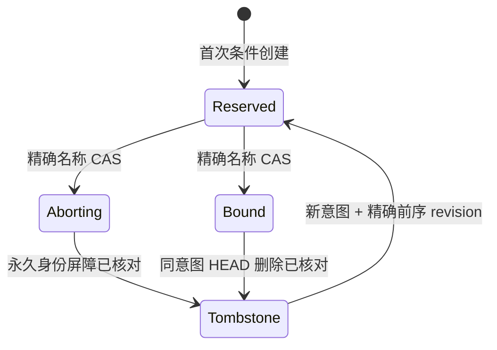

# 名称目录与创建生命周期：可实施协议与验收门槛

- 日期：2026-11-07。
- 代码审查基线：`e2c44b099132700e1305c275c6551c8e156fe510`（已合并 PR #27）；PR #28 保存了第一版待实施方案。
- 状态：**协议、独立有界模型及正式 Rust/HTTP/SDK 已完成本批必要本地验收，通过 PR #31 合入；全目录发现、真实 AWS 及完整 N1/N2 退出仍未完成。** [正式验收记录](../engineering/catalogue-actors-validation.md)与模型分开绑定源码和原始历史。
- 范围：落实[完整方案第 10 节](object-storage-native-proposal.md#catalogue)的可恢复名称绑定；S3 继续是唯一持久权威。
- 前轮执行环境失联及核心重构中断期间保存的恢复候选保持历史 **NOT_COMPILED / NOT_RUN** 状态。后续重新冻结源码、完成精确单元及真实目录/服务合同；旧源码测试结果没有直接认证新生产代码。原失败、审计修正、精确输入身份复用与受影响重跑见正式记录。

## 1. 当前能力与本工作包

当前 `scap-object` 已有不可变 Scope、条件建库、原子 HEAD 发布、权限、显式接管/激活、请求取消、结果退休及 Deleted 屏障。HTTP/Node SDK 使用 deployment、tenant、database、incarnation、generation 五元组，并保留原 SQL 请求以查证 UNKNOWN。参见[运行时](../engineering/object-runtime.md)、[HTTP ADR](../adr/0023-authenticated-http-and-node-sdk.md)和[路线图](../engineering/roadmap.md)。

本轮工作分支已在 `crates/scap-object/src/catalogue/` 写入名称 reservation、Provisioning HEAD、名称解析、名称取消/删除/重用的正式实现草稿，并保留 `Database::create` 直接建立 Ready、inactive HEAD 的能力。新增代码仍待完整单元覆盖、独立审查和真实目录合同验收；不能把工作分支的开发回归称为主线验收或 N2 退出。名称枚举仍未实现。

第一版目录提供固定创建意图、逐步创建、**仅在 Reserved 阶段可接受的创建取消**、按名解析和已绑定名称删除。自动 owner 路由、冷热隔离、结果索引分段、GC、PITR 与 lazy VFS 不在此工作包内。全目录枚举有独立门槛，不能以几个调用者已知的名字代替。

## 2. 身份与记录

名称可以重用；数据库身份不能重用。名称、创建 operation、删除/取消 operation 都不是授权凭证。调用者不能传 S3 key、ETag、HEAD body 或自授角色。

### 2.1 固定名称和身份规则

第一版名称是 1–128 字节的有效 UTF-8，拒绝 Unicode 控制字符；大小写和 Unicode 字节完全区分，不隐式 trim、大小写转换或归一化。名称键使用 deployment/tenant 前缀与规范名称字节的 SHA-256 摘要；读回仍要核对完整名称和租户。摘要碰撞返回错误，不能把不同字符串当成同名。

HTTP 仅接收名字、固定 operation ID、预期前一名称 revision 和显式创建选项。deployment、tenant、principal 来自受信认证上下文。返回的 `Creation` 包含完整 Scope，SDK 保存服务返回的这个固定意图；后续续作不得换 Scope。

第一版服务可用固定的身份派生规则避免进程丢失后重新分配：对 ASCII 域分隔符 `SCAP-NAMED-ID-v1`、一个零字节与 deployment、tenant、principal、create operation 的四个 8 字节大端无符号整数依次拼接后计算 SHA-256；摘要的第 0–7、第 8–15 字节按大端 u64 分别作为 database、incarnation，generation 固定为 1。零值或保留值在写入任何记录前拒绝，要求调用者明确使用另一个 operation。该规则必须在实现时以固定测试向量冻结，不能因默认配置、进程、时间或重试次数改变。它只确定候选身份，**不以哈希碰撞概率承担唯一性正确性**；唯一占用由第 2.3 节的永久 HEAD 键决定。其他可信分配器只能在新的协议版本中采用相同的固定意图与永久占用规则。

### 2.2 持久记录

| 记录 | 内容与约束 |
| --- | --- |
| CreateDescriptor | 按 deployment/tenant/principal/create operation 寻址的不可变记录。保存完整名称、Scope、原 principal、operation、预期前一名称 revision、原始显式选项及首次确定的有效 quota/retention。仅条件创建；同 operation 改名字、选项或身份必须冲突 |
| Binding | 格式版本、deployment/tenant、完整名称、单调 revision、状态、CreateDescriptor 的准确引用和摘要、Scope；Aborting/终态另存相应固定控制意图 |
| HEAD 创建来源 | 明确区分直接创建与命名创建。命名来源保存 CreateDescriptor 引用/摘要及固定创建身份；普通数据库转换不得修改来源 |
| HEAD 生命周期 | 增加 Provisioning；Ready、Maintenance、Deleted 保留。Provisioning 不开放普通数据库入口，Deleted 不可逆 |
| AbortIntent / DeleteIntent | 调用者 principal、独立固定 operation、目标创建意图/Scope、预期名称 revision、原始 nonce；DeleteIntent 另外固定预期 HEAD revision。abort 调用者必须是 creator；delete 调用者可以是其他当前 ADMIN |
| ControlDescriptor | 按 deployment/tenant/caller principal/操作种类/control operation 寻址的永久不可变记录。保存完整 AbortIntent 或 DeleteIntent，在修改名称/HEAD 之前固定全部目标、条件和 nonce |
| AbortProof | 按创建意图寻址的永久不可变取消证明。保存胜出的完整 AbortIntent 与准确身份屏障；仅在 Aborting 已被接受且屏障成立后条件创建，在名称 Tombstone 前持久化 |
| 名称 Tombstone | 被释放的创建意图、Scope、名称 revision、控制意图，以及永久身份屏障的证明类型。不是物理删除名称键 |

CreateDescriptor 不累积其他操作，大小固定有界。首次有效默认值进入持久记录；后续进程不能按新的默认 quota/retention 重解释同一次创建。明确传入不同选项仍是冲突。重复请求只接受规范编码和完整语义一致，不能只比较一个用户给出的 operation 数字。

Binding 初次只条件创建，随后只以同一次 exact GET 的完整 body/ETag 做 CAS。每次变更递增 revision，溢出拒绝。记录字节上限固定为 64 KiB；不把整个租户目录塞入一个 JSON。

正式实现的内部键固定如下，HTTP/SDK 不接收这些键：

| 记录 | 内部键（`P = scap-object/v1/{deployment}/{tenant}/catalogue/v1`） |
| --- | --- |
| CreateDescriptor | `P/create/{creator}/{create_operation}` |
| ControlDescriptor | `P/control/{caller}/{abort或delete}/{control_operation}` |
| Binding | `P/name/{sha256(原始UTF-8名称)}` |
| AbortProof | `P/abort-proof/{creator}/{create_operation}` |
| HEAD | 继续使用 `scap-object/v1/{deployment}/{tenant}/{database}/head` |

目录记录采用固定字段顺序的规范 JSON，严格拒绝缺字段、额外字段、重复字段、超限及与重新编码不同的字节。名称 revision 按每轮创建预留三个值：`previous + 1` 为 Reserved，`previous + 2` 为 Bound 或 Aborting，`previous + 3` 为 Tombstone；预先拒绝可能溢出的 previous。完整字段和有效默认值进入摘要，不能用可变记录的 ETag 充当永久来源身份。

HEAD 新增来源和控制终态字段采用独立的 v3 HEAD 格式并更新严格格式测试。不可变对象 SCAPOBJ2 与结果 envelope 的 v2 格式/hash 合同不随 HEAD 版本改变。保留现有直接 create API，但直接创建记录不能被收编为命名创建。本文不要求旧格式/旧原型迁移，也不能用缺字段默认值伪造命名来源。

### 2.3 HEAD 键就是永久身份占用屏障

物理 HEAD 键由 deployment/tenant/database 决定；incarnation/generation 在 body 中核对。**不能只换 incarnation/generation 复用同一个 database ID。**

所有 HEAD，包括直接创建、Provisioning 和 Deleted，均不得 DeleteObject、TTL 到期或覆盖成另一创建来源。GC 不得回收这些身份屏障。本阶段接受其永久元数据成本，不把它称为免费。

命名创建遇到已存在 HEAD 时只有两种正常解释：同一个完整创建意图，或 ID 冲突。后一种情况必须保持该 HEAD 原样；不能删除它、收编它或自动给当前 operation 再分配一个 ID。调用者可以取消自己的 Reserved 名称后，以新的 operation 发起新的创建。

格式损坏、未知格式、HEAD key 与 body 的 deployment/tenant/database 不符，不是可接受的“其他占用者”证明，必须失败关闭。只有合法且来源明确的其他身份可以作为 ID 冲突证据。

这里的“来源明确”只核对永久身份元数据：显式直接来源为 `creation = null`；命名来源必须 exact GET 它的 CreateDescriptor，并验证完整 Scope 与实际来源摘要，缺失或不匹配即 Corrupt。ForeignOccupied 不证明该外来库的业务数据闭包或 SQLite 健康，也不遍历外来业务页；其可变名称 Binding 可能早已重用，不能要求仍指向同一旧 HEAD。永久槽占用、确认过的不可变来源与不物理删除的协议共同构成屏障。

### 2.4 控制意图的持久准入

仅在成功的 Aborting/Deleted 中保存控制意图还不够：原目标 CAS 发生 412 或 UNKNOWN 后，调用者可能试图以相同 operation 更换预期 revision。因此第一版增加永久 ControlDescriptor，采用如下顺序：

1. 验证当前认证主体、请求语法和完整目标身份。abort 的 caller 必须是 creator 且仍有当前 provision；delete 的 caller 与 creator 分开。语法错误、跨认证命名空间或当前 creator/provision 拒绝可以先于固定意图比较返回；这些检查不读请求所指的新目标。
2. 按当前受信 caller/kind/operation exact GET `ControlDescriptor` 的内部规范键。若该键已经存在，先核对其键/内容归属，再比较完整公开目标 Creation、预期名称/HEAD revision 和 nonce；任何变化都返回 Conflict，之后不读取改投目标的 CreateDescriptor 或 HEAD。即使改投目标尚无 descriptor/HEAD，结果仍是 Conflict，不能被新的 NotFound 或权限结果遮盖。持久记录本身损坏则返回 Corrupt。键不包含目标 Scope，因此同 operation 不能借换 Scope 绕过比较。
3. 对原意图重入或尚无 descriptor 的新控制操作，读取真正目标的 CreateDescriptor 并核对来源及当前权限。delete 必须获得 fresh HEAD 的 ADMIN，不以 ADMIN 冒充 READ；新 delete 未授权时不得写 ControlDescriptor。随后才条件创建或完整核对不可变 ControlDescriptor，准确读回确认持久后继续名称/HEAD 的条件写。原意图重入也不能跳过当前权限。发生 UNKNOWN 就停止，不覆盖 descriptor。
4. 后续每一个控制步骤都核对这个同一意图。目标 CAS 即使失败，ControlDescriptor 也不删除；不同条件、nonce 或目标需要新的 control operation。

“同 operation 变参冲突”的服务端保证从**控制意图已持久准入**开始；服务器不能记录根本没有送达或未持久化的请求。SDK 从发送前就保存完整原意图，不能利用未观察到 descriptor 的 UNKNOWN 重新编造条件。语法无效/未授权且尚未准入的请求不产生控制权威。

ControlDescriptor 持久不表示取消已接受，更不表示取消/删除完成：取消接受仍由 Reserved → Aborting 排序，完成仍需要永久身份屏障、AbortProof 和名称释放。对只读进度查询，控制 descriptor 缺失只表示尚未查证准入，不能返回 Aborted/Deleted。

## 3. 创建状态机

名字的有效转换为：



Bound 只表示名称意图已经发布。只有 fresh HEAD 为 Ready 并通过当前 READ 授权时，名称解析才成功。

固定创建顺序：

1. `prepare` 条件创建/读取 CreateDescriptor，确认完整固定意图。UNKNOWN 时停止写步骤，不猜测失败。
2. `reserve` 条件创建 Binding Reserved，或在请求指定的 Tombstone revision 上 CAS。既有 Tombstone 丢失不能视为首次创建。
3. `provision` 在目标 HEAD 键条件创建同意图、inactive 的 Provisioning HEAD。所有依赖对象按现有不可变上传与回读合同持久化。
4. `bind` 核对当前 Reserved 和同意图 Provisioning HEAD，以准确名称 ETag 将 Reserved 改为 Bound。
5. `complete` 重新核对 Bound、完整创建来源、当前主体及 HEAD 恢复闭包，以准确 HEAD ETag 将 Provisioning 改为 Ready。
6. 显式 takeover/activate 仍单独执行；Ready 不代表当前进程已获得活跃写者资格。

两个不同创建意图争同名时，只有一个 reservation 能成功。同意图两个进程续作可以返回 CAS 冲突，但不能创建第二个 Scope、重设权限/配额或重放 SQL。

每次调用只有有限步骤、单一绝对 deadline。CAS 冲突和 UNKNOWN 后返回给调用者；显式续作读取持久进度，建立下一步合法候选。不能把失败的旧候选换上新 ETag 再发布，不能将控制步骤的同意图恢复推广为 SQL 自动重试。

多对象 GET 不是原子快照。正式协调器按 **Binding → AbortProof → HEAD → 同一 Binding** 的顺序 exact GET；末次名称 body 与 ETag 必须等于首次读取，否则返回 Conflict。名称 revision 不回绕且不物理删除，使这项稳定名称检查可以识别读取期间合法完成的 Reserved → Bound → Ready，而不误报“Reserved 下出现 Ready”的损坏。AbortProof 必须先于 HEAD 读取：其他同意图续作者能在 Aborting 名称不变时先后发布 Deleted HEAD 和 AbortProof；若先读旧 HEAD，再读新 Proof，即使名称双读相同，也会把合法并发误报为损坏。Proof 永久保留且仅在身份屏障后发布，因此先读 Proof，再读它所依赖的 HEAD，可避免新证明搭配旧的 404/Provisioning。此读序已经过正式并发单元及冻结候选的真实目录切点验收，准确范围见[本批记录](../engineering/catalogue-actors-validation.md)。HEAD 可以在名称 Bound 不变时继续正常推进；后续每个 HEAD 写仍用原始 HEAD ETag 排序，不因第二次名称读取而重基旧候选。

| 观察状态 | 处理 |
| --- | --- |
| 只有 CreateDescriptor，名字尚未 Reserved | 尚未占用名字；可按原意图 reserve，不声称创建或取消完成 |
| Reserved + HEAD 不存在 | 同意图可条件 provision；也可竞争接受 abort |
| Reserved + 同意图 Provisioning | 可竞争 bind 或 abort |
| Bound + 同意图 Provisioning | 只继续 complete；本版 abort 已关闭 |
| Bound + 同意图 Ready | 当前权限允许时返回原身份；不重新初始化 |
| Aborting | 创建步骤停止，只允许固定取消意图的后续收敛 |
| Bound + HEAD 缺失/损坏/错来源 | 错误；不能自动建立空库 |
| Tombstone 或名字已属于后继意图 | 旧创建不能重新 reserve、bind 或 complete |

## 4. `abort_create` 的封闭边界

### 4.1 接受取消的唯一排序点

在同一 AbortIntent 的 ControlDescriptor 已持久准入之后，**取消只接受 Reserved → Aborting 的名称 CAS。它与 Reserved → Bound 竞争同一个 ETag。** Aborting 保存完整 AbortIntent；成功后任何原创建者都不能再 bind。

- Aborting 赢：取消被持久接受，但还没有完成。必须继续建立 HEAD 永久屏障、发布名称 Tombstone，才能返回 `Aborted`。
- Bound 赢：返回 `CannotAbortBound`。调用者以原创建意图恢复至 Ready，再按正常 delete 协议删除。不能把已绑定创建当作可取消写入。
- 只有 descriptor、没有 Reserved：返回 `NotReserved`，**不是永久取消成功**。一个已经在途的 reserve 仍可能完成；调用者先查证/建立原 reservation，再竞争取消。
- Aborting 已存在：只有同一个 AbortIntent 可以续作。另一个 nonce/operation 不能接管或假装完成这次取消。

这是一项明确的第一版 API 限制。不能把 `NotReserved` 或 `CannotAbortBound` 包装成“请求已取消”。若未来产品要求在任意准备阶段取消，必须另行设计覆盖 descriptor/在途 reserve 的持久屏障并重新验收，不能放松当前规则。

### 4.2 Aborting 后处理 HEAD

协调器先 fresh GET 这个物理身份槽，不使用只核对当前完整 Scope 的普通 `Database::status` 来掩盖其他 incarnation 的占用。

| HEAD 观察结果 | 允许动作及名称释放条件 |
| --- | --- |
| 不存在 | 在同一物理 HEAD 键 **条件创建** 属于本创建意图、inactive、不可逆 Deleted 的 HEAD；保存 AbortIntent。使用正常有界空根/索引依赖和严格格式，不用一个不可解析的随意 marker |
| 同意图 Provisioning | 以准确 ETag 发布 Deleted，记录同一 AbortIntent，关闭 active 并推进正常 revision/fence |
| 同意图 Deleted，且保存同一 AbortIntent | 屏障已完成，不能重新创建/初始化 |
| 合法但属于其他 Scope 或创建来源 | 不写、不删该 HEAD。其永久占用足以阻止本意图的条件建库；记录 `ForeignOccupied` 类型的释放证明，不对调用者暴露其他数据库的策略或数据 |
| 同意图 Ready/Maintenance | 属于禁止状态：Aborting 已赢却出现 Ready，意味着来源检查或 Bound 门禁被绕过。返回 Corrupt/协议失败，不能自动删除业务数据 |
| 同意图 Deleted 但取消证明不同 | 不收编其他控制操作；返回冲突并保留诊断 |
| 缺失证明、损坏、未知格式、GET 不确定 | 失败关闭；保留 Aborting，不释放名字 |

Absent HEAD 的取消与迟到 provision 都使用 `If-None-Match: *`：

- 取消的 Deleted HEAD 先成功，迟到 provision 必须冲突。
- Provisioning 先成功，取消续作只把**同意图** Provisioning CAS 为 Deleted。
- 两个候选都不能无条件覆盖。一次 412 不是自动重试许可；UNKNOWN 也不是“没有写入”。

形成永久屏障后，先条件创建并回读校验永久 `AbortProof`，再以准确 Aborting ETag 将名字改为 Tombstone，保存该 proof 的准确引用。proof 包含 `OwnDeleted` 或 `ForeignOccupied` 证明和固定 AbortIntent。`ForeignOccupied` 只保存占用者不可变的 Scope/创建来源，不把会随普通提交改变的 ETag/revision 写成稳定证明。如果最后 CAS/响应丢失，名字仍不可解析；原取消意图可查证或续作。Aborting 不允许 TTL 到期、回到 Reserved 或被新创建覆盖。

永久 AbortProof 是必要记录：名字重用后 Binding 会被覆盖，外来占用者的 HEAD 又不能记录本次取消；如果只保留名称 Tombstone，原取消 operation 的胜出证据就会丢失。AbortProof 不能靠名称重用清理，也不能在 Reserved/Bound 阶段预先写成成功。名称已成为同 proof 的 Tombstone，或已经按单调 revision 进入后继创建时，原取消只返回查证结果，不修改新绑定；若名字意外缺失则失败关闭。

### 4.3 为什么迟到动作不能复活

Aborting 和 Bound 的名称 CAS 互斥，因此取消被接受后，不存在可使本次创建合法 complete 的 Bound。即使 provision 早已在途，永久 HEAD 屏障也会与它在同一个物理键上排序。名称只有在该屏障形成后才变成 Tombstone；新创建必须使用新的固定身份。

旧 reserve/bind/abort 使用旧名称 revision/ETag，不能覆盖后继绑定。永久 HEAD 不回收，故旧 `If-None-Match: *` 不能在未来重新成功。这个论证同时依赖严格来源匹配、不可逆 Deleted、名称 revision 不回绕，以及所有直接/命名创建都遵守相同的 HEAD 占用规则；任何一项被绕过都必须阻断上线。

## 5. Provisioning 不可绕过

`scap-object` 必须统一审查以下入口，不能只在 HTTP 层拦截：

- `execute`/Session execute、`query`/Session query、`session`/恢复物化；
- `lookup`、`cancel`、`close_full`；
- `takeover`、`activate`、`activate_session`；
- `set_policy`、`set_quota`、通用 `set_lifecycle`。

这些普通入口不得将 Provisioning 当作可服务数据库。特别是通用 `set_lifecycle(Ready)` 不得完成创建，`takeover/activate` 不能绕过目录。普通状态接口也不能给出“已经可用”的成功结果；目录有专用的最小进度检查。

仅正式目录协调器可以调用 `complete_named`、`abort_named`、`delete_named` 等最小 core 原语。这些原语自己核对固定来源、准确状态/预期 revision、权限和 fence，不能仅相信一段客户端 JSON。不能开放接受任意 key/intent/HEAD 的裸 HTTP 完成接口。

Ready 后的普通权限、配额和 SQL 合同继续由 HEAD 决定。第一版对命名 HEAD 的 Deleted 转换仅允许带固定 DeleteIntent 的正式目录路径；通用 lifecycle 接口必须拒绝绕过删除来源记录。直接创建 API 保留原有显式能力。当前 Maintenance 的读取行为与 GC 屏障问题不因增加 Provisioning 自动解决，见[路线图](../engineering/roadmap.md)。

## 6. 名称解析、主体与权限

`resolve(name)` fresh GET Binding，再 fresh GET 对应 HEAD，要求租户/名字/Scope/创建来源一致、Binding 为 Bound、HEAD 为 Ready，并由**当前 HEAD**授予 READ。名称绑定不授予业务权限，原 creator 也没有永久绕过当前策略的权利。

名称缓存仅是可丢寻址提示。SQL 执行仍经过完整数据恢复、fresh HEAD、权限和提交协议；resolve 成功不是整个数据库已物化的证明。既有 tracked SQL 请求保留原 Scope，不能因名字被重用而改投新库。

第一版的创建续作/取消必须同时满足：认证主体等于 descriptor 中的 principal，且当前认证配置仍授予本租户 provision 能力。HEAD 已 Ready 后返回业务信息还要遵守当前 HEAD 权限。不能把 descriptor、operation 或旧 token 视为能力令牌。

第一版不提供任意跨主体协调员代办原 create/abort/control operation。另一位当前 ADMIN 以自己的 caller/control operation 发起正常 delete 是受支持的授权操作，不等于冒用 creator 或原删除者。全计算丢失后以原受信主体和固定意图恢复；主体被撤销后保留未完成状态，重新授予同一主体或引入经独立设计/审查的恢复角色才能续作。不能为了清理 orphan 自行绕过撤权。

`inspect_create_operation` 的参数明确是 **create operation**，要求当前 provision 且按当前 principal（原 creator）寻址 CreateDescriptor，返回最小进度；它不把独立 abort/delete operation 当成同一种寻址空间。原取消/删除的精确结果分别通过带完整原意图的 `abort_create`/`delete` 重入查证，不能从创建进度推断某个控制 operation 已成功。HEAD 已 Deleted 时，只能检查保留的来源和对应控制证明，不重新开放 SQL 或数据读取。HTTP 身份认证每次仍必须有效。ID 冲突只向普通调用者返回冲突类型，不泄露其他数据库权限、名称或对象内容。

## 7. 已绑定名称的删除与重用

DeleteIntent 在发送前固定：name、创建来源、Scope、调用者 principal、独立 operation、预期 Binding revision、预期 HEAD revision、nonce。目标 creator 与执行删除的 caller 是两个字段。先按第 2.4 节持久准入 ControlDescriptor；其后同 operation 改任意条件均冲突，包括第一次目标 CAS 未成功的情况。ADMIN-only 主体可以提交已知的目标和预期版本；不为发现删除参数隐式开放需要 READ 的 status/resolve。

1. fresh GET Binding，要求 Bound、创建来源/Scope/原预期 revision 一致。
2. fresh GET HEAD，要求同一来源、Ready 或 Maintenance、当前 ADMIN 权限及精确预期 HEAD revision。Bound + Provisioning 必须先按原创建意图 complete，普通 delete 不绕过这一步。构造 inactive、不可逆 Deleted，保存完整 DeleteIntent 证明并推进 revision/fence；只对原 ETag CAS 一次。
3. fresh 查证原 HEAD 已 Deleted 且删除证明等于**这个** DeleteIntent，才以准确 Binding ETag 发布 Tombstone。
4. 返回成功。后续查证必须匹配原意图，不把另一位管理员的删除转换归作本次成功。

若第 2 步成功但第 3 步未完成，Binding 可能仍 Bound；fresh HEAD 已 Deleted，resolve 必须拒绝。原删除续作只完成名字步骤，不重新删除，也不把原预期 HEAD revision 换成一个新 revision。若 Binding 已是匹配的 Tombstone，可查证完成；若已进入更高 revision 的另一创建意图，只根据永久旧 HEAD 中准确的原 DeleteIntent 返回已完成/已被后继名称替换的结果，绝不编辑新绑定。名字意外缺失不能作为完成证明。若 HEAD 在首次删除前已被 SQL/权限/其他控制修改，原删除请求冲突；需要调用者明确发起带新预期值的新删除意图。

同名重建只接受当前 Tombstone 的准确 revision 和新 CreateDescriptor/新 database ID。旧 HEAD 永久保留，旧 create/abort/delete/SQL 请求不能作用于新数据库。名称 Tombstone 被后继 reservation 替换，不表示旧身份屏障可以物理删除。

Ready 完成与后续正常删除仍在同一 HEAD 上排序。一个迟到 complete 持有的 Provisioning ETag，在 Ready 或 Deleted 发布后已失效；它不能用新 ETag 重新构造旧创建候选。

## 8. 模块和 API 边界

正式目录采用 `scap-object` 内独立 `catalogue` 子模块，利用 Rust 模块隐私保留命名 HEAD 完成/取消/删除原语。先前建议的独立 `scap-catalogue` crate 暂不采用，避免为了跨 crate 访问而暴露一个只相信调用者已见 Bound 的 `pub complete_named`。目录不复制 SQL、完整恢复、HEAD 发布或当前权限算法。

公开 Catalogue 自己 exact GET descriptor/Binding/HEAD 并核对来源、权限和恢复闭包；客户端提供的 JSON、Scope、名字或所谓 proof 不能替代这些读取。全部新生产文件进入原精确覆盖分母，不把产品逻辑放在实验目录。

以下是本轮正式模块采用的公开 DTO/方法边界；内部持久记录不等于 HTTP 输入：

```rust
pub struct Caller { pub principal: u64, pub provision: bool }
// Caller 只能由受信认证适配器构造，HTTP 不接受主体自报权限。

pub enum QuotaChoice { Default, Unlimited, Limited { max_bytes: u64 } }
pub struct CreateOptions { pub quota: QuotaChoice }
pub struct PrepareCreate {
    pub name: String,
    pub operation: u64,
    pub expected_name_revision: Option<u64>,
    pub options: CreateOptions,
}
pub struct Creation {
    pub creator: u64,
    pub operation: u64,
    pub name: String,
    pub scope: Scope,
    pub expected_name_revision: Option<u64>,
}
pub struct PreparedCreate {
    pub creation: Creation,
    pub initial_quota: DatabaseQuota,
    pub retention: Retention,
}
pub struct AbortCreate {
    pub creation: Creation,
    pub operation: u64,
    pub expected_name_revision: u64,
    pub nonce: u64,
}
pub struct DeleteNamed {
    pub creation: Creation,
    pub operation: u64,
    pub expected_name_revision: u64,
    pub expected_head_revision: u64,
    pub nonce: u64,
}
```

QuotaChoice 明确区分使用默认值、显式关闭业务配额、显式限额三态。retention 第一版取受信 Options；二者的有效初始值都进入 CreateDescriptor 并回显。`PreparedCreate` 只证明 descriptor 持久，不能用它宣称名字已经 Reserved 或库已经 Ready。Creation 只含公开身份，不含 S3 key、ETag、内部摘要、Source 或 proof；所有回传字段仍需与持久 descriptor 比较。

进度类型使用固定字段，不让 SDK 按名字猜测目标：

| 返回类型 | 固定字段与 phase |
| --- | --- |
| CreationProgress | creation、phase、binding_revision: Option<u64>、head_revision: Option<u64>、initial_quota、retention。phase 为 NotReserved/Reserved/Provisioning/Bound/Ready/Aborting/Aborted/Deleting/Deleted/NameConflict/IdentityConflict |
| AbortProgress | creation、operation、nonce、phase、binding_revision: Option<u64>、head_revision: Option<u64>。phase 为 NotReserved/CannotAbortBound/Aborting/Aborted |
| DeletionProgress | 同 AbortProgress 字段；phase 为 NotDeleted/Deleting/Deleted |
| Named | creation、binding_revision、fresh HEAD；仅当前 READ 授权的 resolve 返回 |

revision 只回显属于这个 Creation 的记录；名字已经重用则原操作的 binding_revision 为 None，不能把新绑定 revision 当成旧操作的新条件。initial_quota 明确是初始值，不能覆盖或伪装当前 HEAD 经管理员修改后的配额。

```rust
impl Catalogue {
    pub fn new(objects: Arc<dyn Objects>, deployment: u64, tenant: u64,
        worker: u64, options: Options) -> Result<Self, CatalogueError>;
    pub fn prepare(&self, caller: Caller, input: &PrepareCreate,
        deadline: Instant) -> Result<PreparedCreate, CatalogueError>;
    pub fn resume_create(&self, caller: Caller, creation: &Creation,
        deadline: Instant) -> Result<CreationProgress, CatalogueError>;
    pub fn abort_create(&self, caller: Caller, input: &AbortCreate,
        deadline: Instant) -> Result<AbortProgress, CatalogueError>;
    pub fn inspect_create_operation(&self, caller: Caller, create_operation: u64,
        deadline: Instant) -> Result<CreationProgress, CatalogueError>;
    pub fn resolve(&self, caller: Caller, name: &str,
        deadline: Instant) -> Result<Named, CatalogueError>;
    pub fn delete(&self, caller: Caller, input: &DeleteNamed,
        deadline: Instant) -> Result<DeletionProgress, CatalogueError>;
}
```

`inspect_create_operation` 与 `resolve` 严格只读。精确原 abort/delete 的查证与收敛使用保存原控制意图的对应方法重入。mutation 可以顺序推进有限阶段；遇到 412/UNKNOWN 立即停止该候选，不自动更换 ETag/Scope/条件，不把未完成状态报告为终态。独立有界控制准入不得挤占已有数据库 lookup/cancel。

第一版 `CreationPhase` 不把 Maintenance 包装成 Ready：同意图创建检查/续作遇到 Maintenance 返回 Conflict，正常 delete 仍允许当前 ADMIN 删除该库。`CannotAbortBound` 同样必须核对 fresh 同来源 HEAD：Provisioning 核对初始不变量，Ready/Maintenance/正常 Deleted 遵守当前保留策略的 READ 权限；Bound 配上 HEAD 404 或错误来源必须失败关闭，不能仅凭名称绑定返回正常完成后的状态信息。

CatalogueError 至少区分 Invalid、Denied、NotFound、Conflict、IdentityConflict、Corrupt、Limit、Unknown。Bound 的 HEAD 404 是权威缺失，不能归为“名字未使用”。Aborting 已接受但屏障/证明/名称释放尚未完成，不能报 Aborted。u64 的 HTTP/SDK 表示继续使用规范十进制字符串，禁止 JSON number 丢精度。

实施前核对的核心 API：`Objects::{get,put}` 的 404/409/412/UNKNOWN 映射；`format::{Scope,Head,Lifecycle,Transition}` 严格解码和 HEAD key；`Database::{create,read_head,authorize,control,publish,next,verify_closure,verify_results}`；第 5 节全部入口；服务认证/provision、engine 的 create/lifecycle/scope 调度；SDK 原请求、u64 codec 与 UNKNOWN 查证。内部 identity-slot 读取必须区分同物理 key 的其他合法完整 Scope，不能变成公开任意对象读取接口。

### 8.1 固定错误和进度分类

错误与正常进度不能在测试中混为“任一拒绝都算通过”。以下分类约束正式入口，调用者身份/语法/传输错误的先后边界仍按第 2.4 节执行：

| 条件 | 结果 |
| --- | --- |
| 相同已持久 create operation 改名称、公开 Creation 或创建选项 | Conflict |
| 相同已持久 caller/kind/control operation 改目标、预期 revision 或 nonce | Conflict；先比较旧记录，再访问新目标 |
| 原 CAS 条件失败、当前预期版本不符、名称双读发生合法变化 | Conflict；不换 ETag 重发 |
| 同一名称已经属于另一个有效创建意图 | CreationProgress 的 NameConflict，不泄露另一身份的 revisions |
| Reserved 的物理 HEAD 槽由其他合法身份永久占用 | 创建进度 IdentityConflict；不重新分配同一 operation 的身份 |
| 正常 delete 指向尚未绑定的另一合法物理身份 | CatalogueError::IdentityConflict；不修改其 HEAD |
| Bound 指向 HEAD 404、错误完整 Scope/来源；已引用 CreateDescriptor/ControlDescriptor/AbortProof 缺失或不匹配 | Corrupt，不降级成 NameConflict、IdentityConflict 或普通 NotFound |
| 确实没有被引用的目标 descriptor，或 descriptor-only delete 尚无 HEAD | NotFound；不是已绑定/终态关系损坏 |
| 尚未 Ready 的合法名称或已正确核验来源的终态 resolve | NotFound；已引用证明必须先核对 |
| 当前 provision、READ、ADMIN 不满足相应入口合同 | Denied；旧 descriptor 不授予能力 |
| 已知输入/资源限额或 revision 预算不足 | Invalid 或 Limit，按具体字段合同区分 |
| 有效操作的 deadline 已耗尽、请求是否持久化不能确认 | Unknown；不得在测试中宽松接受 Limit 作为同一结果 |

Bound + Deleted 的 resolve 必须确认对应 ControlDescriptor 与 HEAD 删除标记，但这一来源验证不要求原 creator 仍有 READ；调用入口自己的当前权限合同保持独立。正常创建/取消进度需要 creator READ 时，由相应入口另外检查。名字已被后继意图覆盖时，旧正常 Deleted HEAD 或旧 AbortProof 只允许在当前名称 revision 严格大于旧轮次的 Tombstone revision 后证明原操作结果；回滚到低 revision 是 Corrupt。

### 8.2 内部不可变记录的类型边界

恢复候选使用私有 Canonical 记录封装一次严格校验后的完整值、规范字节、摘要和形状见证。它仅提供不可变访问，不暴露可变 inner 或 DerefMut；decode 会重新编码并逐字核对输入。Source/Admitted 只从完整有效记录产生，不能用公开 JSON 或字符串摘要直接构造。Binding 的状态见证还须通过 exact GET 确认实际 ControlDescriptor，HEAD 的命名来源仍须 exact GET 实际 CreateDescriptor。

这项结构调整用于消除对已经不可变校验过的同一记录反复做 fallible 编码，并不缓存可变 Binding/HEAD 的新鲜度、权限或 CAS 条件。每个发布候选依旧独立校验，原 ETag、名称双读和当前权限检查保留。公开 DTO 不变；对应内部测试适配、重新编译、精确覆盖和指定故障合同已随 #31 完成本地验收，不能据此推导完整 N2 或真实 AWS 通过。

## 9. 枚举、预算与仍然阻断 N2 的事项

主线 Objects port 只有 exact GET/条件 PUT，没有 LIST。本工作包即使全部实现，也不能凭 exact-name 或原调用者名单声称完成全目录恢复。

[全目录发现方案](catalogue-discovery-plan.md)规定 LIST 只发现候选键，逐项 exact GET Binding/HEAD 才作权威和权限判断。分页边界、重复项、错误、403、截断、错误租户和 continuation 均需单独验证。在线分页不是跨 key 一致快照，不承诺某个时刻的完整目录；不能把未知/缺项结果标为“完整空目录”。

**N2 完整枚举/冷启动恢复仍是独立阻断：**需要冻结并实现发现范围、并发变更合同、完整性凭据/判定及真实恢复实验。若产品要求在持续并发创建/删除时获得准确瞬时 inventory，则必须增加相应的持久索引/协调协议；当前 GET/PUT 名称方案没有证明这个能力。不能把进程内路由表补成所谓权威目录。

| 资源 | 第一版约束 |
| --- | --- |
| 名称/记录 | 名称 128 字节、单记录 64 KiB；严格字段、整数、编码、revision 溢出检查 |
| 控制操作 | 单一绝对 deadline、有限步骤、每个转换单次条件写；无无限 CAS 循环 |
| 并发 | 独立有界目录控制准入；大量 reservation 不能挤占现有 lookup/cancel |
| 持久状态 | CreateDescriptor/ControlDescriptor、Aborting、Tombstone、永久 HEAD/AbortProof 和 orphan 的数量/字节分别计量；业务 10 GiB 配额不是 bucket 上限 |
| 缓存 | 全可丢，不常驻一库一线程，不把名称解析缓存当权限 |
| 后续枚举 | 固定页数/字节/在途 GET/总 deadline 上限，明确 continuation 和未完成状态 |

权威名称、CreateDescriptor/ControlDescriptor、AbortProof 和 HEAD 不使用通用 TTL。生命周期取消只撤销可服务资格，不声称回收上传对象。物理回收是 N3 的另一套协议。

## 10. 模型与 OT-11 / OT-14 验收

冻结候选 `c0b067d` 已完成 121 项模型单元、885 条目录正向历史和 25 个正确拒绝的负对照，原始历史摘要逐份核对。准确交错范围、审阅发现、失败保留与未覆盖项见[模型验收记录](../engineering/named-catalogue-model.md)。这不认证后续正式 Rust 或真实 S3。

先建立一个有界状态模型，覆盖两位创建者、同意图两位续作者、一位取消者、迟到请求及名称重用。模型与独立历史审计必须检查：唯一当前绑定、固定 operation 不换 Scope、来源不可变、Aborting/Bound 互斥、Provisioning 不可服务、终态不可复活、ID 永不重用、UNKNOWN 不被报告为确定失败。模型未执行之前只称“设计论证”，不能写“协议已验证”。

真实场景必须调用正式 crate/HTTP/SDK，并保存原意图、请求/响应、ACK、条件写和 exact GET 的历史。每个 PUT 在发送前、服务端已写/响应未达、收到响应后分别注入故障；只检查最终名字能查到不足以验收。

| 场景 | 必须独立判定的结果 |
| --- | --- |
| 同一 create operation 改名/Scope/选项；跨租户或 principal 复用 | 拒绝；无第二身份，无权限泄漏 |
| 控制 descriptor 准入后，首个目标 CAS 412/UNKNOWN，再以同 control operation 改 expected revisions/nonce/目标 | 原 descriptor 不变；修改后的控制请求冲突，不重新 CAS 新版本 |
| 非 creator 的当前 ADMIN 删除；无 ADMIN 或非 creator 取消 | 前者按自己的固定 DeleteIntent 执行；后者拒绝，不将 ADMIN 等价为 READ/provision |
| 两个不同意图争同名；两个进程续作同意图 | 最多一个当前绑定；同意图不重初始化、不重放 SQL |
| CreateDescriptor/ControlDescriptor/reserve/provision/bind/complete 各发布切点丢响应或进程退出 | 原意图可查证/续作；UNKNOWN 不换身份、不冒充失败 |
| bind 与 abort 使用同一 Reserved ETag 并发 | 只有一个成功：Bound 获胜则不可取消；Aborting 获胜则永不 Ready |
| Aborting 后 HEAD 缺失，迟到 provision 与取消 tombstone 同时条件创建 | 两个顺序都覆盖；永久屏障最终成立，不能无条件覆写 |
| Aborting 后同意图 Provisioning 已存在 | 精确 CAS Deleted；所有直连 core 入口仍不能服务 |
| 同 database key，不同 incarnation/generation/来源 | 只处理合法占用证明；其他 HEAD 字节/策略/数据不被修改 |
| HEAD 冲突发生于 Ready、Maintenance、Deleted、直接创建 | 均不能收编或删除；同一创建 operation 不重新分配 ID |
| HEAD 损坏、未知格式、错物理 key、无法确认占用 | 保留未完成状态并报错；不释放名字、不自动空库 |
| Aborting 接受后进程丢失、权限撤销、AbortProof 条件写/回读及最后名称 CAS/响应丢失 | 固定取消意图恢复；当前鉴权仍生效；proof 已写但名称未释放不能报 Aborted |
| 名称保持 Aborting，同意图续作者在另一读者的多键读取之间发布 Deleted HEAD 与 AbortProof | 先 Proof 后 HEAD 的读取顺序接受合法进度；不得因旧 404/Provisioning 配新 Proof 误报 Corrupt；两个初始 HEAD 情况均须定向运行 |
| 已持久控制意图改投尚无 CreateDescriptor/HEAD 的合法新目标 | abort/delete 都先返回 Conflict；不读取改投目标，不把错误宽松匹配为 NotFound |
| ForeignOccupied 取消后名称被重用，原取消再次到来 | 永久 AbortProof 保留胜出的原意图；不借外来 HEAD 推断另一个取消 operation 成功，不改新绑定 |
| descriptor-only / Bound 阶段调用 abort | 分别返回 NotReserved / CannotAbortBound；审计不得计为取消成功 |
| 名称重用后旧 reserve/bind/abort/complete/Delete/SQL 到来 | 旧条件和永久 HEAD 阻断；新库无修改，tracked SQL 不换 Scope |
| Ready 创建重入，随后 policy/quota/data 已改变 | 不能重设初始策略/配额或旧空根；当前权限决定返回 |
| 正常删除 HEAD 成功但名称/响应失败；相同/不同 DeleteIntent 重入 | 原删除只完成剩余步骤；不同意图不能冒认结果或使用新 revision 重删 |
| 查询、Session、lookup/cancel、全部控制入口针对 Provisioning | 无一能够绕过 Bound/complete；专用进度读取不泄漏业务数据 |
| 全计算和全部本地缓存丢失 | 按固定意图及 S3 恢复同一个库；保留所有原 ACK 对应结果 |
| 403/409/412/5xx/超时/耗尽/溢出 | 预算内失败关闭；Missing/Conflict/Unknown/Corrupt 分离 |
| 全目录恢复与在线并发分页 | 独立报告覆盖范围与未完成项；不能以已知名称列表代替 |
| 审计负对照 | 错意图、漏 ACK、错根、重复身份、漏分页、取消后 Ready 必须使独立审计器拒绝 |

新增目录模块、受影响 core、HTTP/SDK 均进入正式生产分母，逐文件行/函数/region/分支精确 100% 单元门禁保持不变。单元、模型、原生 SQLite、真实兼容端点、真实 AWS Standard、进程故障各自保留证据，不混 profile 填覆盖率。候选源码、工具链、二进制/native archive 和原始失败/通过记录遵守[本地验证规范](../engineering/local-validation.md)。

## 11. 实施次序与交付判断

1. 冻结规范编码、身份派生测试向量、状态/错误与预算；实现有界并发模型及独立判定，先验收第 4 节两个取消竞争顺序。
2. 增加 core 命名来源、Provisioning、永久取消/删除证明与不可绕过的正式原语；修复全部原单元并增加直连入口反例。
3. 实现 core 内独立 catalogue 模块的 CreateDescriptor/ControlDescriptor、reservation、创建续作、Reserved 取消、名称删除/重用和精确进度查询。
4. 接入有界 HTTP 控制与 SDK 固定意图；错误和取消接受/完成状态必须完整透传。
5. 冻结候选，通过逐文件精确覆盖与真实 OT-11/OT-14 切点/历史审计，再报告这批名称能力完成。
6. 独立完成枚举/完整恢复、owner 路由、冷热隔离和活性门槛，之后才能判断 N2 整体退出。

本版不再把 Reserved 取消、ID 冲突和永久身份屏障留作“以后选一种做法”；采用第 4 节的保守协议。其运行正确性仍必须由模型与原生实验验证。任意新发现的未封闭交错都保持阻断，不以文档齐全替代证据。Bound 后快速取消、任意跨主体恢复、精确并发 inventory 仍未提供；不得在实现或产品描述中偷偷扩大合同。
