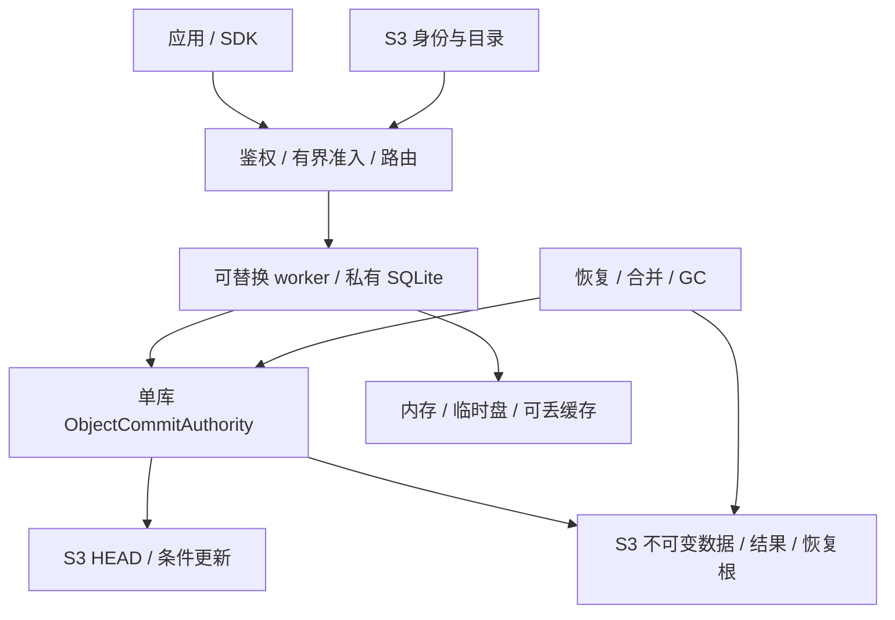

# SCAP 全新架构方案：S3 权威持久化与可丢弃计算

- 提案日期：2026-11-05；实施映射更新：2026-11-07。
- 状态：**目标架构已接受，S3 单库运行时、认证 HTTP 和 Node SDK 已实现；N1–N4 整体验收仍未完成**。关联 [ADR-0020](<../adr/0020-object-storage-native-authority.md>)、[ADR-0021](../adr/0021-object-native-runtime.md)和[ADR-0023](../adr/0023-authenticated-http-and-node-sdk.md)。
- 历史提案基线：`f14b03d03d9216ea56b78aef9d71c5d78fd83645`；本次已合并实现审查基线：`e2c44b099132700e1305c275c6551c8e156fe510`。
- 目标场景：大量独立用户／工作区数据库、低活跃比例、短事务、可接受有界冷启动的 SaaS 与 Personal Agent。
- 用户范围确认：现有原型尚未投入使用，按 greenfield 重设计；**无需迁移、回退、旧格式、旧 SDK 或双后端兼容，可完全替换 Raft/RocksDB 架构**。
- PR #16 的提交范围：完整方案与 ADR；该文档 PR 没有修改运行时代码或创建云资源。

**历史基准：**本文涉及旧源码、原型和文档 PR 的事实，以 2026-11-05 提出方案时的上述源码基线为准；旧代码链接仅供追溯。目标协议与 N0–N4 验收要求继续有效。当前单库实现、已选择的对象布局和实际门禁见 [ADR-0021](../adr/0021-object-native-runtime.md)、[对象运行时](../engineering/object-runtime.md)及[验证规范](../engineering/validation.md)，不能从局部实现或本地验证推导完整目标通过。

> **设计与事实分开：**本文定义 SCAP 的新目标架构，不是为旧系统增加可选后端。现有源码和旧 Raft 文档只作为原型事实与经验，不约束新系统的 API、格式、模块或部署。方案经评审后，实现可以删除和重写旧组件；没有保留双后端的要求。文档提交不表示新系统已运行或已验收。后续实现必须同步重定义[工程约束](<../../AGENTS.md>)、[机器设计清单](https://github.com/ckanner/scap/blob/4cd99eb3ce404dfa26a8df2536d881f078c9c809/contracts/design-contract.json)和验证脚本，而非继续用旧 quorum 断言检验新协议；正确性与覆盖率要求不因此降低。

## 当前实施映射与执行顺序

下表更新当前事实；后文中的目标协议仍按各阶段独立验收。第 2 节保留提案时旧原型的取舍背景，不能据此把旧 Raft/RocksDB 误认作当前运行时。

| 目标 | 当前实现 | 尚未完成的退出条件 |
| --- | --- | --- |
| S3 唯一数据库持久权威 | 正式 object authority、条件对象访问、原生提交 gate、请求结果与 owner fencing 已合入 | 完整 OT-01–OT-08、真实 AWS Standard 合同与独立并发历史审计 |
| 可丢弃计算与容量 | 完整冷恢复、Session、增量数据树、默认 10 GiB 可配置配额，已有冻结候选的本地 1/10 GiB 证据；执行存储防护已通过 PR #28 的本地验收 | 冷恢复仍物化全库；新候选重新执行受影响门禁，不继承旧源码结果 |
| 应用接入和多库服务 | 认证 HTTP、Node SDK、有界准入和独立控制执行已合入；名称协议/模型已合入，正式目录/HTTP/SDK 候选正在验收 | 精确目录的真实切点验收、全目录发现、自动 owner 路由、完整冷热隔离及预定义负载活性 |
| 长期运行 | 已有请求窗口关闭和逻辑退休 | 分段索引、pin、generation、安全 GC、PITR、总存储与请求成本收敛 |

当前机器合同见 [design-contract.json](../../contracts/design-contract.json)，历史证据及各自源码身份见[验证规范](../engineering/validation.md)。本轮遵循以下顺序：先固定本方案、[N1 真实生命周期合同](../engineering/n1-lifecycle-validation-plan.md)和[名称目录协议](name-catalogue-plan.md)，再验证并合入执行存储防护，随后完成 N1 合同、N2 目录与调度、N3 持续存储、N4 生产验收。具体候选和未运行项见[状态记录](../engineering/status-2026-11-07.md)与[路线图](../engineering/roadmap.md)。方案或文档合入不替代运行时验收。

## 阅读导航

- [目标与非目标](<#summary>)、[现状和取舍](<#baseline>)、[外部参照](<#comparison>)。
- [对象合同与信任模型](<#assumptions>)、[组件和数据格式](<#architecture>)、[不变量](<#invariants>)。
- [提交协议](<#protocol>)、[读取及接管](<#reads>)、[请求结果及取消](<#requests>)。
- [目录与权限](<#catalogue>)、[恢复及 GC](<#lifecycle>)、[模块和接口](<#implementation>)。
- [故障矩阵](<#fault-matrix>)、[验证计划](<#validation>)、[性能成本](<#cost>)。
- [从零实施与首发](<#greenfield>)、[安全运维](<#operations>)、[实施阶段](<#rollout>)、[待决事项和来源](<#sources>)。

<a id="summary"></a>
## 1. 目标与非目标

### 1.1 建议方向

将 SCAP 从“自管 Raft/RocksDB 是提交权威，S3 是冷归档”演进为：

> **S3 保存全部不可丢失的数据库及正确性状态；计算节点只保存可重建的执行文件和缓存；对象存储中的权威发布完成后才能确认成功。**

候选方案采用“不可变物理变更／快照 + 每库单个可条件更新的 HEAD”。S3 提供强一致按键访问与条件更新；SCAP 负责将单库事务的生效点收敛到这个对象，并实现其上的身份、权限、去重、恢复和回收协议。

本地 SSD、临时盘或内存仍可用于执行与缓存。目标是**不依赖自管持久磁盘的存活**，不是禁止使用缓存，也不是不需要 CPU/RAM。没有计算节点时数据仍然保留，但执行 SQL 需要重新调度计算。

执行文件仍须满足 SQLite 的本地 I/O 假设：各执行器使用独占私有目录和 WAL，不共享网络卷中的数据库文件。本地读取错误可能污染待发布候选，S3 CAS 不负责修复这种错误。服务配置、直接 Engine 和原生 ImageBuilder 的文件系统准入必须一致；支持类型、overlay 底层、挂载命名空间以及独立临时文件目录的边界见[执行存储合同](../operations/sqlite-storage-safety.md)。该准入是误配置防护，不是任意存储栈正确性的证明。

### 1.2 决定性验收条件

在所选 S3 产品兑现其合同、对象与解密密钥未被删除的前提下：

1. 全部 SCAP 计算节点和本地磁盘同时丢失后，仅凭 S3 数据和必要部署配置／身份材料，恢复全部客户端已确认事务，效果恰好一次且原子完整。
2. 数据库身份、当前版本、权限、删除／退休屏障和原请求结果不依赖旧机器上的唯一副本。
3. 竞争同一数据库的节点不能同时发布互相覆盖的后继；接管后旧 writer 不能继续提交。
4. 超时和断连不被误当作未提交；原请求可查证或有序取消，不换身份盲重放。
5. 正式运行的对象、索引、结果和历史保留有界；安全 GC 和长期成本有实测，而非永久保留后宣称低成本。

“全计算丢失、原区域 S3 健康”不等于“整个区域永久损毁”，也不包含恶意管理员删除对象、丢失密钥或应用错误写入的自动修复。

### 1.3 初版非目标

- 跨数据库原子事务、多区域多写或自动区域晋升。
- 普通 SQLite 同库多个有效 writer；初版仍为单库单有效 writer。
- 用 S3 FUSE/Mountpoint 直接挂载并共享读写 SQLite 文件。
- 任意同步文件驱动透明替换、完整 ORM／交互会话兼容、用户自定义扩展加载。
- 每次写上传完整库、每次唤醒扫描整个 bucket、每个休眠用户常驻一个进程。
- 第一版同时实现跨库日志打包、全局页去重、页懒加载和离线写合并。
- 未测的“零空闲成本”“无限容量”“比托管服务更便宜”或继承云厂商 SLA 的表述。

<a id="baseline"></a>
## 2. 历史原型及当时必须改变的边界

### 2.1 2026-11-05 的旧源码事实

| 当前部分 | 已有实现 | 新后端的方向 |
| --- | --- | --- |
| 权威持久层 | [节点初始化](https://github.com/ckanner/scap/blob/4cd99eb3ce404dfa26a8df2536d881f078c9c809/crates/scap-server/src/node.rs)在 `data_dir/raft` 打开 RocksDB；[RocksBackend](https://github.com/ckanner/scap/blob/4cd99eb3ce404dfa26a8df2536d881f078c9c809/crates/scap-raft-rocks/src/lib.rs)使用 WAL 和同步 WriteBatch | 新数据库权威不依赖该目录 |
| 提交控制 | [原生 gate](https://github.com/ckanner/scap/blob/4cd99eb3ce404dfa26a8df2536d881f078c9c809/crates/scap-sqlite/src/gate.rs)在页面发布前取得精确裁决 | 复用边界，重构裁决来源与回执，不伪造 Raft term/index |
| S3 | [归档接入](https://github.com/ckanner/scap/blob/4cd99eb3ce404dfa26a8df2536d881f078c9c809/crates/scap-server/src/archive.rs)独立于热提交；[生命周期](https://github.com/ckanner/scap/blob/4cd99eb3ce404dfa26a8df2536d881f078c9c809/docs/architecture/storage-lifecycle.md)保存完整单库恢复对象 | 数据和元数据进入实时提交路径 |
| 容量 | [当前限额](https://github.com/ckanner/scap/blob/4cd99eb3ce404dfa26a8df2536d881f078c9c809/crates/scap-server/src/config.rs)为每 cell 32 库、每库 256 KiB、每窗口 128 请求、4096 行政记录 | PoC 可沿用小 profile；生产须重构布局和回收，不能只放大常数 |
| 验证 | [本地证据](https://github.com/ckanner/scap/blob/4cd99eb3ce404dfa26a8df2536d881f078c9c809/docs/evidence/retention-reconciled-local-2026-11-05.json)明确生产规模、三 AZ 和 SLO 未验收 | 新后端重新建立证据，不借用旧后端结果 |

### 2.2 不做“RocksDB 接口直接换 S3”

若保留三个 Raft 节点、仅将每份持久镜像写入 S3，会同时保留成员管理与对象请求开销；whole-state 编码、quorum 等待和恢复复杂度也不自动消失。这不是主路线。

**目标架构只有对象存储权威，不设计 Raft/Object 双后端框架。**现有代码是否复用取决于正确性与长期结构，不以保留旧接口为目标。旧原型由 Git 历史保存即可；不需要旧库导入、原格式升级、反向转换或生产回退。新系统中仍必须保证一个数据库只有一个当前权威根，这是自身一致性要求，不是兼容需求。

### 2.3 可用性变化

| 故障 | 当前 `raft-cell` | 候选 `object` |
| --- | --- | --- |
| S3 不可达、热库 quorum 健康 | 热提交可继续到本地容量等边界 | 新提交无法完成，新强读不能绕过权威 |
| 全部计算/本地盘丢失、S3 健康 | 普通单库归档不足以重建整个 cell 权威 | 目标是数据库和正确性元数据均可恢复 |
| 单执行进程失效 | cell 接管与物理恢复 | HEAD fencing、对象恢复与计算调度 |
| 共享依赖故障 | cell、节点及控制依赖 | S3 区域端点、bucket/IAM/KMS、入口和限流 |

每库 HEAD 减少提交域耦合，但不消除共享基础设施故障。S3 从后台依赖变成在线依赖，是需要明确接受的取舍。

<a id="comparison"></a>
## 3. 外部参照与存储类别选择

2026-11-05 官方资料仅作为能力与边界参照，不是本项目压测或合同背书：

| 方案 | 可借鉴点 | 不能推导的结论 |
| --- | --- | --- |
| D1 | 多个小库水平扩展；付费单库 10 GB 硬上限；付费账户最多 1,000,000 库、前 100,000 包含；Time Travel 和读副本独立提供 [S8] | 外部 REST 可达不等于可自建，也不等于所有 binding 能力／限流相同；不套用 Workers SLA |
| Turso Cloud | 对象持久化后 ACK；公开 AWS 路径为近期 WAL 先到 S3 Express One Zone，随后合并到 S3；跨库及时间合批摊薄请求 [S6] | 未公开其完整提交/选主协议，不能声称它使用本文 HEAD/CAS；单 AZ WAL 不等于多 AZ 提交保障 |
| libSQL / Rust Turso | 引擎与客户端可复用 | 开源引擎／旧 server 不是完整 Cloud；新 Cloud server 闭源，新 Rust 引擎的 Cloud offering 为 early preview [S7] |
| SQLite + 异步备份 | 适合接受相应 RPO 的场景 | 本地 COMMIT 后上传不能满足本提案的确认边界 |
| 当前 SCAP | 已有 gate、fencing、UNKNOWN 和真实故障测试基础 | 不自动继承为新后端的可靠性证明 |

Turso 套餐存储额度不是单库硬上限，本次资料不足以给出其统一单库最大值；不能以“无限单库”作为本项目竞争目标。

初版候选仅支持**一个区域的 AWS S3 general purpose bucket，使用 Standard storage class**。Standard 的多 AZ 与 Express One Zone 的单 AZ 不是等价故障模型 [S3]。Express 可后续作为可丢缓存；若保存唯一近期已确认日志，必须另立 ADR、声明故障合同并验收。

其他 S3-compatible 服务逐一验证。相同 API/SDK 不证明条件更新、一致性、覆盖、删除和故障语义相同。

<a id="assumptions"></a>
## 4. 对象合同、信任模型与证明边界

### 4.1 必需原语

| 原语 | 必需语义 | 初版约束 |
| --- | --- | --- |
| GET exact key | 完整 body 和同一响应 ETag；已完成写之后开始的读不退回旧值 | 不经过缓存代理或异步区域副本，不从 LIST 选最新 |
| `PutObject If-None-Match: *` | 同 key 条件创建，竞争只能有一个创建成功 | 不可变对象和首次 HEAD；存在时校验，不无条件覆盖 |
| `PutObject If-Match: etag` | 当前对象版本的原子条件替换 | HEAD 唯一修改路径；冲突与 UNKNOWN 分开处理 |
| 成功 PUT | 符合指定服务/类别的持久合同 | 内存 fake 或本地兼容服务不能证明 AWS 保障 |
| 完整性 | scope、格式、长度和自有摘要可验证 | ETag 当 opaque 比较令牌，不当 MD5 或业务序号 |

AWS 公布强一致读写、单 key 原子更新及条件请求 [S1] [S2]。**将 HEAD 条件替换作为单库事务线性化点，是本方案需要模型与集成测试支撑的假设，不是 AWS 为 SCAP 提供的数据库事务承诺。**S3 不提供跨 key 原子事务。

HEAD 初版只使用有界普通 PutObject，不使用 CopyObject、multipart HEAD、Append 或假设跨对象 batch 原子性。数据按硬上限分块。部分外部文档对 CopyObject 条件支持存在更新差异，本方案不依赖该组合。

### 4.2 信任与授权边界

- 协议服务、worker、GC 为非拜占庭可信组件；考虑崩溃、暂停、迟到和检测到的损坏，不声称抵御持有存储写权限的恶意实现。
- 用户/Agent 不能直接写权威前缀、指定 HEAD body、epoch 或任意 S3 key。
- S3 比较 ETag，但不理解权限、owner 或数据库状态转换；可信服务必须校验完整不变量。
- Pod Ready、心跳、路由、lease TTL 和墙钟不是写权证明；时间用于预算和故障怀疑，不用于绕过 fencing。
- IAM/KMS、bucket 配置、运行二进制和必要部署配置是外部依赖；全计算恢复不保证丢失密钥仍可解密。

### 4.3 从新目标重新定义合同

新系统的确认条件是“全部依赖已在 S3 持久化，单库权威发布成功”，不再有 SCAP 自管 quorum、Raft term/index、cell membership 或可靠本地盘要求。单库 HEAD 序列替代旧 cell 提交排序，不需要保存旧类型或伪装原回执。

需要保留的是问题本身的安全属性：提交前不可见、数据与结果原子绑定、旧写者拒绝、UNKNOWN 不盲重放、无完整恢复闭包不服务。这些属性不依赖某套旧实现。S3 内部复制由服务提供，跨数据库仍无共同序号或原子事务。

<a id="architecture"></a>
## 5. 组件与对象格式

### 5.1 逻辑组件



职责不要求全部拆成微服务；可在一个进程装配，但资源预算和错误边界独立。多个数据库共享计算，不为休眠库常驻线程或连接。监控可外置，不参与提交权威。

### 5.2 目标候选布局

```text
scap-object/v1/<deployment_id>/
  catalogue/<tenant_id>/<binding_id>
  db/<database_id>/head
  db/<database_id>/inc/<incarnation>/
    gen/<object_generation>/blocks/<hash>
    gen/<object_generation>/manifests/<id>
    gen/<object_generation>/commits/<id>
    gen/<object_generation>/results/<id>
    gen/<object_generation>/snapshots/<id>
    gen/<object_generation>/plans/<id>
```

数据库 ID、incarnation 与 generation 不复用。名称可变，不是身份。数据对象创建后不可修改；同 key 已存在时核对完整内容身份，异常不靠覆盖修复。首版不跨库共享对象，避免权限/回收耦合。

对象 envelope 包含格式、作用域、引擎兼容版本、页大小、长度、摘要、压缩/加密描述和父关系；压缩前后均限额。恢复直接通过引用定位，不扫描 bucket 判定当前状态。

### 5.3 HEAD 候选字段

| 字段 | 职责 |
| --- | --- |
| `protocol_version / format_version / feature_set` | 新系统协议与格式版本；未知能力失败关闭，不提供旧原型兼容层 |
| `deployment_id / tenant_id / database_id / incarnation` | 不可复用的权威作用域 |
| `metadata_revision / transition_id` | 每次状态转换推进 revision 并采用唯一身份，避免 ABA |
| `db_seq / data_root / commit_hash` | SQL 内容版本与完整恢复根 |
| `owner_epoch / owner_instance / owner_state` | 写者资格及 Recovering/Active 状态 |
| `auth_epoch / policy_root` | 与提交同序的单库权限 |
| `request_epoch / retired_prefix / request_root` | 结果、取消、确认索引及旧身份拒绝屏障 |
| `lifecycle / maintenance` | 创建、维护、恢复激活和删除门控 |
| `retention_root / pin_root / gc_generation` | 历史保留、操作保护及安全回收 |
| `last_transition_root` | 诊断/管理结果入口，不内联永久行政日志 |

ETag 从同一 GET 的响应取得，保存在调用上下文；不能拼接两个响应的 body/ETag，不能自行计算 ETag。HEAD 内容每次转换都变化；禁止恢复旧 bytes 或普通删除后用同 ID 重建。tombstone 保留最小、非业务明文的不可复用身份屏障。

HEAD 必须有界。大对象、请求结果和历史采用不可变 copy-on-write 索引，不把当前 whole-cell Vec 变成一个无限大 JSON。HEAD 字节数、索引深度、每次转换的内存与对象数在 N0 冻结。

<a id="invariants"></a>
## 6. 状态与不变量

生命周期候选为 `Provisioning → Ready → Maintenance / Deleted`，恢复激活显式门控；owner 为 `None / Recovering / Active`。热缓存存在与否不是持久化保障等级。对象后端每个已提交状态始终具有完整对象恢复闭包，休眠只释放计算，不再等后台归档把最后一份权威数据搬走。

| ID | 必须成立的属性 |
| --- | --- |
| OI-01 | SQL ACK 对应成功 HEAD 发布，发布前全部恢复依赖已持久化 |
| OI-02 | 同一前序 HEAD 的竞争转换至多一个成为直接后继 |
| OI-03 | 提交、接管、权限、取消、退休、维护和删除在同一 HEAD 序列排序 |
| OI-04 | 不把旧 data root 上执行的页面差分挂到新 ETag；冲突不是无条件 rebase 许可 |
| OI-05 | 数据与请求结果索引在同一次发布生效，无“先写数据后补去重”窗口 |
| OI-06 | 权威发布前不交付成功、RETURNING 行、通知或成功 Promise |
| OI-07 | 原请求身份绑定运行代、请求世代、ID、主体及业务指纹；UNKNOWN 不换身份 |
| OI-08 | 新强读选择新鲜、完整、已授权的快照，不隐式读取旧缓存 |
| OI-09 | 旧请求／owner／删除／恢复身份不因旧快照再次发布而复活 |
| OI-10 | GC 不删除当前、保留或受保护操作仍需要的唯一对象 |
| OI-11 | HEAD 已提交后本地发布失败，不可撤销远端提交或改报明确未提交 |
| OI-12 | 全部本地执行文件可丢，正确性元数据全部可恢复 |
| OI-13 | 权威不可达时失败关闭，不本地写成功，不自动切换后端 |
| OI-14 | 副作用重驱动必须有查证或取消/fence 证明；通用 retryable 标志不够 |

写入与控制变更的线性化点是 HEAD 成功 CAS。强读选择调用期间的新鲜 HEAD 快照；启用 pin 时，准入点为成功保护该快照的 CAS，竞争则重新选根。数据序号 `db_seq` 与 `metadata_revision` 独立：接管、pin、权限等只推进后者。无变化 SQL 仍可能需要发布原结果记录。

<a id="protocol"></a>
## 7. 写入协议

### 7.1 正常流程

```text
Admit → ReadHead → ResolveIdentity → VerifyBase → ExecuteStaged
      → UploadDependencies → BuildHead → ConditionalPublish
      → MaterializeLocal → Reply
```

1. **准入**：验证 SQL/参数/结果上限、可信主体与原 deadline，预留暂存、上传、最终确认和取消所需资源。禁止外部工具动作位于 SQL 提交 gate 内。
2. **读权威**：GET HEAD，同时取 body/ETag；校验格式、scope、生命周期、当前权限、请求世代及 writer epoch。
3. **查原请求**：从该 HEAD 引用的索引判断已提交、取消、退休、指纹冲突或尚无记录。已知结果按当前权限返回，不再次执行。
4. **对齐基线**：私有 SQLite 必须对应准确的 `data_root/db_seq/commit_hash`；恢复后校验，不以“文件可打开”判断版本。
5. **执行并封存**：原生提交前 gate 捕获最终物理页面、数据库长度、完整结果及身份；结果有界缓冲。传输物理事实，不在另一节点重跑随机 SQL 来恢复。
6. **持久依赖**：上传不可变数据块、commit manifest、结果和新请求索引节点；核验完整性。未完成的引用不能进入候选根。
7. **纯转换判定**：基于步骤 2 的精确 HEAD 校验前序、owner/auth/request epoch、预算和状态，构造含固定唯一 `transition_id` 的候选。
8. **原子发布**：用同一次 GET 的 ETag 执行 `PutObject If-Match`，禁止适配器退化为无条件 PUT。
9. **本地发布**：CAS 成功后事务已经权威提交；SQLite materialization 完成后返回成功。若本地失败，停止使用失效缓存，保留已提交事实并从 S3 恢复。
10. **返回**：回执包含 object authority 身份、运行代、提交序号、转换身份及摘要，不伪造 Raft 位置。请求响应丢失后仍可按原 ID 查证。

原子性来自“一次切换完整不可变闭包的引用”，不是“一次原子写入全部 S3 对象”。论证依赖对象不可变、先持久后引用、无提前 GC、结果与数据同根，以及读者不混用多个版本。

### 7.2 错误语义

| 结果 | 数据库解释 |
| --- | --- |
| 依赖对象 PUT 成功 | 对象存在，不说明事务提交 |
| HEAD CAS 成功且收到响应 | 已提交；本地失败不等于回滚 |
| `412` | 这次条件替换未成功；仍须检查同请求早前/竞争发布是否已成功 |
| `409`、超时、断连、5xx | 按操作及在途历史保留 UNKNOWN，先查证，不盲重跑 SQL |
| 已有库 HEAD `404` | 身份/生命周期异常；不自动新建、不从 LIST 复活 |
| HEAD 有效但依赖缺失/损坏 | 隔离拒绝；不造空页、不降到旧快照冒充最新 |
| 上传完成但竞争失败 | 未发布残留；不作为提交证明，仅安全 GC 可回收 |

当前 SDK 每次显式调用只发送一次 POST，不自动重试。任何后续增加的对象传输重试都必须使用同一候选 bytes/条件、受原 deadline 约束并计量；一次重试得到 412 可能是前一次已成功，因此不能只看最后一次 HTTP 状态。重新执行 SQL 属于更高层的独立决策，不能由传输层隐式实施。

崩溃点必须覆盖执行前后、每个依赖上传前后、CAS 发出后响应前、CAS 后 native publish 前、publish 后 HTTP 回包前。不能由本地 WAL 推断远端接受。

<a id="reads"></a>
## 8. 强读、接管、休眠与冷启动

### 8.1 强读

初版不使用读租约、不从 CDN 或异步跨区副本读 HEAD。每个强读请求取得新鲜 HEAD、校验 READ 权限，再固定其数据根执行完整只读请求/read batch。后续提交可以并发发生，但同一读请求不逐句跳版本；之后新请求必须重新准入。

候选 object 模式可由独立授权 reader 执行，不要求常驻 leader。旧 writer 如提供读取，也须完整重新准入，不能凭旧 owner 或文件服务“最新读”。已经合法建立的快照可以在后续撤销发生后完成，不承诺追回已交付数据。生产 GC 启用后必须遵守读取 pin 协议。

### 8.2 owner 接管

调度器选择候选只是提示，不是写权：

1. GET 新鲜 HEAD，CAS 增加 owner epoch、记录新 worker 并进入 Recovering，保持数据、请求、权限、保留 roots。
2. 从所选权威根恢复；恢复后重新 GET 校验当前身份、所有权及数据，再 CAS 激活。变化则重校验，不能沿用恢复前的候选。
3. 新写绑定准确前序。旧请求若先于接管 CAS 提交，必须被恢复包含；若后到，则旧 ETag 失败。
4. 接管响应丢失按转换身份查证，不能初始化另一份库。

lease/心跳可减少争抢，不提供 fencing。无业务时不要求每库持久续租；重新活动时以 HEAD 判定。接管振荡、争抢和公平性需测试，安全不代表有界恢复时间。

### 8.3 休眠和唤醒

关闭前排空或解析在途发布；无法访问 S3 时可丢失本地计算，但不能假称释放命令已完成。新节点之后依 HEAD 接管。

恢复读取准确基线与有限 tail，校验后才服务；按库去重并限制全局/租户并发。等待、下载、重放和校验都算入首次请求与恢复时间。初版先完整物化，分页读取另行验证；任意大小库不承诺固定几秒。

<a id="requests"></a>
## 9. 原结果、取消、退休及外部动作

### 9.1 身份与原子结果

请求协议从零定义；[ADR-0019](https://github.com/ckanner/scap/blob/4cd99eb3ce404dfa26a8df2536d881f078c9c809/docs/adr/0019-explicit-request-result-retirement.md)仅提供已识别故障的参考，不约束新 SDK 或返回格式。身份至少包含 authority generation、database/incarnation、请求世代、request ID、原主体及规范业务指纹。owner 可变化，未知业务的请求世代/ID 不变。

结果与取消索引通过同一 HEAD 与数据根一起发布。独立结果对象上传成功不代表提交。返回原结果仍检查当前权限，不能凭旧 token 读取敏感历史。

### 9.2 Lookup 与 ResolveOrCancel

Lookup 可返回 committed、cancelled、retired、指纹冲突或 unknown。**没有记录不代表旧 CAS 不会晚到。**

候选取消流程：GET 新鲜 HEAD → 查原结果 → 若无结果且有权限，以当前 ETag CAS 发布取消记录并推进 metadata revision，数据根不变。

- 取消先成功：旧 CAS 的前序已失效，后续同身份发布看到取消记录而拒绝。
- 原提交先成功：取消 CAS 失败，重新读权威并返回原提交结果。
- 取消响应丢失：保留 UNKNOWN，按原身份查证，不能先回应取消成功再后台存 fence。

此流程封闭迟到接受后，才可提供明确未提交终态。应用重新发起业务必须是经过判断的新操作，不是 SDK 自动换 ID。

### 9.3 面向长期运行的结果留存

新系统不继承“每库 128 条记录、应用逐条确认后由管理员轮转”的操作接口。协议必须同时解决有限存储和迟到重放；数据库创建时明确结果留存合同，SDK 能读取其能力与边界。

建议以**有界请求世代 + 单调关闭屏障 + 分段结果索引**为基线：当前接受范围内，原结果与数据原子发布；结果可按明确保留政策关闭整段身份空间。关闭屏障、下一接受范围和索引根由同一次 HEAD CAS 发布。任何旧世代永远不可再被接受，查不到已退休结果时返回 `RESULT_EXPIRED_OR_RETIRED` 类独立状态，不解释为取消或从未提交，也不替用户重新执行。

显式应用确认可作为提前释放结果的可选机制，但不是永久运行依赖人工管理员轮转的前提。时间只能触发一次有序退休提议，不能直接删索引或依赖机器墙钟证明旧请求不在途。N0 的首个[有界模型合同](../engineering/object-authority-n0.md)选择按已完成的满窗口计量：保留 current 与最近两个 closed epochs，仅满窗口可关闭；不承诺任何正的墙钟保留时长。该选择明确了最低世代保障、窗口重叠、时钟不参与安全及客户端保存原身份的责任。需要按小时或天保证结果可取回的产品仍须增加独立留存条件与验收，不能从模型的两代推导。不能兑现已公布的保留合同时拒绝退休；模型不执行物理 GC，存储预算不足仍背压。

请求结果退役与业务效果去重分开：原效果保留在数据中，原身份由屏障永久关闭。订单业务仍应保存独立业务键和供应商订单号，不能把数据库传输结果日志当永久业务账本。PITR 也不得回退关闭屏障以复活旧请求。

管理操作使用期望版本、稳定转换身份和同样有界的查证规则，不保留无限永久行政日志。索引分段、屏障压缩和查证范围均需经过独立模型与长期运行验证。

### 9.4 订票／支付的边界

数据库不能使外部 API 自动 exactly-once。单库事务记录 intent/outbox 与稳定业务键，提交后调用供应商，使用对方幂等键/订单查询对账，再记录结果。SQL callback、staged 阶段不得直接付款、发信或执行浏览器动作。外部超时不能解释为“没下单”。

<a id="catalogue"></a>
## 10. 目录、权限、创建与删除

数据库身份、名称绑定、创建意图与删除屏障也须在 S3 可恢复；路由和列表索引可重建，不能留下唯一的 etcd/PG/VM 内存目录而声称只有对象存储是必要持久层。

创建使用固定 operation ID：名称 reservation → Provisioning HEAD → 绑定发布 → HEAD Ready。步骤间并非原子事务，依持久状态幂等协调；中间状态返回 provisioning/不可用，不创建同名第二份库。初版可先用不可变 ID 接入，名称目录随后实现。删除后重建分配新 ID；旧缓存别名必须重新校验身份。

详细状态、固定创建意图、精确名称恢复和全目录枚举按[名称目录实施协议](name-catalogue-plan.md)冻结。正常完成、取消创建、删除及同名重建都必须有持久终态和迟到动作屏障；不能因 reservation 超时直接移除名称记录，也不能删掉别的创建意图占有的 HEAD。未就绪的 Provisioning 不能被普通 core/HTTP 入口绕过。正式核心、HTTP 与 SDK 候选已按 [ADR-0024](../adr/0024-named-catalogue-and-permanent-identities.md)接入，仍须完成本轮精确覆盖与真实切点验收；精确名称 API 不代替完整枚举。

每次操作从 HEAD 的 auth epoch/policy root 检查可信主体。单库权限变更与提交同序；外部检查后不绑定版本会留下 TOCTOU 竞态。撤销先发生则旧 CAS 失效；提交先发生则不追溯撤销已提交数据，结果查询仍检查当前权限。

跨库/整租户撤销不是单 HEAD 事务，初版不承诺瞬时原子全租户撤销，必须报告扇出进度、失败关闭和完成确认。若客户要求更强合同，先补协调协议，不依赖 JWT 尚未到期。

删除由 CAS 写 tombstone 并推进 fence，不能 DeleteObject HEAD。物理 HEAD 键由 deployment/tenant/database 确定，不能仅换 incarnation/generation 复用同一身份槽。PITR 使用新的 database ID 和独立 HEAD，发布新的 incarnation/控制世代，不回写旧 HEAD、不恢复旧权限、不复活旧请求。身份屏障应最小化，不保留业务明文；数据删除、审计和保留期另有明确政策。

<a id="lifecycle"></a>
## 11. 增量、恢复、PITR 与垃圾回收

### 11.1 恢复闭包

提交保存最终页面差分、截断和恢复元数据，不重跑 SQL、不每次传整库。manifest 绑定前序、序号、页大小、最终长度、引擎版本和摘要。

恢复顺序为：HEAD → 校验/授权 → 保护选定根 → 获取基线与有限 tail → 校验并重放 → 验证最终状态 → 重新核对 owner/生命周期 → 激活。缺段、损坏、超限或未知格式必须拒绝。

compaction 先生成并上传一致新基线，后 CAS 切物理根，保持 SQL 内容、db_seq、请求身份和控制状态。不同物理布局需有明确内容等价校验，不能将 compaction 当成另一笔业务提交。

### 11.2 pin 与未发布对象

无 GC 的有界 PoC 可保留所有对象，到预算就停写；不能将其当成长期低成本实现。

生产中，hydration、长读、快照、恢复和上传都需要保护。**读旧 HEAD 后无条件注册 pin 不安全**：GC 可能已经删除它。保护登记必须与根和 GC generation 同序，竞争失败重新选根。

保守候选将 pin root 纳入 HEAD 的有界索引，通过 CAS 登记/释放；这增加读路径写放大与竞争，必须计入性能成本。完整本地物化后可释放远端 pin；分页读取可能全程持有。

TTL 到期不证明旧执行器停止。撤销/过期后旧操作不得直接将原候选挂到新 HEAD；读取依赖缺失必须中止，不能填零页或读更旧状态。自动 pin 回收必须证明迟到发布已被 fence。

### 11.3 首个生产 GC 的保守候选

建议先研究每库维护冻结，而不是直接做无停顿 GC：

**当前 `Maintenance` 只阻止新写与 takeover，仍允许已授权读取及结果查证，不能直接作为以下 GC 冻结协议。** 启用物理回收前必须新增读取/恢复准入与 pin/generation 的同序保护，证明旧读者、旧 uploader 和迟到 Delete 均被正确处理。该工作不能通过改变现有 Maintenance 测试的期望来跳过。

1. CAS 进入含 gc_id 的维护状态，推进 owner/上传 generation，关闭旧候选发布；暂停新写与 hydration，将既有 pin/保留根纳入保护。
2. 保存精确不可变计划，计算数据、结果、取消/退休、PITR、备份、pin、恢复任务和未决事务的完整引用闭包。
3. 等待保护操作完成或经过证明地撤销其未来发布资格；在途 CAS 仍可引用的对象不能当 orphan。
4. 复核 scope/generation/保留根后，由专属 GC 角色删除精确候选；崩溃后从持久计划继续或安全停止。
5. 新阶段禁止重新引用已进入回收集合的对象身份。同样内容需要新 generation/key，保证旧 Delete 不能命中新写入。取消 GC 也不能回退 generation。
6. 删除与引用转换可证明后 CAS 解除维护。权限/删除等紧急变更与计划冲突时必须中止或重建计划，不能换根后沿旧列表继续。

维护冻结有可用性代价，需预算和可恢复协调。精确 pin 结构、回收集合证明、暂停执行器行为必须在 N3 经模型评审；本段不是已实现 GC。无法证明则阻断生产 GC，不能用 bucket TTL 替代。

权威前缀不能配置通用过期策略。对象物理删除与逻辑请求退休是两个协议；S3 Versioning 也不替代引用闭包。

### 11.4 PITR 与区域灾备

PITR 从权威保留提交链选择恢复点，在新的 database ID/HEAD 下构建隔离目标，验证后以新运行代激活。历史权限、tombstone、请求屏障不能随业务数据一起回退；外部订单等要独立对账。

备份闭包包括数据、目录、策略、结果、保留根、格式解释及必要密钥引用。“全部计算丢失、原 S3 健康”是主要验收；跨区域异步副本只保证其完整覆盖的历史位置。

初版不自动区域晋升。两区域各自的 HEAD 不形成全局同一 CAS；旧区域可能恢复，必须防止双权威。区域故障切换需独立的隔离、新身份和损失报告协议，不承诺自动零丢失。

<a id="implementation"></a>
## 12. 目标模块、API 与原型取舍

以下是方案提出时的目标职责划分，不是兼容旧模块或预先建立空 crate 的要求；当前实际模块边界见 [ADR-0021](../adr/0021-object-native-runtime.md)。可以原地重写或重新组织 workspace，不设计公开双后端切换接口。

| 目标职责 | 新系统责任 | 现有代码可参考的位置 |
| --- | --- | --- |
| SQL executor | 私有 SQLite、staged/publish/abort、物理增量、结果缓冲 | [scap-sqlite](https://github.com/ckanner/scap/blob/4cd99eb3ce404dfa26a8df2536d881f078c9c809/crates/scap-sqlite/src/lib.rs)及[gate](https://github.com/ckanner/scap/blob/4cd99eb3ce404dfa26a8df2536d881f078c9c809/crates/scap-sqlite/src/gate.rs)；不适合新协议的类型可以重写 |
| Object authority | HEAD、状态转换、提交/查证/取消、权限与 owner fencing | [scap-core](https://github.com/ckanner/scap/blob/4cd99eb3ce404dfa26a8df2536d881f078c9c809/crates/scap-core/src/lib.rs)、[scap-cell](https://github.com/ckanner/scap/blob/4cd99eb3ce404dfa26a8df2536d881f078c9c809/crates/scap-cell/src/lib.rs)的安全规则；删除 cell/term/index 语义耦合 |
| Object I/O | 强一致 GET、条件创建/更新、摘要、错误、计量 | [scap-archive](https://github.com/ckanner/scap/blob/4cd99eb3ce404dfa26a8df2536d881f078c9c809/crates/scap-archive/src/lib.rs)的对象校验经验；不是原归档格式兼容 |
| Worker runtime | 恢复、激活、执行、强读、取消、缓存和资源预算 | [scap-sql-worker](https://github.com/ckanner/scap/blob/4cd99eb3ce404dfa26a8df2536d881f078c9c809/crates/scap-sql-worker/src/lib.rs)；旧原型与 cell client 绑定的装配重新设计 |
| Authority client | 与对象提交/读/结果协议交互，无 Raft ReadIndex 依赖 | [scap-cell-client](https://github.com/ckanner/scap/blob/4cd99eb3ce404dfa26a8df2536d881f078c9c809/crates/scap-cell-client/src/lib.rs)仅作为耦合审计对象，不保留旧 adapter 要求 |
| Lifecycle | pin、基线/增量、PITR、GC、目录及恢复闭包 | 按目标对象格式实现，避免 whole-cell 镜像复制 |
| API/SDK | 新建的异步远程数据库 API、稳定请求身份与明确结果语义 | [service](https://github.com/ckanner/scap/blob/4cd99eb3ce404dfa26a8df2536d881f078c9c809/crates/scap-service/src/lib.rs)、[SDK](https://github.com/ckanner/scap/blob/4cd99eb3ce404dfa26a8df2536d881f078c9c809/sdk/node/src/client.ts)可选择性复用，不承诺兼容旧 Hrana 子集或客户端版本 |
| Server composition | API/执行/对象任务装配、身份、启动预检和观测 | [scap-server](https://github.com/ckanner/scap/blob/4cd99eb3ce404dfa26a8df2536d881f078c9c809/crates/scap-server/src/lib.rs)可重写；无 Raft peer、RocksDB、PVC 的必要启动依赖 |
| Raft/RocksDB 子系统 | **不在目标架构中** | 历史代码见 [Raft/RocksDB](https://github.com/ckanner/scap/blob/4cd99eb3ce404dfa26a8df2536d881f078c9c809/crates/scap-raft-rocks/src/lib.rs)；实现时可移除，不作自动备用路径 |

窄 port 候选为 ReadHead、PutImmutable、CompareAndSwapHead、CommitAuthority、ReadAuthority、ResolveAuthority、EngineMaterializer、PinAuthority、Clock/IdSource。它们用于分离正确性与 I/O，而不是为未来所有数据库后端建立通用框架。返回区分 Applied、PreconditionConflict、DefinitiveReject、Unknown、Corrupt、Unavailable，不能用 bool 吞掉可能提交的事实。

### 12.1 新 API 的要求

- 从目标能力定义协议与 SDK；SQLite SQL 语义、数据库文件、网络协议和 SDK 是不同兼容维度，初版明确支持范围即可。
- 所有新回执使用对象权威身份与版本，不含伪造 Raft 位置；未知格式/能力失败关闭。
- 提供单库自包含 execute/batch、强读 query、tracked request、lookup、resolve/cancel 和结果留存状态，不要求旧函数名或返回结构不变。
- 明确未进入发布窗口的路由错误可以重选节点；可能发布后只按原身份查证。
- 不因恢复/重试刷新原操作身份。新请求取得新的接受范围是不同的应用动作。
- 初版无跨库事务、跨请求交互会话、任意扩展或同步文件 API 透明替换。
- 明确 WAKING、冲突、资源不足、结果退役、维护和删除状态。具体 wire schema 在 N0 冻结。
- S3 key、ETag 和内部临时凭据不是业务 API 权限，不让 Agent 直接构造 HEAD。

### 12.2 工程合同一并重建

正式重写时同步替换[机器设计合同](https://github.com/ckanner/scap/blob/4cd99eb3ce404dfa26a8df2536d881f078c9c809/contracts/design-contract.json)及其校验脚本，删除不适用于目标的 Raft-only 假设，建立本文 OI/OF/OT 的可执行门禁。现有原型代码、旧 fixture 和历史文档可以移除或归档，不要求两个架构同时运行或测试兼容。保留历史证据用于追溯，但不能把旧 quorum 测试算作新协议通过。

第一方生产代码仍要达到原有严格覆盖率和独立真实故障验证要求。取消无关旧实现的分母与偷偷排除新生产代码不同；重写 PR 必须明确实际发布源码、测试资产和新增分母。PR #16 文档提交时尚无对象运行时，因此没有修改这些机器文件；当前实现的门禁见[验证规范](../engineering/validation.md)。

<a id="fault-matrix"></a>
## 13. 候选故障矩阵

以下是新系统的目标故障矩阵，具体验收范围以当前实现的独立证据为准，不能从局部场景通过推导整表完成。[Raft 原型故障矩阵](https://github.com/ckanner/scap/blob/4cd99eb3ce404dfa26a8df2536d881f078c9c809/docs/operations/failure-matrix.md)仅为历史参照，不要求新系统继续提供 Raft 行为。

| ID | 故障／竞争 | 必须行为 |
| --- | --- | --- |
| OF-01 | SQL 后、上传前退出 | HEAD 不变，无半事务；不能从 local WAL 推断成功 |
| OF-02 | 部分对象上传、未发布 | 仍可见旧版本；残留不算提交 |
| OF-03 | CAS 成功但响应丢失 | 原 ID 查到结果，不重复 SQL |
| OF-04 | CAS 后 native publish 失败 | 保留提交，停旧缓存，从 S3 重建 |
| OF-05 | 同 HEAD 两 writer | 至多一个直接后继；失败者不能给旧差分换 ETag |
| OF-06 | 旧 worker 在接管后恢复 | 旧候选被拒，不能凭 lease 本地成功 |
| OF-07 | 提交与取消/撤权/删除竞争 | 具有遵守 HEAD 顺序的唯一结果 |
| OF-08 | Lookup absent、旧 CAS 在途 | 仍 Unknown；有序取消才能封闭迟到接受 |
| OF-09 | 同 ID 不同参数/世代 | 冲突或退休拒绝，不覆盖原结果 |
| OF-10 | 全计算和缓存丢失 | 从 S3 恢复全部确认集与元数据，不需要旧 PVC |
| OF-11 | S3/IAM/KMS 不可用 | 新写/新强读失败关闭，不偷切 Raft |
| OF-12 | 引用对象缺失/损坏 | 隔离拒绝，不建空库、不选旧版本 |
| OF-13 | pin/合并/GC 与发布竞争 | 所有保护根可恢复，旧删除不命中新对象 |
| OF-14 | GC 崩溃/旧任务重现 | 持久计划可查证，过代任务受 fence |
| OF-15 | PITR/删除后旧 SDK 回来 | 旧运行代与旧请求空间不可重新接受 |
| OF-16 | 目录丢失/路由陈旧 | S3 重建及真实 HEAD 校验，不各自新建同名库 |
| OF-17 | 唤醒风暴/热点库 | 有界排队、公平预算，慢库和失败留在分母 |
| OF-18 | 容量/结果窗口满 | 预留取消/关闭/恢复资源并背压，不提前删除仍在公布留存保证内的结果；超过保证的退休必须与身份关闭屏障同序，不能直接 TTL 删除 |
| OF-19 | 全新初始化/恢复激活中崩溃 | 持久意图可协调，身份唯一；不能重新初始化已存在的权威 |
| OF-20 | 区域不可达、副本可见 | 不自动晋升，报告覆盖与隔离条件 |
| OF-21 | 对象请求重复/迟到 | 固定候选与身份查证，不隐式改请求 |
| OF-22 | 大量长期闲置库 | 不要求每库常驻计算，但元数据和存储仍计量 |

<a id="validation"></a>
## 14. 验证计划与 Go / No-Go

### 14.1 分层证据

1. 纯转换单元：分别改变 owner/auth/base/request/格式条件，验证拒绝无副作用；正式代码进入原[覆盖率门禁](https://github.com/ckanner/scap/blob/4cd99eb3ce404dfa26a8df2536d881f078c9c809/docs/engineering/testability-and-coverage.md)。
2. 可控对象模型：原子 CAS、请求重排、响应丢失、损坏和崩溃；模型假设显式，不能替代云服务。
3. 确定性全流程：真实核心状态机与 gate，记录 seed、反例和缩减历史。
4. 真实 AWS S3 合同：精确 region/storage class、GET/body/ETag、条件请求、权限策略及错误重试；其他兼容端点独立报告。
5. 真实 SQLite/SDK/多进程：至少两个可竞争 worker、真实对象端点、透明故障代理、独立确认账本；不维护实验专用提交算法。
6. 故障域/长期：跨 AZ 计算、全部本地状态丢失、cold storm、GC/PITR/升级和成本收敛。一机多进程不是 AZ 验证。

### 14.2 独立 oracle

| Oracle | 验证内容 |
| --- | --- |
| OA-ACK | 客户端已确认集合恢复后恰好一次、原子完整 |
| OA-LIN | 标准读写历史遵守调用/响应实时顺序 |
| OA-FENCE | 新 fence 后旧候选不能提交；此前提交晚响应不误判 |
| OA-RESULT | SQL 与结果索引原子绑定，同身份同指纹返回同终态 |
| OA-CLOSURE | 当前/保留/pin 根的引用完整，GC 后可实际恢复 |
| OA-BOOT | 无旧机器/盘/内存目录，仅 S3 和必要配置重建 |
| OA-ISOLATION | 错 tenant/db/token/key 及资源过载不越权 |
| OA-BOUND | HEAD、索引、未决请求、缓存、对象和后台积压受声明预算约束 |

### 14.3 最小合同集

- OT-01：同 ETag 双 CAS、迟到重发、transition ID、ABA/旧 HEAD 恢复拒绝。
- OT-02：全部提交切点崩溃，零变化事务、DDL、RETURNING、截断、结果超限。
- OT-03：CAS 响应丢失、接管、native publish 失败、全计算丢失。
- OT-04：Commit/ResolveOrCancel 两种胜序；取消响应丢失；absent 但旧 CAS 在途。
- OT-05：同 ID 同/不同指纹、多主体、旧/未来世代、确认及退休竞争。
- OT-06：Recovering/Active、接管振荡、恢复期间 HEAD 变化。
- OT-07：权限、删除、维护 fence 与提交/读准入/结果查询的排序。
- OT-08：格式、摘要、长度、scope、缺基线/缺段与失败关闭。
- OT-09：索引分段、compaction、恢复前缀与跨合并原结果。
- OT-10：pin 与 GC、暂停 uploader 跨 generation、迟到 Delete、GC 重启。
- OT-11：目录中间态、同名竞争、删除重建新 ID、路由过期和全目录恢复。
- OT-12：PITR 新身份、旧权限不复活、过期根不重新发布。
- OT-13：403/404/409/412/5xx/超时、网络分区、KMS/身份失败和预算耗尽。
- OT-14：新建库的 reservation/HEAD/Ready 每个切点，以及清空全部本地状态后的目录重建，证明身份唯一且无空库覆盖。
- OT-15：多轮数据/结果/管理历史回收，安全闭包与成本同时收敛。

每次保存 commit、构建、依赖、格式、region/class、权限配置摘要、原始调用/对象历史、失败样本和计费维度。日志脱敏，只用可销毁合成数据，不对真实订单做故障注入。

ACK 丢失、重复接受、旧写者覆盖、越权、GC 破坏闭包或多重权威均阻断。不能用异步 ACK、陈旧读、缩小分母或丢弃慢样本“修复”。单元覆盖、真实正确性和性能证据互不替代。

<a id="cost"></a>
## 15. 性能、容量与总成本

[原性能目标](https://github.com/ckanner/scap/blob/4cd99eb3ce404dfa26a8df2536d881f078c9c809/docs/engineering/performance-slo.md)是 Raft 对照，不直接赋予 object 后端。新的端到端预算含排队、HEAD GET、恢复、SQL、上传、CAS/冲突查证、本地发布和返回。

N2 性能试验前必须冻结独立 profile 的数字目标、数据、deadline 和恢复条件。未达标保留失败并版本化修订，不测完挑阈值；没有预定义目标和完整样本就没有性能验收。

| 实验维度 | 候选输入，不是成绩 |
| --- | --- |
| 规模 | 先沿用 32 库/256 KiB；布局扩展后逐级千/万冷库及不同活跃比例 |
| 单库 | 小 profile、1 MiB、64 MiB、256 MiB、1 GiB；10 GiB 在资源和布局允许后独立测 |
| 分布 | 稀疏活跃、集中唤醒、热点用户、同用户多个 Agent 与后台索引 |
| SQL | 点读、小 batch、DDL、逐 token/批量事件对照、长读、大结果、超限拒绝 |
| 缓存 | 全冷、热集、超内存、全缓存丢失，不能只测本地 SQL |
| 背景 | compaction/GC/PITR 开启，限流/慢网/身份故障/计算 AZ 故障 |
| 时长 | 短正确性、稳态独立重复、跨越多轮保留/回收的长运行 |

active SQL、hydration、上传、CAS、查证和 GC 分别限流；为确认、取消和恢复预留资源。减少空闲库常驻成本不等于可以无界并发唤醒。

```text
总成本 = 计算 + 缓存 + 对象容量 + 对象请求 + 网络
       + 密钥/身份 + 观测 + 保留历史 + 恢复预留 + 研发/值班

对象请求成本 = 各类实际 GET/PUT/CAS/LIST/DELETE/重试数量
             × 对应区域、类别、日期及计费单位下的单价
```

价格输入记录 region、class、日期、单位、折扣和税费，来源为 [S5]，不虚构月费。每次 SQL 的对象数取决于块、manifest、结果索引和 CAS；强读 HEAD、pin CAS、冲突查证、校验 GET、compaction 和 GC 均入账。

比较必须遵守：相同可靠性/保留期/数据和负载；不只与“每用户一台 PG”比较；现有 server 共置的 Raft/worker 不重复计费；不把旧目标拓扑当实际账单；冷库的身份、结果和历史仍随总库数增长。跨库合批可能省请求，但增加等待、权限与 GC 耦合，初版不能以尚未实现的合批计算收益。

沿用开环负载、全部结果分母与稳定恢复窗口；UNKNOWN 后来解析成功不能抹去原 deadline 失败。按库报告，全部受影响库恢复才算整次恢复完成。S3 耐久性不是 SQL 可用率，更不是 SCAP SLA。

<a id="greenfield"></a>
## 16. 从零实施与首发策略

### 16.1 无历史包袱

用户明确确认：原型尚未投入使用，没有需要承诺迁移的客户数据。因此不设计旧 cell 导入、旧请求/回执翻译、旧 SDK 兼容、旧磁盘升级、双后端运行或回退到 Raft 的机制。可以删除当前 Raft/RocksDB 路径、重建协议和 workspace；Git 历史足以保存研发参考。

只用新对象布局、新服务身份和新测试数据库验证目标架构，不扫描旧归档猜测新 HEAD。已有未使用原型的清理并非本方案中的自动数据删除操作；真正执行任何环境清理仍须核对目标和授权。

### 16.2 实现顺序不受旧模块约束

先冻结对象权威协议和新数据格式，再实现真实 SQLite gate 接合。现有代码若自然符合新接口即可复用，否则直接替换，不为复用而保留 cell、term/index 或整个原型状态机。第一版可以采用新 SDK 和新的管理/API 合同。

首发只提供经过完整验证的能力：单区域、单库单写者、自包含事务、强读、明确结果查证、全计算丢失恢复、可持续存储和安全回收。不要以“兼容性工作没做完”为由推迟，因为它不在范围内；不能以“没有兼容要求”为由省略恢复和数据安全。

### 16.3 新系统自身的长期演进

不兼容旧原型，不代表新系统未来可以任意破坏已发布数据。目标对象 envelope、HEAD 与 API 从首版就有版本/feature 标识，未知格式失败关闭。首发以后如何升级新系统属于其自身长期运营设计，在正式有用户之前冻结，不需要为当前未发布格式提供转换器。

备份、PITR、误删恢复和区域灾难恢复保留在本方案中：它们是新系统的基础能力，不是旧方案迁移。首发灰度采用合成或明确非关键数据；任何生产启用都依赖 N4 的独立验收和授权。

<a id="operations"></a>
## 17. 安全与运维

### 17.1 基线

bucket 私有、TLS、静态加密；KMS 与租户密钥策略独立评审。使用短期工作负载身份，不向 Agent 分发长期 AK/SK。写入与 GC 删除角色分离；对 HEAD 条件替换、不可变创建和删除前缀分别授权，并用策略阻止无条件写 [S4]。

不接受任意 key/path、跨库 ATTACH 或用户扩展。访问日志、CloudTrail data events、CloudWatch 指标按范围启用并计入成本，日志目标加密且不含敏感 SQL 参数/结果。高权限管理员仍可能破坏权威，误删保护和备份必须单独设计。

### 17.2 必备运行手册

| 手册 | 核心步骤 |
| --- | --- |
| 全计算恢复 | 新机器预检 → 目录/HEAD → 闭包校验 → 新 epoch → 独立确认集合核对 |
| UNKNOWN | 保存身份 → Lookup → 有序 ResolveOrCancel → 外部订单对账 |
| 对象损坏 | 停发布/GC → 保全根 → 验证备份/修复，不造空库 |
| S3/IAM/KMS 故障 | 区分限流/权限/网络 → fail closed → 恢复后查原转换 |
| GC 卡住 | 查持久 gc_id/保护根 → 核对 generation → 安全继续或停止 |
| 权限轮换 | 管理授权 → HEAD 排序 → 旧请求拒绝及结果访问核对 |
| 升级 | 格式能力检查 → 小范围验证 → 分库升级，不支持的 feature 拒绝 |
| PITR | 隔离恢复 → 新运行代 → 外部副作用对账 → 显式切换 |

指标至少涵盖 HEAD GET/CAS 延迟与结果、冲突率、每事务对象请求、上传/恢复放大、UNKNOWN 解析、owner 切换、唤醒队列、保留量、pin/GC/orphan 积压与每库资源。新名称在实现时冻结，本文不宣称指标已存在。

<a id="rollout"></a>
## 18. 实施分期

N0–N4 是新系统从零实施的阶段，不沿用旧原型完成度。[N0 有界模型子集](../engineering/object-authority-n0.md)、正式 v2 对象格式、单库真实提交以及 HTTP/SDK 已有各自实现与冻结候选的本地证据。完整 N1–N4 退出条件仍待完成；每一批变更重新绑定源码与验收，不能从已交付能力推导整个阶段完成。

| 阶段 | 交付 | 退出条件 |
| --- | --- | --- |
| N0 协议冻结 | 新格式、receipt、模型、API、结果留存和故障语义 | 核心竞态评审通过；无旧系统兼容任务 |
| N1 单库提交 | S3 adapter、object authority、gate、强读和原请求；生产默认配额与独立有界故障夹具，GC 关闭 | 真实对象合同、OT-01–08、全计算丢失通过；新代码进入原覆盖门禁 |
| N2 多库接入 | 新目录、权限、SDK、路由/准入、独立 reader | 并发创建、跨库隔离、活性和真实业务接入；性能实验前冻结 profile |
| N3 可持续存储 | 分段索引/增量恢复、退休、compaction、pin、GC、PITR | OT-09–12/15，多轮回收后安全与成本收敛 |
| N4 首发验收 | MB/GiB、长尾/热点/唤醒风暴、故障域、长运行及运行手册 | 预定义性能/恢复/成本和 OT-14 全新启动通过；单独获准后以非关键数据试运行 |

顺序原则：先协议再“能上传”的代码；从新数据库和新协议起步，SQL 内核按适合程度选择性复用；引用/恢复布局成熟后扩容量；GC 是上线门禁，不是无限延期项。跨库 group commit、页懒加载、全球读、多写者、Express 持久层均另立 ADR。

停止/重评条件：对象原语不满足、gate 无法阻止提前可见、迟到操作不能封闭、GC 无法证明、同保障下成本/延迟不适合，或客户需要超范围事务/区域能力。不能通过弱化 ACK 保证继续宣布成功。

<a id="sources"></a>
## 19. 待决事项与资料

### 19.1 实施前冻结事项

| 事项 | 当前建议 | 截止门禁 |
| --- | --- | --- |
| 对象服务 | AWS S3 Standard 单区域，其他后端单验 | N0/N1 |
| 格式/预算 | 有界 HEAD + 不可变 COW roots，哈希与 schema 明确 | N0 |
| 请求空间与留存 | 有界世代、单调关闭屏障、明确结果留存合同，不依赖人工轮转 | N0/N3 |
| GC/pin | 先无 GC PoC，再冻结式保守候选 | N3 前，失败则禁止生产 GC |
| owner 活性 | CAS fence，调度不决定正确性，无每库闲置续租要求 | N2 |
| 结果回收 | 显式确认可提前回收；正式保留政策经 HEAD 关闭身份空间，不直接 TTL 删除 | N0/N3 |
| 格式演进 | 新系统 protocol/format/feature 标识，未知即拒绝；无旧原型转换器 | N1 |
| 性能/费用目标 | 真实业务 profile，事先固定数字目标 | N2 实验前 |
| 保留与密钥 | 业务数据、审计、身份屏障分别设政策 | N4 灰度前 |
| 区域灾备 | 初版无自动晋升，另定 fencing/损失报告 | 单独 ADR |

### 19.2 外部来源

查询日期均为 2026-11-05。实施前复核，外部指标不等于本项目承诺。

| 编号 | 官方来源 | 使用范围 |
| --- | --- | --- |
| S1 | [S3 consistency](<https://docs.aws.amazon.com/AmazonS3/latest/userguide/Welcome.html#ConsistencyModel>) | 强一致按键访问、单对象原子、不支持跨 key 原子事务 |
| S2 | [Conditional writes](<https://docs.aws.amazon.com/AmazonS3/latest/userguide/conditional-writes.html>) | If-Match/If-None-Match 与冲突/未知处理；仅依赖 PutObject |
| S3 | [Storage classes](<https://docs.aws.amazon.com/AmazonS3/latest/userguide/storage-class-intro.html>) | Standard 多 AZ 与 Express One Zone 单 AZ |
| S4 | [条件写策略](<https://docs.aws.amazon.com/AmazonS3/latest/userguide/conditional-writes-enforce.html>)、[安全实践](<https://docs.aws.amazon.com/AmazonS3/latest/userguide/security-best-practices.html>) | 权限、加密、审计与防无条件覆盖 |
| S5 | [S3 pricing](<https://aws.amazon.com/s3/pricing/>) | 容量、请求、传输等维度；不编造月费 |
| S6 | [Turso durability](<https://docs.turso.tech/cloud/durability>) | 对象持久化 ACK、Express/S3、跨库/时间合批；未公开本文协议 |
| S7 | [Turso 开源边界](<https://turso.tech/blog/upcoming-changes-to-the-turso-platform-and-roadmap>)、[Cloud 引擎](<https://docs.turso.tech/turso-cloud>) | 新 Cloud server 闭源，libSQL 与新 Rust 引擎区分 |
| S8 | [D1 limits](<https://developers.cloudflare.com/d1/platform/limits/>)、[pricing](<https://developers.cloudflare.com/d1/platform/pricing/>)、[外部访问](<https://developers.cloudflare.com/d1/tutorials/build-an-api-to-access-d1/>) | 小库限制、包含库数/额外收费、访问边界 |
| S9 | [SQLite WAL](<https://sqlite.org/wal.html>)、[WAL hook](<https://sqlite.org/c3ref/wal_hook.html>) | 原生并发、文件与提交后 hook 边界 |

**证据边界：**最初 PR #16 只交付设计。此后已有对象运行时、模型和本地 S3 兼容端点的真实提交/恢复证据，准确范围见[验证规范](../engineering/validation.md)。真实 AWS Standard、完整故障集合、安全 GC、生产负载及长期成本收益仍未验收；旧 Raft 证据及其他候选的绿色结果均不能填补这些空项。

## 20. 已确认决策与后续合入边界

用户已明确 greenfield 范围：可推翻现有原型，无迁移、回退或旧接口/格式兼容要求。评审应围绕长期有效的对象权威协议、S3 在线依赖取舍、可持续回收和可验证的性能成本，而不是如何保留旧系统。

**本次是新目标架构方案，不是已实现声明或生产启用批准；不宣布其成本收益已经证明。**

2026-11-07 维护者已授权先更新方案与文档，按顺序继续实现和合并。合入仍以本候选所需验证为依据：文档检查内容和链接，运行时代码执行完整单元、逐文件四维精确 100% 及受影响原生/对象故障合同；CI 无额度时按既有授权使用完整本地证据。环境或依赖缺失记 NOT_RUN，未验证运行时保留草稿，不改分支保护、不创建未经配置的云资源。
