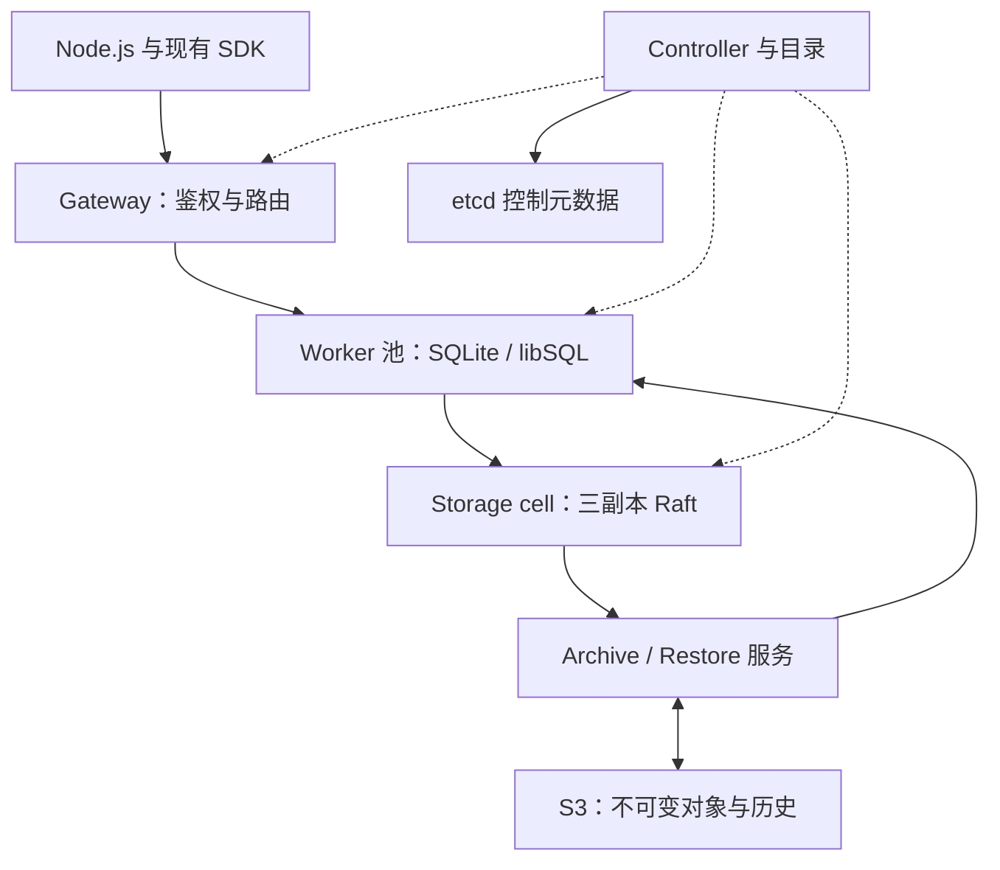

# 总体架构

状态：拟实现架构。本文描述目标行为，不代表现有 `sqld` 或 `raft-rs` 直接具有这些平台能力。

## 1. 架构选择

SCAP 采用“SQL 计算与可靠持久化分离”的结构：SQLite / libSQL 负责单库 SQL、事务和页面管理；共享 cell 负责写者裁决与可靠提交；对象存储负责冷数据和历史。

共识库首选候选为 TiKV 的 `raft-rs`，选型原因见 [ADR 0006](../adr/0006-raft-rs-consensus-library.md) 与 [对比调研](../research/raft-library-selection.md)。该选择不改变共享 cell 拓扑，也不表示已经接入 TiKV 的完整存储或调度系统。

先使用完整的本地数据库副本执行 SQL。首次唤醒下载经过验证的快照和增量；按页远读作为后续优化，不进入正确性首版。

## 2. 组件职责

| 组件 | 主要职责 | 不承担的职责 |
| --- | --- | --- |
| Gateway | TLS、租户认证、协议接入、限流、请求路由、错误映射 | 不持有唯一数据；不在写超时后盲目重放 |
| Worker | SQL 执行、事务隔离、本地缓存、待提交变更暂存、读屏障执行 | 不单独决定全局提交；本地 lease 不授予写权 |
| Cell / log service | 持久 Raft、数据库 head、epoch、incarnation、幂等、归档水位 | 不重新执行 SQL；不把所有业务数据塞进 etcd |
| Archive / Restore | 构造快照与增量、上传校验、恢复验证、按库索引 | 不自行认定尚未共识提交的数据有效 |
| Controller | 数据库生命周期、owner 调度、资源放置、修复任务、运维编排 | 不通过 etcd CAS 直接越过 cell 授予写权 |
| etcd | 租户目录、数据库到 cell 的映射、控制意图、任务元数据 | 不是事务日志，不是 owner epoch 的最终权威 |
| S3 | 冷数据、不可变恢复链、历史、控制面备份 | 不提供跨对象事务或数据库选主 |
| Observability | 日志、指标、链路、审计和容量告警 | 观测服务停机不能触发弱持久化写入 |

## 3. 物理部署与故障域

初始生产目标为一个区域中的三个可用区 A / B / C：

- 每个 cell 有三个 voter，分别放置在 A / B / C；多数派为两个。
- 一个存储节点可承载多个 cell 的副本，但同一 cell 的两个 voter 不能放在同一个可用区。跨 cell 的共置会扩大相关故障范围，需要容量和租户分组策略限制。
- Gateway 至少两个实例跨故障域部署；Controller 至少两个无状态实例，调度任务以幂等状态机推进。
- etcd 使用三成员或经验证的五成员配置跨故障域部署，与业务数据库独立维护；不共享一个可被 SCAP 自己休眠的数据库作为启动依赖。
- Worker 数量随活跃负载变化；至少预留故障接管和批量唤醒容量。
- 选择具有匹配故障保障的对象存储类别；不能把单可用区对象存储视为区域级多可用区持久化。
- 开发环境可以将多个进程放在一台机器，但必须标为开发拓扑，不能称为 HA 验证。

Kubernetes 可负责进程拉起、调度和滚动更新；Pod 存在、PVC 存在或 Deployment 副本数都不能证明数据库层有 quorum、写权或可靠恢复点。

一个节点承载多个 cell 时，每个复制组的 `RawNode` 事件由受控执行路径串行驱动；跨组公平调度、网络复用、存储背压和快照限速由 SCAP 实现。不能因为使用 `raft-rs` 就把 TiKV 的多组运行与调度能力算作已有功能。

## 4. 请求流程

### 4.1 热读

1. Gateway 解析不可变 `db_id`，验证权限和资源预算。
2. 路由到候选 owner。Worker 对 cell 做线性化读屏障，同时校验 incarnation / epoch 并取得数据库 head。
3. Worker 保证本地应用到该 head，开启 SQL 快照，执行有时间和输出限制的查询。
4. 结果按约定的 SQLite 快照语义返回。不能因为本地文件可打开就绕开屏障。

### 4.2 写事务

1. Worker 获得有效 owner 身份，基于权威 head 开启本地事务。
2. 引擎在提交可见前暂存最终页面变更和恢复元数据。
3. 向对应 cell 提交携带 incarnation、epoch、前序 `db_seq`、事务变更和可选幂等标识的命令。
4. 多数副本持久化；状态机按相同规则接受或拒绝命令。
5. 接受后发布本地可见状态并返回成功；若发布失败，返回结果未知或暂时不可用，恢复到已提交状态，不撤销权威提交。

禁止在普通提交后 WAL hook 中上传后就声称同步 HA。SQLite 官方说明该 hook 在提交完成并释放写锁后调用，回调错误也不会撤销已发生的提交。[SQLite WAL hook](https://sqlite.org/c3ref/wal_hook.html)

### 4.3 冷库唤醒

Gateway 发起或复用一个幂等的唤醒任务，等待范围受请求 deadline 限制。Controller 选择有容量的 worker，cell 授予新 epoch，恢复服务读取权威 manifest 与尚未归档的已提交尾部。只有校验完整并应用到 head 后，worker 才发布 Ready。

并发首次访问合并为同一数据库的一个恢复任务；不能同时产生两个有效 owner。超过 deadline 返回可辨识的未执行 / 唤醒中错误，不让 SDK 无限等待。

## 5. 元数据权威与重复控制任务

`etcd` 保存期望状态，cell 保存影响提交正确性的实际状态。二者之间通过可重试任务推进，不假设存在跨 etcd / cell 的原子事务。

例如创建数据库：先记录带唯一 operation ID 的意图，再让指定 cell 幂等创建数据库身份，再发布可访问路由。中途进程退出后继续该任务；重复请求不创建另一份数据库。删除和迁移采用同样的可恢复编排，但实际禁止读写必须先由 cell 进行 fencing。

etcd watch 只是缓存更新机制，不能充当线性化授权。目录丢失时暂停创建和重新放置；已有路由必须经过 cell 校验。权限缓存另有时间界限，见 [租户隔离](tenancy-security.md)。[etcd API 保证](https://etcd.io/docs/v3.6/learning/api_guarantees/)

## 6. 水平扩展与热点

- **数据库分片**：数据库整体属于一个 cell；初期不把单库拆成多个 Raft 组。
- **计算扩展**：不同数据库可分散到多个 worker。单库仍只有一个有效写者，多增加 worker 不会自动增加同库写并发。
- **存储扩展**：增加 cell 并迁移数据库。首版只支持可证明安全的离线迁移，先封存源、校验目标，再切路由。
- **公平调度**：按租户和数据库限制在途事务、变更字节数、提交速率、SQL 执行时间、结果大小、缓存和唤醒并发。
- **热点隔离**：将重租户迁入独立 worker 进程或 cell；通用共享池不能提供等同独占机器的故障和安全边界。
- **大事务**：首版设置显式硬上限，超过上限在权威提交前回滚。分块日志事务以后通过独立 ADR 引入，不能先发送缺乏完整性证明的部分事务。

## 7. 必须通过的关键 PoC

1. libSQL WAL 接口可在提交可见前可靠暂存、提交和回滚，包括 savepoint、DDL、checkpoint、磁盘错误和取消。
2. `raft-rs` 的 `HardState`、`Ready` / `LightReady`、应用进度、`ConfState` 和 snapshot 适配满足持久性及恢复契约；没有提前发送持久确认或跳过未应用状态。
3. 已接受的事务页面能够从快照与日志确定性恢复，版本、page size、schema 和校验规则一致。
4. 严格兼容的 Hrana / SDK 子集与故障错误语义被真实 Node.js 应用验证。

任一关键 PoC 不成立，应重新评审引擎或复制底座，不能将异步备份替换为同步 HA 的证明。详细门禁见 [实施路线](../engineering/roadmap.md) 和 [raft-rs 集成门禁](../engineering/raft-rs-integration.md)。
