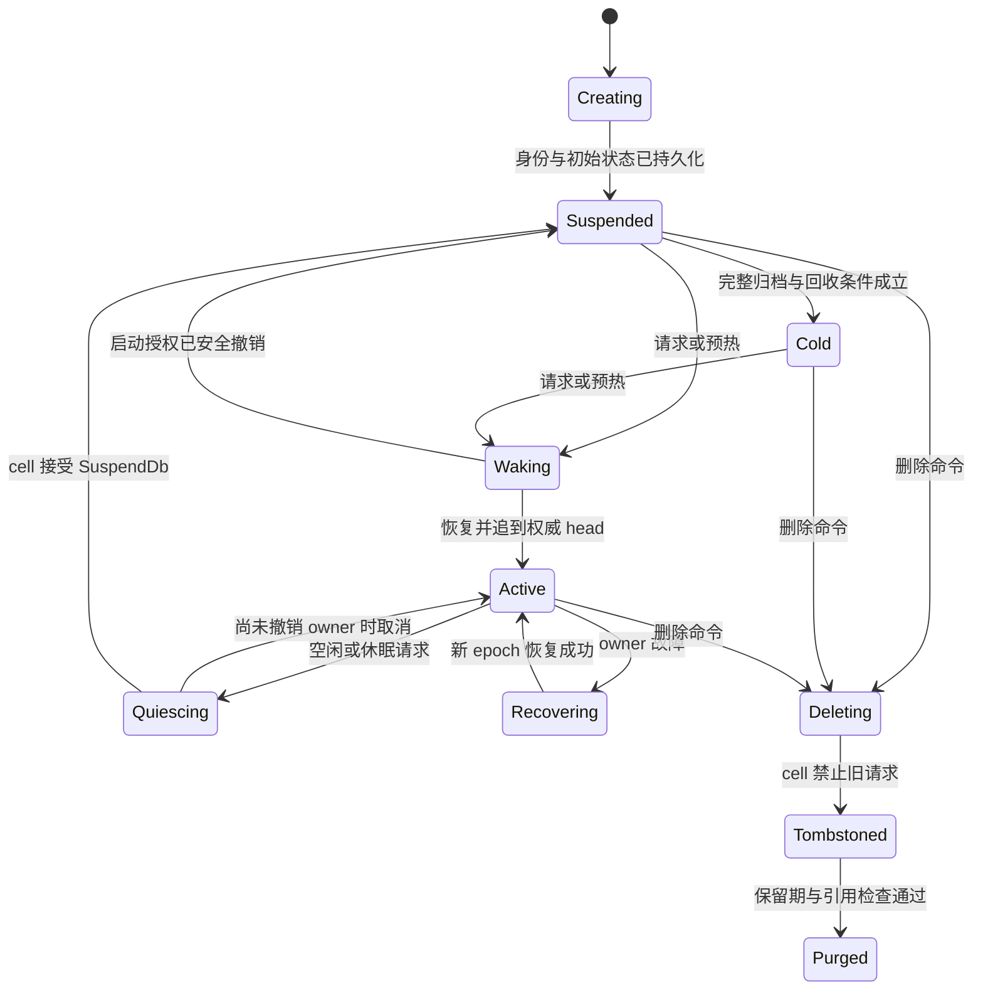

# 存储布局、归档与数据库生命周期

状态：2026-11-02 已实现有界的 Suspend、S3 归档发布、物理数据 Prune、Cold 唤醒与全 cell checkpoint；增量分段、对象 GC、删除、迁移、PITR 和仅剩 S3 的 DR checkpoint 仍为 planned。本文受 [一致性协议](consistency.md) 约束，当前源码与部署边界见 [SQLite 服务实现](../engineering/sqlite-service.md)及 [ADR-0014](../adr/0014-sqlite-service-and-cold-lifecycle.md)。

## 1. 三层数据及其权威

| 层 | 保存内容 | 数据丢失时如何处理 |
| --- | --- | --- |
| Worker 本地副本 | 完整 SQLite 文件、缓存、可丢弃暂存、已应用水位 | 从权威快照和已提交日志重建；不能从该副本反推全局 head |
| Cell 持久层 | 有序日志、数据库身份/head/epoch、幂等、归档指针、尚未归档的已提交变更 | 当前 OpenExisting 遇损坏/身份错误直接拒绝；自动坏盘重建与成员替换尚未实现；多数永久丢失不能靠普通单库归档重建权威 |
| 对象存储 | 当前为不可变的完整单库事务历史与 manifest；后续扩展快照、增量段和备份 | 缺失或校验失败不能伪造空页；暂停依赖对象的恢复并修复 |

归档完成前，cell 必须保留恢复所需的事务数据。归档完成后，快照、增量与 cell 元数据共同构成恢复来源。S3 不必在每次热提交路径中，但已经回收到 S3 的数据在冷恢复时依赖它。

## 2. 标识与对象布局

当前 `scap-archive` 的实际对象键为：

```text
scap/v1/{cluster_id}/{cell_id}/{cell_incarnation}/{database_id}/{incarnation}/{placement_generation}/{sha256}
```

cluster/cell/database ID 使用固定十六进制身份，摘要来自完整对象字节。节点 ID 不进入对象作用域，使合法接管节点能够读取同一归档。对象内 manifest 再次绑定 cell/database 全部世代、源应用位置、head、完整事务与原结果；外部 `ArchiveRef` 记录精确长度、对象摘要及保留元数据摘要。对象格式为 v2，key 中的 `v1` 是独立的路径布局版本。

以下是后续增量/PITR/DR 的候选布局，当前不创建这些对象或恢复目录：

```text
regions/{region}/cells/{cell_id}/cell-snapshots/{snapshot_id}/...
databases/{db_id}/{incarnation}/snapshots/{snapshot_id}/...
databases/{db_id}/{incarnation}/segments/{first_seq}-{last_seq}-{digest}
databases/{db_id}/{incarnation}/manifests/{manifest_id}.json
control-backups/{backup_id}/...
```

- 显示名称不进入权威身份，也不能直接拼接本地路径。
- 每个对象有格式版本、长度和内容摘要。多段上传的 ETag 不能普遍当作文件内容摘要。
- 数据对象和 manifest 一经发布不覆写；需要更新时创建新对象，由 cell 更新指针。
- 当前按数据库和完整内容组织独立对象；跨库打包可能减少小对象请求费，但涉及权限、回收和恢复放大，后续另立 ADR。
- 从 manifest 直接定位恢复链，不在唤醒时扫描整个 bucket 或整个共享 Raft 日志。

后续分段 manifest 至少描述 `db_id`、`incarnation`、格式版本、引擎兼容标识、page size、基准快照、连续增量范围、最终 `db_seq`、数据库大小、对象摘要和加密元数据引用。当前完整历史归档不声明分段读取、对象压缩或 KMS 元数据协议已实现。

## 3. 事务变更格式

Cell 保存经过版本化的物理事务增量：最终页面变化、数据库大小变化和恢复必须的元数据。不得在 follower 上再次执行带有时间、随机数、触发器或其他副作用的原始 SQL。

不能把来自不同 checkpoint 世代的裸 WAL 字节直接拼接。WAL salt、校验、数据库截断、页大小与代次必须经过适配层处理。正式 `scap-engine` / `scap-sqlite` 已使用有界完整逻辑镜像与版本化物理变更，固定 page size 为 4096；未验证的格式拒绝进入服务，通用导入/离线转换工具尚未提供。

事务日志条目设置大小上限；超过上限在权威提交前停止并回滚。当前单事务物理变更上限 300 KiB、完整 cell command 上限 4 MiB，归档加 hydrate envelope 也必须装入 command；详细配置见服务文档。此 profile 仍待规模压测，不将“能够写入一个 S3 大对象”视为支持任意大事务。

## 4. 归档与发布

当前实际顺序是：固定休眠库的权威 view → 构造完整单库归档 → 条件 PUT → 有界 HEAD/GET 并校验精确长度和 SHA-256 → `PublishArchive` → `PruneArchive`。发布和裁剪同时绑定排队时的 owner token、完整数据库世代与 head；I/O 完成后不能刷新成新 owner 来继续旧任务。同一内容已存在仍需回读验证，不接受“对象键存在”作为完整性证明。

正式后台队列每库最多一个 pending，任务和完成通知各 8 槽，目录容量受静态数据库数约束。原 auth、deadline、owner/head 和 operation IDs 贯穿任务；失败有限退避，下一轮从新权威状态重新开始。SQL 维护只 enqueue/poll，不等待后台 S3 I/O。上传完成但未被 cell 发布的对象永久保留为未发布对象，不能参与自动恢复，也尚未被 GC。

后续拆分为基准快照与连续增量时，仍需遵守以下发布合同：

1. 读取某个数据库已接受的提交范围及其前序 manifest。
2. 从已提交的物理增量构造连续段；必要时在隔离的恢复目录中从旧快照重放到目标 `db_seq`，生成一致的新快照。
3. 上传不可变对象，确认完整性、长度、校验和和可读取性。
4. 上传不可变 manifest，核验它引用的所有对象与连续提交范围。
5. 向 cell 提交 `PublishArchive`，校验数据库代次、基准 manifest、归档范围和发布幂等标识。
6. 只有该命令被状态机接受后，才推进 `archived_seq`。上传成功但尚未发布的对象暂时是 orphan，不能作为自动恢复的最新状态。

归档服务不能自行移动数据库 head。对象存储的强单对象一致性也不能提供跨多个对象的原子发布；这里的发布权威来自 cell。[S3 一致性](https://docs.aws.amazon.com/AmazonS3/latest/userguide/Welcome.html#ConsistencyModel)

## 5. 两种不同的回收

### 5.1 Raft 日志压缩

Raft 日志索引属于整个 cell。压缩必须由可恢复的状态机快照覆盖：数据库状态、`ConfState`（包括尚未结束的 joint configuration）、last-applied 的 term/index 与 cell 身份、幂等记录、归档指针以及尚未归档的数据尾部都不能遗漏。

状态机快照可以直接包含未归档尾部，或引用已经发布且不可变的恢复对象。只有满足 `raft-rs` 及 SCAP 的存储、snapshot 安装与恢复契约后才截断日志；不能仅凭“某个库已上传到 S3”截断整个 cell 的历史。具体检查见 [raft-rs 集成门禁](../engineering/raft-rs-integration.md)。

当前 `PruneArchive` 只清除该库的物理事务字节。后台完成通知促使正式全 cell `Checkpoint`，所有 voter 还按 applied/snapshot 差距及周期维护检查快照；membership、应用位置、所有数据库和未归档数据一并持久化。日志回收继续由 Store 的快照协议完成，Prune 不直接截断共享日志。逻辑冷卸载与 RocksDB 实际释放旧镜像字节不是同一个时刻。

### 5.2 数据归档与对象 GC

**当前没有对象 GC。** 已发布归档、旧归档和未发布对象全部保留，取消 fence、请求 receipt/result 和管理记录也不自动回收。已发布精确引用构成恢复根，永久对象保留避免恢复过程中与删除竞争；当前没有动态恢复 pin/退休协议，不能把这种保守保留描述为完整 GC 或长尾成本问题已经解决。不得给 SCAP 前缀配置自动删除规则。

以下是启用 GC、PITR 或迁移前必须实现的 planned 合同：

对象删除与已归档热数据删除，要同时考虑当前恢复链、历史保留、保留的 cell snapshot、恢复任务 pin、迁移 pin、读取快照以及对象共享引用。**保留期内的完成态 DR checkpoint 及其全部传递引用，也是 GC 根；生成中的 DR checkpoint 必须持有持久 pin。** 保护范围包括基准快照、增量、尚未归档的 committed payload、manifest 和恢复所需的密钥引用。

回收采用标记、等待、复核、删除四步；扫描到无引用对象不立即删除。checkpoint 的生成中 pin、完成态保留根和任务阶段必须随 cell 状态机持久化，并进入 Raft snapshot。生成、完成、取消和过期的保护转换见第 11.2 节；不能因任务超时或执行进程退出直接释放 pin，也不能把尚未完成的上传误判为可立即删除的 orphan。

初版不依赖 bucket 自动过期规则来决定活跃恢复对象的删除。若启用生命周期规则，其前缀和保留期必须与 GC 证明和恢复窗口一致；不能让 bucket 规则提前删除 manifest 仍引用的对象。

一个迟迟未归档的数据库可能牵制 cell 快照或占用持久空间。必须按库索引、限额和迁移治理，不能让所有冷库唤醒都扫描热租户的巨大共享日志。

## 6. 生命周期状态



图中是完整平台目标：当前持久状态覆盖 Creating 后的 suspended、owner 准备/激活及 cold；删除、tombstone、purge 和通用任务目录为 planned。SQLite 自身不提供这些状态。当前后台队列是可丢失的工作提示，退出不撤销已提交 Suspend/Publish/Prune；重启维护依据 cell 状态继续，不能凭内存任务是否存在推断回滚。

平台的 `Suspended` 和 `Cold` **都对应一致性协议中的权威 lifecycle `SUSPENDED`**，都没有有效可写 owner。两者仅区分存储进度：`Suspended` 已撤销执行授权，可以释放 worker 与无引用的执行缓存，cell 仍可靠保留必要的 committed tail；`Cold` 还要求当前 head 已被完整、已发布的归档覆盖。当前 `cold` 是由有序 Prune 写入、受完整覆盖关系验证的持久字段，不是另一份授予写权的权威，也不表示所有本地字节已经实际回收。

当前冷库先按新 ReadIndex 的精确归档指针完成 `HydrateArchive`，再执行 `ClaimOwner → restore → ActivateOwner`；cold=true 时 Claim/Activate 和新 Commit 均被拒绝。目录中的旧 `Cold` 标签不能绕过当前 cell 状态。后续跨 cell 迁移的不可逆 `SEALED` 与可重新唤醒的 `SUSPENDED` 不同，不复用“封存”一词混淆它们。

## 7. 安全休眠与冷数据卸载

### 7.1 Suspend：释放计算资源

1. 将数据库置为 `Quiescing`，停止接收新写事务，并按策略处理在途只读和写事务。
2. 等已提交结果完成发布或明确转入恢复；对尚未确定的提交不能直接丢弃暂存后宣布成功休眠。
3. 取得当前权威 revision，向 cell 提交绑定当前数据库身份、owner token 和 `expected_revision` 的 `SuspendDb`。若 head 或 owner 已变化，重新核对状态并幂等继续，不能沿用旧判断释放资源。
4. cell 接受后撤销 active 并进入 `SUSPENDED`；已有且尚未休眠的 owner 增加 epoch，重复休眠和从未 Claim 的零 owner 不额外推进。该命令之前的 accepted commit 保留，之后到达的旧 owner 新提交拒绝。
5. 此后关闭连接、按策略结束仍持有快照的读事务；引用释放后卸载该库执行实例并回收执行缓存。操作进度区分“owner 已撤销”和“计算资源已释放”，不能把仍有引用的资源标为已经回收。
6. 当前 status 直接经 ReadIndex 返回 suspended；未来外部目录可以异步反映该状态，旧路由即使命中原 worker 也不能绕开 cell 权威。

Suspend 不要求先将最新事务上传到 S3。必要的 committed tail 继续由 cell 的可靠日志或受保护的持久状态机快照保存，worker 缓存不承担唯一持久副本职责。S3 故障本身不阻止这一步，但 quorum、身份或持久恢复字节不完整时，不能报告安全休眠成功。

当前 daemon 按 `idle_seconds` 检查本地 slot；只有 slot 的 owner、active 和 revision 与新权威 view 相同，才能依据其 last_use 休眠。旧 slot 先退休，不能用旧空闲时间撤销新 owner。重复休眠不重复增加 epoch；从未 Claim 的初始库保持合法的零 owner。

### 7.2 Cold：完成冷数据卸载

数据库处于 `SUSPENDED` 后，归档任务可以为固定 head 生成并发布完整恢复对象。只有当前世代/owner 未变、库仍休眠且已发布对象完整覆盖当前 head 时，才允许有序 Prune 并标记 `Cold`。这个标记表示应用状态里的物理历史可由精确归档恢复；共享日志及旧快照字节仍须等第 5 节的完整 cell snapshot 覆盖与持久回收条件，不能由 Cold 单独授权清除。

当前有界实现由 `PruneArchive` 检查 exact owner、inactive、suspended、当前已发布对象和完整 head，只移除 physical_changes；事务身份、fingerprint、receipt/result、取消记录、权限及归档位置仍在 cell。`HydrateArchive` 必须逐条核对这些保留元数据与对象中原历史，且只能补回物理字节，不能用对象输入覆盖当前权限或结果。

这个步骤不再次授予或撤销 owner，也不把每库归档完成当作共享 Raft 日志可直接截断的许可。期间发生唤醒、删除或迁移时，按当前权威身份和引用重新判定；不能依据缓存中的 `Cold` 标签删除数据。S3 不可用或归档失败时保持 `Suspended` 并保留必要 tail，不影响已完成的计算资源释放，也不能伪报完整冷卸载。

每库休眠不会停止其所属 cell 的全部副本。共享的仲裁、目录与存储基础设施仍需运行；节省的是该库的执行、连接和缓存资源。

## 8. 唤醒与 worker 重启

休眠库唤醒适用于 `Suspended` 和 `Cold`：先在新的强读视图中确认调用者当前权限和数据库身份；Cold 按精确已发布对象 hydrate 后，再取得新 owner、重读 head 并恢复到隔离目录，验证连续性和支持的 SQLite 格式，再按权威激活协议声明 Ready。Suspend 可以不等 S3，不代表唤醒一定不依赖 S3；恢复基线若已归档，仍须能读取对应对象。

Worker 重启后使用新的进程实例身份。当前 daemon 不复用旧 SQLite cache：OpenExisting 校验原 cell 后，由 leader 从权威历史构造新目录和新 writer。旧 cache 缺失或内容损坏不改变已提交 head；目录命名、symlink 或清理异常则停止相应准入要求检查。有效缓存加速是后续优化，不能替代恢复证明。

后续可从已验证缓存、其他有效副本或对象存储选择最快来源，但最终必须到达 cell 要求的提交位置。缺一段日志、checksum 不匹配或无法判定 head 时保持不可用，不创建一个同名空库。RocksDB/WAL/完整 cell 镜像损坏或丢失也不会自动 Initialize；该故障与可丢弃 SQLite cache 不同。

后台 Prune 可能发生在请求读取非冷状态后、Claim 前。只有 Claim 路径明确返回 `Rejected(Cold)` 且 SQL 尚未执行，服务才以原 deadline 进行一次 fresh view/hydrate/恢复；其他错误和 UNKNOWN 不自动重试。前景 hydrate 当前仍同步占用单 SQL actor，可能推迟同进程其他热库请求；总体 cell 容量不足也会拒绝 hydrate，当前尚无恢复空间预留或自动搬迁。

## 9. S3 中断与空间背压

S3 中断时，热库可在 cell 仍有持久多数派且有安全空间时继续提交；需要对象的唤醒、节点重建、归档和相应 GC 暂停。满足第 7.1 节条件的库仍可进入 `Suspended`，但不能通过删除唯一的 committed tail 来完成 `Cold` 卸载。

当前后台归档与热 SQL actor 分离，S3 连接黑洞不会让一次后台上传阻塞整个热请求队列；已经 cold 的前景请求仍需等待对象读取或在原预算内失败。真实对象与三 daemon 故障场景见 [S3 实验](../../experiments/archive-s3/README.md)和 [服务实验](../../experiments/service-network/README.md)，它们不替代云产品持久性及生产 SLO 认证。

必须保留未归档数据。当前通过固定 command/state/history/queue 上限拒绝继续增长；按磁盘百分比水位分级限流、fencing/恢复预留和容量治理仍待实现。具体目标阈值见 [故障矩阵](../operations/failure-matrix.md)，不得把目标阈值描述为已启用的磁盘监控。任何阶段都不得删除未归档尾部、改成内存确认或伪报归档完成。

S3 恢复后先追赶归档、校验发布链并降低积压，再逐步恢复写入额度，防止重试和集中唤醒再次压垮存储。

## 10. 删除、恢复与迁移

本节全部为 planned。当前 cold hydrate 恢复同一数据库的当前 head，不提供用户选择历史时间点、删除/重建或跨 cell 迁移的管理 API。

### 删除

先由 cell 提交 tombstone 并废除写权，再隐藏目录和进入保留期。后台 GC 完成后才是物理清除。相同名称重新创建产生新 `db_id` / incarnation，不允许旧 token、请求、WAL 或对象混入新数据库。

### 历史恢复

首版恢复到新的数据库身份，选择精确 `db_seq` 或已可用恢复点。时间戳只能用于定位候选，不能替代提交序号；恢复精度不得超过实际保留的事务边界。

恢复会复制历史中的逻辑错误，只有恢复到错误前的有效位置才有意义。完成校验、权限分配和业务确认后再显式切换应用路由，不覆盖现库来试错。

### 跨 cell 迁移

首版采用离线单向迁移：源 cell quorum 先提交不可逆 Seal 和最终位置，目标核验完整数据与 Seal 后激活，最后更新路由。更新目录失败会造成可恢复的不可用，不允许源、目标独立恢复可写。详见 [一致性协议](consistency.md)。

## 11. 灾难恢复与启动依赖

本节的 S3-only 灾难恢复与 DR checkpoint 生成仍为 planned。当前服务重启依赖原合法 cell 持久状态和 quorum，普通单库归档不能重建整个 cell 的已接受发布、权限和 owner 历史；没有这些证明时必须保持不可用。

控制面目录、权限元数据、密钥引用和 cell 元数据也必须备份。仅有 SQLite 对象文件不足以恢复完整平台；还需要知道哪些库存在、最新有效提交/归档位置、哪些对象已删除以及如何解密。

永久失去多数副本时，先隔离旧部署和旧凭据，核验最后一致的恢复点，再创建新的恢复实例代次。只能恢复到已证实的位置，公开可能的数据缺口。不得让过期的 etcd 备份或旧 S3 manifest 自动复活原写者。

### 11.1 仅剩 S3 时的发布证明

普通数据 manifest 不是独立灾难恢复入口：它可能已经上传但尚未被 cell 发布。首版必须额外生成**完成态 DR checkpoint**：

1. 从有效 cell 的已提交、已应用状态构建状态机快照，固定 Raft membership、last-applied 和每库的身份、head、epoch、auth_epoch、tombstone、幂等与已发布 manifest 指针。取得固定视图和持久 pin 之间不得出现无保护窗口。
2. 快照包括该时刻尚未归档的已提交尾部，或先为这些尾部构造被快照明确引用的完整恢复对象。不能只上传指针而丢掉对应数据。
3. 上传并校验快照引用的全部对象，记录对象摘要、格式版本、源 cell 身份和精确恢复位置。
4. 按第 11.2 节取得完成发布资格，最后创建不可变 `dr-checkpoint-complete` 清单及受控备份身份的签名 / 来源记录。该清单是“所有引用已经齐备”的完成标记，不以目录排序表示最新共识状态；完成标记写入前后都必须有连续的引用保护。
5. 完成清单必须能够证明来源是合法的 committed/applied snapshot，并可在没有原集群的环境中验证和演练。来源记录不防拜占庭伪造；信任模型仍以受控服务、密钥和非拜占庭故障为前提。

区域恢复只选择未退休且完整校验通过的完成态 checkpoint。快照内的 cell 状态确定哪些 manifest 曾被接受；它以外更“新”的零散对象不自动推进恢复点。快照上传未完成就损毁的情况，回到前一个完成 checkpoint，因此区域灾难 RPO 受其生成和上传进度影响。

etcd 备份可独立滞后；恢复后先在维护模式中对照 cell 状态重建目录，核查删除、迁移 Seal 和权限。未完成跨 cell 迁移的库不能自动解封为双写。此机制的快照格式、来源验证和故障注入是 G3 恢复门禁的一部分，尚未实现。

### 11.2 Checkpoint pin、完成与退出

以下是待实现的持久任务协议；任务记录与 GC 保护由源 cell 的同一有序状态机裁决。S3 PUT 和 Raft 命令不是跨系统原子事务，保护通过阶段记录和重叠保留衔接：

1. **生成。** 为唯一 `checkpoint_id` 注册固定 snapshot 边界、数据库世代和持久生成 pin，保护其全部传递依赖。构建所需的源 snapshot 在 pin 注册完成前继续受原有保护；新上传对象也先纳入该任务的保护集合，不能先暴露给 orphan GC 再登记。
2. **准备完成。** 全部依赖上传并校验后，通过有条件的 cell 命令将任务从 `BUILDING` 转为 `COMPLETING`，固定完成清单的 key、摘要和来源。只有获得此资格的任务才能写完成标记；生成 pin 此时仍保留。数据和对象验证在状态机之外执行，`apply` 只处理确定性元数据。
3. **完成。** 以固定 key 和内容写入并核验完成标记，再由同一 cell 命令原子登记完成态 checkpoint 保留根并移除生成 pin。根包含全部引用及其保留约束。不得先删除生成 pin，再异步建立保留根。
4. **崩溃或结果未知。** pin 和任务状态不因进程退出、超时或响应丢失而过期。恢复者按 `checkpoint_id`、精确对象 key 和摘要核验后幂等续作；完成标记可能已写入而 cell 确认尚未完成时，生成 pin 持续保护全部依赖。
5. **取消。** 只有仍处于 `BUILDING` 的任务可以通过同一有序状态机取消，并同时撤销其进入 `COMPLETING` 的资格及释放专属 pin。迟到的构建任务不能再发布完成标记。进入 `COMPLETING` 后不得因超时直接取消并释放 pin；必须先消除完成标记写入的不确定性、完成保护转换，再按保留退出流程处理。
6. **保留期结束。** 先由 cell 有序进入退出阶段，拒绝新恢复 pin，已有 pin 仍须满足。按固定 key 写入并核验绑定该 checkpoint 身份及摘要的不可变退休记录，再通过有条件的 cell 命令移除其保留根。S3-only 恢复必须检查退休记录；迟到重试再次写入完成标记也不能使已退休 checkpoint 复活。退出中崩溃或退休写入结果未知时保守保留引用；只有完成退出且没有其他根引用的对象，才可进入常规 GC。恢复任务必须先取得持久 pin，防止选择恢复点与开始读对象之间被回收。

不得用任务租约到期代替上述有序转换。S3-only 恢复先保持 GC 关闭，在新权威中重建所用 checkpoint 的引用保护并核对任务状态后，才允许回收。checkpoint 生成、完成标记 PUT、pin 转换、取消与保留退出的每个边界都必须做崩溃和并发 GC 验证；“完成标记存在，但保留期内的依赖已被删除”是发布阻断缺陷。
