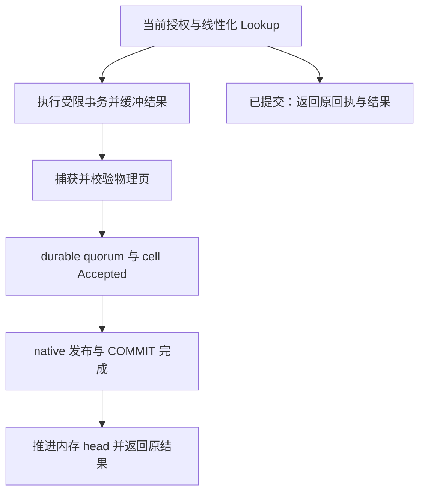

# 正式 SQLite adapter：提交、结果与恢复

初版日期：2026-10-31；网络接合进展更新：2026-11-01。状态：有界正式运行模块；尚不是可部署 SQL 服务。决策见 [ADR-0011](../adr/0011-bounded-native-sqlite-adapter.md)，实际测试计数见 [G0 执行证据](g0-evidence.md)。正式 peer mTLS/runtime 已由 [ADR-0012](../adr/0012-bounded-raft-network-runtime.md)落实，本文的 native SQLite 合同与完整 SQL 网络组合仍须区分。

## 1. 模块与固定依赖

| 模块 | 责任 | 不承担的责任 |
| --- | --- | --- |
| `scap-sql` | SQL/参数类型、请求 fingerprint、结果版本化 codec 与限额 | 执行 SQL、权限、共识 |
| `scap-engine` | 规范物理页事务、完整逻辑镜像、精确基线/回执/恢复 tip 校验 | 文件 I/O、native publish、凭证认证 |
| `scap-sqlite` | 私有 libSQL 连接、SQL 准入、结果缓冲、提交 gate、目录物化与 native 完成 | peer transport、quorum 调度、自动故障接管 |
| `scap-cell` | 有序 owner/auth fencing、提交接受、请求去重/取消与完整恢复历史 | SQLite SQL 执行或物理格式解析 |

引擎固定为 [`libsql-sys` 的同一完整 revision][libsql-sys] `d8bc862d20bedc72945a1da27c8b7045414c0261`，开启默认 `api/wal` 与 `rusqlite`，完整解析依赖固定在根 `Cargo.lock`。底层 SQLite C 为 3.47.0；当前没有第一方引擎 patch，没有引入 Rust Turso rewrite，也没有把旧实验作为运行时依赖。构建采用 Rust 1.90.0、C/C++ 编译器与 Linux/Unix 文件系统；first-party `unsafe_code = forbid` 保持不变。

libSQL 源树的[许可文件][libsql-license]和原生 SQLite 子目录许可随锁定源码核对；新增依赖升级仍须复核许可、native 编译配置和格式。此处直接使用 sys/WAL 边界，不代表完整 sqld 与平台 HTTP/RPC 依赖已经合编。

## 2. 精确执行顺序

`SqliteWriter::create_new` 接受由可信运行时分配的全新目录、受校验的 `Image`、明确的 `WriterLimits` 和 `CommitGate`。它新建权限至多 `0700` 的目录与 `0600` 的文件；已有目录立即失败，不能继承旧的 `-wal/-shm/-journal`。父目录必须由运行时可信持有，不能让租户提供任意路径或并发替换目录。

`execute(ticket, statements)` 是单个显式事务，不是逐语句 autocommit。request ticket 的 `payload_digest` 以零占位，engine 在生成规范页 envelope 后填入真实摘要；数据库身份与前序 revision 必须匹配当前 Image。SQL 以位置参数绑定，不能将参数拼入字符串。

前置 `CommitGate::lookup` 必须在真实身份验证、当前权限检查及 Safe ReadIndex 后进行。`NotFound` 只是该视图没有记录；最终 gate 仍会再次去重。已提交的 DDL 重试直接返回原结果，不重新运行 `CREATE TABLE`。当前事务入口可包含读和写，上层必须验证所需 `READ | WRITE` 权限；不能把仅验证 `scap-cell::lookup` 的 READ 权限当成完整写准入。credential 与 admission 的真实性仍由生产服务负责。

执行开始后固定 WAL 模式和 4096 字节页，使用 `synchronous=FULL`、关闭 cache spill 与自动 checkpoint。结果先完整读取、限额检查和编码，再执行 COMMIT。真实 WAL 回调在调用 native `insert_frames` 前生成 `PreparedWrite`，连同准确的请求 fingerprint 与完整结果送至同一 cell。gate 的 `Accepted` 必须代表持久多数派上的业务接受，不能是 RPC 接收回执。

正式 adapter 校验不可变回执与连续序号；native WAL 成功后仍等待整个 COMMIT 成功。只有此时才替换当前逻辑镜像、解除 stopped 状态并返回 `Completed`。`RETURNING` 暂定行不会流出此边界。

### 无物理变化的请求

SQLite 可对无 dirty pages 的 COMMIT 不调用 WAL 回调。[锁定 pager 源码][pager]中的早返回与正式真实测试覆盖此行为。adapter 在 COMMIT 成功且本次没有 gate 裁决后，生成空页、同镜像记录，经过相同 quorum 与业务接受后返回结果。

因此 SELECT 和更新零行不会获得本地成功捷径；它们也占用请求记录、Raft 日志和数据库 revision。当前 API 是有界事务接口，尚未实现高吞吐、只走 ReadIndex 的 SQL 查询协议。后者需要绑定实际 SQLite snapshot 与权限/owner，不能仅省略日志记录。

## 3. 数据格式与限额

### 3.1 SQL 请求及结果

`SCAPSQL1` fingerprint 输入包含精确 SQL UTF-8 字节、statement 顺序、参数顺序、类型与值。不消除空白、不重写 SQL；两个文本不同但逻辑等价的请求具有不同身份。物理页中的 `randomblob()` 结果不会用于替代这一业务 fingerprint。

`SCAPRES1` v1 结果保存每条 statement 的列名、全部行、`affected_rows` 与 `last_insert_rowid`。值支持 NULL、i64、有限 f64、UTF-8 TEXT 与 BLOB；保留 `-0.0` 的位表示。NaN、无穷大和非法 UTF-8 TEXT 在此版本明确拒绝，不能默默改成字符串或损失整数精度。

`SqlLimits` 明确限制事务总 SQL 字节、statement 数、每条参数/列数、事务总结果行数、单值/列名字节和结果总字节。解码拒绝未知格式、截断、尾随字节、超限计数、非法值和不匹配的行结构；不会先依据未验证计数预分配巨大容器。

### 3.2 物理事务

`SCAPIMG!` v1 使用 152 字节固定头，包含版本、4096 页大小、完整 cell/数据库世代身份、前序 revision、前序/结果镜像 SHA-256、最终页数与变化页数；随后是递增页号及固定大小页内容。重复页、乱序、页 0、越界、错误长度与增长留下的页洞均被拒绝。

每步恢复验证 receipt、物理 payload digest、前序身份/head 和结果镜像摘要。截断缩小后，后续增长必须重新提供所有新增页，不能复活被移除的内容。非空镜像必须具有正确 SQLite header 与页大小；native 打开还会做真实 `integrity_check`。

`max_database_pages`、`max_changed_pages`、`max_transaction_bytes` 是显式配置。格式中的最大数据库页上限不是推荐默认值或已验证容量。native 拷贝页前也限制变化页数；native 已设置并核对 SQLite `max_page_count`，提前限制执行阶段的数据库增长；变化页捕获上限本身不构成 SQL staging 内存保证。部署时应使 native、engine、cell 与 Store 预算一致，并计入结果、历史与多份镜像内存。

### 3.3 两种摘要的作用

`image_digest` 校验完整逻辑页镜像。最新页可能仍位于 WAL，不能用 main database file 的直接 hash 替代它。`cell commit_hash` 则绑定接受历史、原准入、结果与物理事务链。SHA-256 是完整性校验，不是对端认证、quorum 证明或防回滚机制。

## 4. 恢复与重启

恢复调用者先从权威 cell 取得新 Safe ReadIndex，使用同一 Store view 的实际 applied entry term/index 执行 `decode_bound`。`Image::recover` 再比较完整身份、目标 applied position、数据库 revision 和 cell commit hash，读取经过当前授权的完整内部恢复历史，从空镜像按物理页重建。该 API 只服务可信恢复 worker，不能把其他主体的历史结果作为普通 READ 导出。

首次初始化 DDL 也通过同一提交路径进入历史，恢复不需要未记录的 schema 基线。重建不会执行原 SQL，不重新产生随机值、时间或触发器效果。

物化依次完成：创建新目录、独占新文件、写完整镜像、sync 文件、sync 目录、sync 父目录。任何一步失败都不返回可用路径；留下的半成品目录不会被下一次 create_new 复用。随后通过 native 配置和完整性检查。恢复完成与 `ClaimOwner/ActivateOwner` 的生产调度仍需服务层装配；构造一个 Image 不能自行授予写权限。

结构检查先安装安全配置、值/SQL/列/页数限额，再仅在私有检查阶段临时设置 `ignore_check_constraints=ON`；检查成功或失败后都恢复为 OFF，恢复失败不返回连接。原因是固定引擎允许 CHECK 使用连接状态或非确定函数，而默认 `integrity_check` 会重新求值这些表达式，可能错误拒绝合法的物理恢复。[表达式解析源码][resolve]与[检查源码][pragma]说明这一边界；真实回归验证换连接后原行可恢复，随后违反 CHECK 的业务 INSERT 仍被拒绝。

旧本地缓存不在恢复权威之列。当前选择以全量恢复换取清楚的崩溃边界；尚未实现可安全复用缓存、增量追赶或 S3 冷唤醒。

## 5. 失败语义

| 事件 | 返回/停止行为 | 恢复依据 |
| --- | --- | --- |
| preflight 无法取得权威结果 | `OutcomeUnknown`，停止，不执行 SQL | 当前授权下查询或有序取消 |
| SQL/参数/结果/VM 预算失败，尚未提议 | 本次执行错误，回滚并停止 | 不据此宣称同请求的所有在途尝试已取消 |
| cell 明确拒绝 | `Rejected`，不发布，停止 | 拒绝只说明本次尝试 |
| proposal 超时、断连或 panic | `OutcomeUnknown`，不发布，停止 | 查询/取消；禁止盲目重放 |
| 回执身份或序号错误 | `InvalidReceipt`，不发布，停止 | 重新核对权威；不能假定未提交 |
| 已 Accepted，native 或最终 COMMIT 失败 | `CommittedButUnavailable`，保留 receipt，停止 | 从已接受物理历史重建 |
| 合法历史 receipt 对应的结果过大或 codec 损坏 | `CommittedButUnavailable`，保留已提交 receipt，停止 | 在原身份下取得可验证结果；不把它报成提交前 SQL 错误 |
| 历史去重命中 | 返回原 receipt/结果，丢弃新页，停止当前 writer | 重新恢复当前 head 后再执行后续请求 |
| writer 在 Accepted 后被杀 | 无客户端完成响应；cell 历史仍可恢复原结果 | 全新目录物理恢复 |

WAL FFI callback 整体捕获 Rust panic；用户 gate panic 不能穿越 C ABI。[固定上游 frames 桥接][ffi]并不替 SCAP 提供这一隔离。捕获 panic 也不能推导 proposal 未生效。

## 6. SQL 支持边界与资源

支持受限的参数化 DDL/DML、普通表/index/view/trigger、完整事务批次和有界返回。authorizer 默认拒绝事务控制、PRAGMA、ATTACH/DETACH、临时库、虚表和未知函数；允许的无外部副作用 builtin 集合见正式源码。未提供扩展加载、用户注册 UDF 或 raw connection 绕过通道。

当前每个 Statement 恰好一条 SQL；用户不能自行提交/回滚整个外层事务。interactive transaction、用户 savepoint、通用 VACUUM/import 与完整 SDK 兼容不在本轮接口中。跨 writer 重启不保留连接内的 `last_insert_rowid()` / `changes()` 会话上下文；已经接受的请求结果由 cell 原样保留。

VM 指令预算用于限制 SQL 执行工作，不是全程 wall-clock deadline。COMMIT、同步文件和同步共识调用需要上层独立的有界执行与超时预算。SqliteWriter 线程受限，必须放在受控阻塞 worker；不能在处理心跳的网络 executor 内运行。

## 7. 验证边界与后续工作

正式 unit harness 测确定性格式/状态、窄 port、真实 native 调用及可控 I/O 失败；所有第一方 adapter 路径进入覆盖分母。真实多数派、分区、快照和进程被杀的独立 [adapter 合同](../../experiments/sqlite-engine/README.md)不补 unit coverage。

2026-11-01 的后续阶段已实现 [正式 wire、mTLS transport 与单 cell runtime](raft-network-runtime.md)，并通过 [八项真实三进程网络契约](../../experiments/raft-network/README.md)。这些用例验证正式 cell 业务接受、Safe ReadIndex、分区、重启、snapshot 与证书撤销，但 `physical_changes` 是合成 opaque payload，没有执行 SQLite SQL。2026-10-31 adapter 实验使用受控路由的历史范围保持不变；不能把两套独立实验的通过合并描述成完整 native SQLite + mTLS + SDK 验收。

下一阶段需要将可信 `CommitGate`、native writer 的线程和取消边界接入正式网络运行时，保持 durable quorum、cell Accepted、native 发布及最终 COMMIT 的完整顺序。`Answer::Admitted` 与 peer `Received` 都不能替代 gate 的业务接受证明。独立 SQL 强读还要绑定实际 SQLite snapshot、当前权限和 owner；Hrana/Node.js 入口、writer 自动 fencing/恢复/激活仍待实现。

完整镜像构建和每次启动全历史恢复尚未通过生产规模与延迟测量；不能把网络或 SQL 测试的执行时长报告为故障 RTO。当前性能目标保持原定义，增量布局、S3 归档/恢复/GC 和长期容量继续接受各自的门禁。

[libsql-sys]: https://github.com/tursodatabase/libsql/blob/d8bc862d20bedc72945a1da27c8b7045414c0261/libsql-sys/Cargo.toml
[libsql-license]: https://github.com/tursodatabase/libsql/blob/d8bc862d20bedc72945a1da27c8b7045414c0261/LICENSE.md
[pager]: https://github.com/tursodatabase/libsql/blob/d8bc862d20bedc72945a1da27c8b7045414c0261/libsql-sqlite3/src/pager.c
[ffi]: https://github.com/tursodatabase/libsql/blob/d8bc862d20bedc72945a1da27c8b7045414c0261/libsql-sys/src/wal/ffi.rs

[resolve]: https://github.com/tursodatabase/libsql/blob/d8bc862d20bedc72945a1da27c8b7045414c0261/libsql-sqlite3/src/resolve.c
[pragma]: https://github.com/tursodatabase/libsql/blob/d8bc862d20bedc72945a1da27c8b7045414c0261/libsql-sqlite3/src/pragma.c
