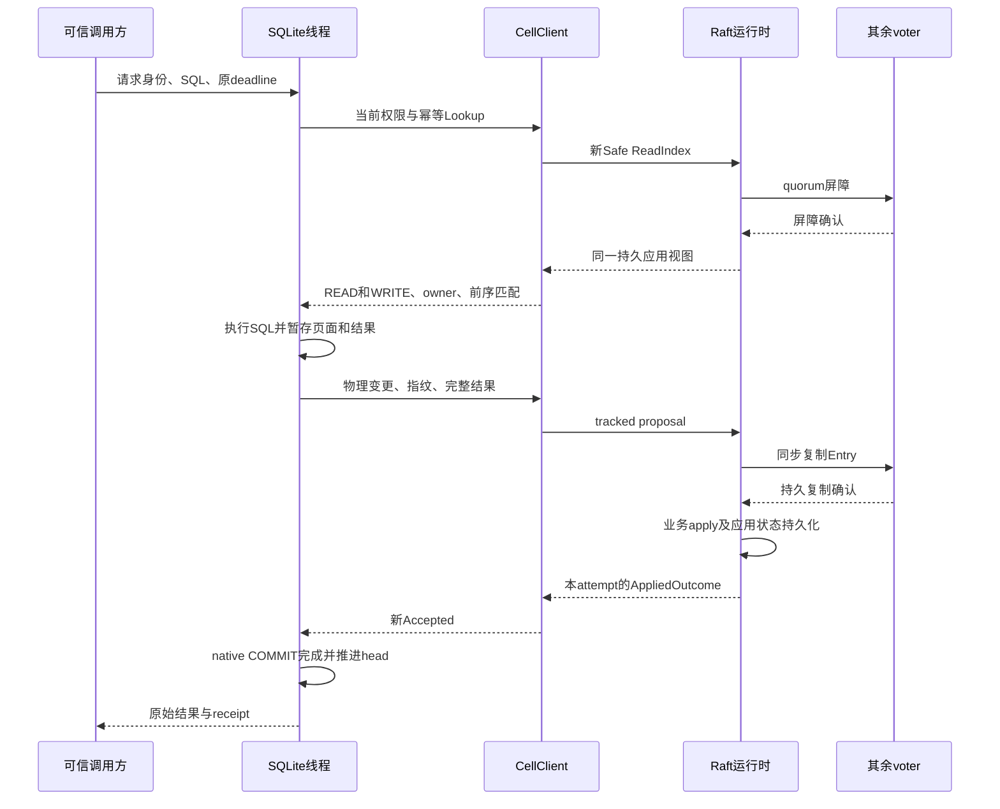

# SQLite 与真实 Raft 网络的提交及恢复

初版日期：2026-11-02（UTC）。本文描述一个 cell、明确恢复和激活的 SQLite writer 与可信 Rust 请求入口之间的提交合同；初版真实组合使用固定三个 voter。决策见 [ADR-0013](../adr/0013-tracked-sqlite-network-commit.md)，测试实况与精确计数见 [执行证据](g0-evidence.md)。后续 [SQLite 服务](sqlite-service.md)已装配 Hrana/Node.js 入口、有界生命周期与受控成员替换；当前物理历史和请求退休格式见 [ADR-0017](../adr/0017-bounded-physical-history.md)与 [ADR-0019](../adr/0019-explicit-request-result-retirement.md)，不将初版实验范围当成当前部署能力上限。

## 1. 正式模块与线程边界

| 模块 | 本阶段职责 |
| --- | --- |
| `scap-raft-driver` | 真实 RawNode、同步持久化、按 attempt 关联的应用结果 |
| `scap-raft-runtime` | 单 cell owner、绝对 deadline、有限 tracked waiter、网络调度和取消 |
| `scap-cell` | 每条命令的确定性业务裁决、版本化结果 codec、当前写入权限预检 |
| `scap-cell-client` | 固定完整 scope、ReadIndex/view 绑定、可信命令提交、正式 SQLite CommitGate |
| `scap-sql-worker` | owner claim、权威物理恢复、native 创建、激活、每次执行生命周期 |
| `scap-sqlite` | 在 WAL 可见前调用 gate，缓冲结果，在 native COMMIT 完成后推进本地 head |

SQLite writer、gate 及 invocation 使用 `Rc`，不可跨线程移动或共享。调用方先启动 cell 的专用 `Runtime::run` 线程和 Tokio 网络 worker，再在单独 SQL 线程构造和使用 writer；所有同步 SQLite/文件 I/O 和 gate 等待都在该 SQL 线程。Rust API 本身不创建无界后台队列，也不包含 worker 调度器。测试 harness 的固定有界控制通道只负责测试输入和观测。

`RuntimePort` 固定连接一个进程内 Handle，Handle 对应的 cluster/cell/incarnation/node 在 runtime 创建时冻结。客户端构造、每次 I/O 和返回 ReadView 分别验证 scope，不能将另一个 cluster 中相同 cell 编号的结果当成本请求结果。

Admission 来自可信调用方，含 principal、credential、admission ID、auth epoch 和原始 request epoch。request epoch 与 owner/auth epoch 独立；后续查询、取消和结果 ACK 必须沿用原请求身份，不能刷新为当前窗口重放旧请求。这里重新检查复制策略，但不替代外部凭证验证。`Client::read` 返回完整 cell 状态，只允许内部恢复和授权代码使用；不能把整个状态暴露为租户查询接口。

## 2. 一次成功事务的真实顺序



页面和 `RETURNING` 行在最后一步之前都不作为成功返回。`Received` 是 peer 内存准入，`Admitted` 是本地 Raft 准入，`Applied` 是该 Entry 的业务裁决，三者不能互换。`Applied` 中的业务结果可能是拒绝或历史去重，只有新 `Accepted` 可以发布当前暂存页面。

每次执行持有一个 `Invocation`，绑定完整 ticket、独立 Admission、取消标志和原始 deadline。lookup 和 propose 必须依次进行并且指纹一致，每个阶段至多一次。释放 invocation 会清除本次上下文，不能让持久连接继承旧主体或预算。

preflight 同时检查 READ 和 WRITE、原 request epoch、active owner 和准确 predecessor。SQL 执行期间这些条件可以改变，因此 cell 在最终有序提交时再次校验；预检不授予绕过后续 fencing 的许可。没有 dirty WAL 页的 SELECT/零行更新仍提交同镜像结果，该 execute 事务接口保留此语义；后续正式 `Writer::query` 已提供独立 Safe ReadIndex 强读，不写结果记录，见 [ADR-0014](../adr/0014-sqlite-service-and-cold-lifecycle.md)。

## 3. tracked proposal 的关联和资源

driver 生成 `ProposalTicket { boot_id, sequence }`，在 Entry context 中还绑定 cluster、cell incarnation 和 node。精确匹配原 context、command bytes 和 Entry term 后，才将该 Entry index 交给 `Application::apply_with_results`。应用按这些 index 的顺序捕获结果，不读取整个批次最后的裁决来猜测其他请求。

只实现旧 `Application::apply` 的类型仅兼容普通 Propose；若误用 tracked，默认空结果导致 driver 停止并返回 UNKNOWN，此时命令可能已提交。支持 tracked 的应用必须实现 `apply_with_results`，正式 CellApplication 已实现。

结果先在内存形成，随后 `Store::apply_committed` 将最终状态和 applied 水位原子持久化。只有持久化返回成功，结果才进入可交付输出。磁盘错误可能已经发生在提交之后；任何错误都停止 driver，等待者只得到 UNKNOWN。新 term 提交旧 term Entry 合法，回执仍保留 Entry 的原 term/index。

| 资源 | 限额与释放原则 |
| --- | --- |
| driver 未完成 tracked attempts | `max_pending_proposals` 与 `max_pending_proposal_bytes` 同时限制；计入原命令、context、最大结果与固定开销 |
| 每次裁决 | runtime `max_result_bytes`；cell 格式上限 512 bytes；完整 SQL 结果留在有界业务历史中 |
| driver 输出 | 消息、read barrier、proposal result 共用 `max_output_bytes`；不能在配置上接受永远装不进一个输出批次的结果 |
| runtime 本地请求 | 原有数量/字节 reservation 覆盖排队、处理、响应等待；新增 tracked waiter 数量限制 |
| 截止时间 | enqueue、等待和 client 返回均沿用原绝对时间，不在每跳重置 |
| 取消 | `Pending::wait_cancelled` 最迟在一个配置 tick 等待周期内观察外部 atomic；它不强制中断 owner 正在执行的 fsync |

取消或超时从等待表移除本地 waiter，不删除已入 Raft 的 command。完成或取消尚未释放实际数据时，内存 reservation 也不能提前归还。重启 boot 不复用；snapshot 恢复状态不会虚构旧 waiter 的专属结果。

## 4. owner 恢复协议

`Writer::recover` 在调用方指定的 SQL 线程同步执行下列步骤，全程使用同一个 context/deadline：

1. 校验请求字段；claim 和 activate 使用不同的非零 operation ID，worker instance ID 对本次启动唯一。取一次新读确认目标 cell/database scope。
2. 提交有序 `ClaimOwner(expected_epoch, worker_instance_id)`，确认本请求的 `OwnerClaimed`，精确 token 必须等于 expected epoch 加一及本次 worker ID。此操作撤销旧 owner 并使数据库 inactive。
3. 再取 Safe ReadIndex，检查数据库身份、owner token 和 inactive 状态。从这一相同视图取得已验证的物理基线、连续 tail、退休前缀、revision 和 commit hash。
4. `Image::recover` 先核验并装入物理基线，再校验并应用连续 tail；只有没有退休 SQL 前缀、也没有基线时才从空镜像开始。退休 SQL 前缀必须由基线覆盖，即使当前请求记录为空也不能恢复成空库。禁止重执行 SQL；结果绑定 cell/db identity、applied term/index、revision、commit hash 和物理页格式。
5. `NativeFactory` 在从未使用过的目录创建私有 SQLite writer。它执行现有新文件、fsync、完整性和资源校验；不打开旧 main/WAL/sidecar 作为权威恢复源。
6. 在原 deadline 内提交 `ActivateOwner(token, restored_revision, restored_hash)`，确认对应激活裁决。
7. 最后再取新 ReadIndex，确认当前 READ+WRITE、owner 和 revision，检查原 deadline，才交付 writer。

任何阶段失败都不交付 writer。若已经 claim 成功而恢复失败，数据库保持 inactive，后续需显式重新恢复；若激活已完成但最终读失败，引擎仍被关闭，不能把等待失败解释为激活回滚。本 crate 本身不清理目录；正式服务由持有独占存储锁的 Cache owner 关闭连接后删除其保留目录，启动时只清理经过验证的私有 writer namespace，未知路径不删除。调用方不得复用先前存活 worker 的身份。

这个 crate 提供可测试的恢复入口。后续 `scap-server` 已实现有界单 cell 的 leader-owned 自动恢复、term 变化退休 writer 和请求路由配合；动态多 cell 调度及跨 AZ 容量仍待实现。接管来自新鲜权威与 owner fencing，不依赖 Kubernetes 决定写权限。

## 5. 已提交、拒绝与未知结果

| 观察到的结果 | 正式行为 |
| --- | --- |
| 新 Accepted，receipt、位置及前序都匹配 | 允许本次 native 发布，完整 COMMIT 成功后返回 |
| 前置 Lookup 找到同一请求 | 使用当前权限及原 request epoch/ID 返回原 receipt/result，不执行 SQL；退休 writer，下一次必须恢复 |
| preflight 后发生竞争，proposal 返回 AlreadyCommitted | 新 ReadIndex 验当前 owner/READ+WRITE，以原 request epoch、相同请求 ID/指纹查历史；必须与 tracked 历史 receipt/position 完全匹配，丢弃本次新页面 |
| owner/auth/predecessor 或其他有序业务拒绝 | 不发布本次页面，返回明确拒绝并停止 writer |
| 原 request epoch 已退休 | 返回 `Retired`，不执行或发布新 SQL，不将旧请求改成当前 epoch 重试 |
| 超时、取消、无 quorum、非法回执、scope 或历史绑定不明 | UNKNOWN，不发布新页面，不自动重执行 SQL |
| 已知 Accepted 后 native 发布失败 | `CommittedButUnavailable` 保留 receipt；不能称为事务回滚 |
| native 已完成，但返回前原 deadline 已到或时钟失效 | 同样保留已提交 receipt，退休 writer；请求 deadline 达标率仍记录失败 |

当前 request epoch 内 Lookup 的 Unknown/未找到只描述一个线性化读时刻。仍可能存在先前请求在途，必须以原身份通过有序 `ResolveOrCancel` 才能建立取消终态；若命令返回 AlreadyCommitted，则继续查询原结果。一次普通拒绝也不等于持久取消。旧窗口返回 `Retired`，永久阻止旧请求再次执行，但不证明原请求从未提交；完成显式退休后不再保证逐请求原结果可查。

## 6. 分区、重启和组件不可用

| 事件 | 保证和限制 |
| --- | --- |
| writer 所在节点成为少数派 | 新 ReadIndex/写等待失败；在预检之后才分区的写也不能越过 quorum gate，UNKNOWN 后停止 writer |
| 旧 leader 隔离、新 leader 当选 | PreVote/check_quorum/Safe ReadIndex 沿用正式 driver；旧 Handle 不转发业务写，不把网络可达当成新的写权限 |
| SQL 执行后 owner 或 auth 改变 | 后续有序 commit 被拒绝，独立 SQLite 读连接仍只看到原值 |
| cell Accepted 后 SQL 进程被杀 | 幸存多数派保留物理恢复数据和尚未显式退休的完整结果，新 owner 在新目录恢复同一事务，不重执行随机函数或 DDL |
| 整组重启 | 各副本严格重开原 RocksDB；取得新 quorum、ReadIndex 与 owner 后再创建 SQLite；旧 SQLite 缓存不能直接服务 |
| snapshot 安装 | 传递正式 cell 全状态，包括基线/tail、request epoch/退休前缀、保留的结果/ACK、fence；接收方重开后仍验证绑定，再供新 writer 恢复 |
| 本地 RocksDB 损坏 | 继续严格拒绝不可信历史；健康多数派下可用新身份 Join、learner 追赶和显式 joint 配置受控替换，自动坏盘检测/调度仍未实现 |
| S3 不可用 | 正式服务热提交不依赖 S3；冷库由 scap-archive 完成有序归档/恢复，对象不可用时不裁剪唯一历史且唤醒失败，不能削弱同步提交 |

## 7. 复现与上线边界

正式 workspace 的单元门禁独立运行，精确配置见 [覆盖率规范](testability-and-coverage.md)。新真实组合实验使用自己的 lock、进程和证据目录：

```bash
cargo +1.90.0 fmt --manifest-path experiments/sqlite-network/Cargo.toml --all -- --check
cargo +1.90.0 clippy --manifest-path experiments/sqlite-network/Cargo.toml --all-targets --locked -- -D warnings
cargo +1.90.0 test --manifest-path experiments/sqlite-network/Cargo.toml --locked -- --test-threads=1
```

固定工具和 native 依赖与前一阶段相同；新增的两个正式 crate 只组合已有固定依赖。网络实验不能填补 unit coverage；固定小库、同机 loopback、进程 SIGKILL 和控制器观测也不能证明三 AZ 延迟、断电持久性或运营 RTO。

热写 SDK p99 ≤100 ms、leader 故障 RTO p99 ≤5 s、R0 worker 恢复 p99 ≤30 s 等仍为原定验收目标。后续 [真实服务实验](../../experiments/service-network/README.md)已有同机小库 SDK 与双库 30 秒稳定窗口观测；生产参考档仍未达标，详情以 [性能目标](performance-slo.md)为准。本阶段不修改这些数值、不剔除 UNKNOWN，也不以测试运行时间替代恢复时间。
